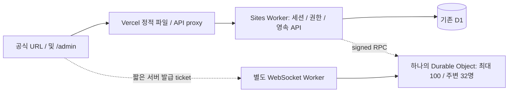

# WINTERLIGHT 운영 구조

현재 운영과 미배포 수정본을 구분한다. [소스 감사·설계·한계](public-operations-v45.md).

실선은 기존 호스팅 경로, 점선은 이번 로컬 구현이며 아직 운영 설정하지 않았다. 브라우저는 D1·RPC secret에 접근하지 않는다.

| 상태 | 권위·보존 | 전달 |
|---|---|---|
| 닉네임·외형·소원·장식·퀴즈 | 기존 D1·세션 권한 | 검증 HTTP, 필요한 profile을 WS로 알림 |
| 이동·점프·방향 | 검증된 DO profile, D1은 주기 checkpoint | bounded delta snapshot |
| 좌석 | D1 유일성·만료·위치 검증 | 같은 공유 예약 목록 |
| 불꽃 | D1 조건부 갱신, ID/seed/startsAt | HTTP + WS, GPU 입자는 클라이언트 |
| 운영 권한 | 기존 Sites owner + 새 hashed owner session | 서버에서 매 요청 검사 |

관심 구역 필터는 서로 다른 방을 만들지 않는다. 클라이언트가 같은 구역에 접근하면 다시 보인다. 프런트에는 기존 `camera-policy.js`, 게임 입력, 품질 예산, 원격 보간, LOD/instancing, lazy 실내, 파티클 pool을 유지한다. 초기화는 generator 작업을 약 8ms 단위로 나누되 개별 생성 작업은 그보다 길 수 있다. 완료 전에 loading을 닫지 않는다.

코드 rollback과 데이터 restore는 분리한다. [배포 문서](DEPLOYMENT.md)의 staging → 검증 → 동일 source → 전환 순서를 따른다.
