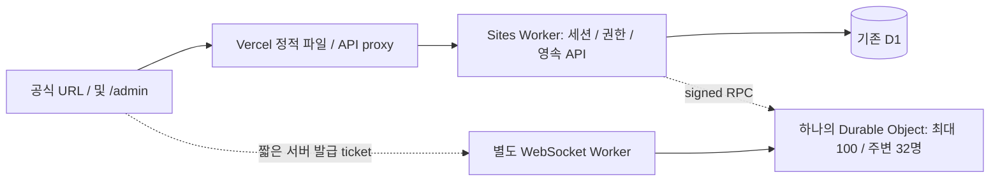

# v58 실제 운영 연결 확인

기존 Vercel 정적 프런트엔드 → Sites API Worker → 기존 D1, 브라우저의 서명 티켓 → Cloudflare Worker/`WinterWorld` Durable Object WebSocket 구조를 유지한다. HTTP 확정 이동·좌석·공연은 서명 RPC로 DO에 전달한다. 게스트 초대 UI만 제거하고 owner 세션/CSRF/DB는 유지한다. 상세 연결·운영 절차와 미검증 항목은 [OPERATIONS](OPERATIONS.md)를 따른다. 아래 그림/기록 중 과거 단계의 계획은 현재 구조가 아니다.

# v57 현재 구조

공식 Vercel → Sites API → 기존 D1, 브라우저 → Cloudflare WebSocket/Durable Object가 운영 중이다. 아래 v45의 “점선 미배포” 설명은 과거 이력이다. v56은 검증된 출입만 서명 RPC relocate로 전달하고 v57은 이동 보간·원거리 갱신·혼잡 시 송신 창을 조정한다. DB schema와 영속 데이터는 유지한다. 료칸 모델·좌석·충돌은 공유 layout을 쓰며 수조·음식·수면은 재사용 가능한 별도 모듈이다. [상세](ryokan-world-v57.md).

# v46 구조 상태 — 2026-11-19

[현재 변경 및 확인 범위](official-ui-v46.md)

Cloudflare 무료 SQLite 실시간 서버의 10개 연결 사전 검증을 통과했다. 유료 Render 서버는 생성하지 않았다. 전체 487개·운영 브라우저 17개·추가 UI 15개·캐시 4개 검사 PASS. 운영 전환 결과는 별도로 기록하며 아래 본문은 과거 이력이다.

---

# WINTERLIGHT 운영 구조

현재 운영과 미배포 수정본을 구분한다. [소스 감사·설계·한계](public-operations-v45.md).

실선은 기존 호스팅 경로, 점선은 이번 로컬 구현이며 아직 운영 설정하지 않았다. 브라우저는 D1·RPC secret에 접근하지 않는다.

| 상태 | 권위·보존 | 전달 |
|---|---|---|
| 닉네임·외형·소원·장식·퀴즈 | 기존 D1·세션 권한 | 검증 HTTP, 필요한 profile을 WS로 알림 |
| 이동·점프·방향 | 검증된 DO profile, D1은 주기 checkpoint | bounded delta snapshot |
| 좌석 | D1 유일성·만료·위치 검증 | 같은 공유 예약 목록 |
| 불꽃 | D1 조건부 갱신, ID/seed/startsAt | HTTP + WS, GPU 입자는 클라이언트 |
| 운영 권한 | 기존 Sites owner + 새 hashed owner session | 서버에서 매 요청 검사 |

관심 구역 필터는 서로 다른 방을 만들지 않는다. 클라이언트가 같은 구역에 접근하면 다시 보인다. 프런트에는 기존 `camera-policy.js`, 게임 입력, 품질 예산, 원격 보간, LOD/instancing, lazy 실내, 파티클 pool을 유지한다. 초기화는 generator 작업을 약 8ms 단위로 나누되 개별 생성 작업은 그보다 길 수 있다. 완료 전에 loading을 닫지 않는다.

코드 rollback과 데이터 restore는 분리한다. [배포 문서](DEPLOYMENT.md)의 staging → 검증 → 동일 source → 전환 순서를 따른다.
