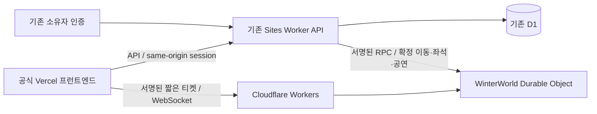

# WINTERLIGHT 운영 안내 — v58

## 주소와 권한

- 공식 입구: https://moru-winter-park.vercel.app/
- 소유자 관리: https://moru-winter-park.vercel.app/admin
- 기존 Sites 주소는 공식 입구로 연결되며 API·로그인 callback 경로는 유지한다.
- 모든 방문자는 하나의 링크로 같은 공개 월드에 자동 입장한다. 초대/게스트 UI는 공개 화면과 관리 화면에서 제거했다. 첫 닉네임·외형은 임의로 정해지며 입장 후 커스터마이징에서 수정할 수 있다. 소유자 로그인은 `/admin`에서만 제공하고 관리는 설정 상자 안의 관리 탭에 표시한다. 관리자 기능은 서버의 소유자 인증·세션·CSRF 검증을 거친다.
- 현재 소유자 계정의 대화형 재로그인은 미검증이다. 소유자 행 보존, 비소유자 403, 세션/CSRF 자동 검사는 별도 기록한다. 권한 검사를 끄거나 새 소유자를 만들지 않는다.

## 실제 연결

D1은 기존 익명 방문자·소원·장식·퀴즈 기록·소유자·설정을 유지한다. Durable Object는 접속·이동·채팅·공동 탑승·공연 시각/seed를 동기화한다. 기존 worker `winterlight-realtime`, DO binding `WORLD`, migration `v1`을 그대로 사용하며 이번 변경에는 schema migration이 없다. HTTP에서 확정된 실내 이동을 DO에 즉시 전달해 오래된 WebSocket 위치가 퇴장을 거절하던 문제를 수정했다.

## 점검과 대응

| 증상 | 확인 | 대응 |
|---|---|---|
| 화면과 서버 버전 불일치 | `/release.json`, `/api/health`, realtime `/health`의 revision | 같은 소스의 3개 배포가 모두 준비됐는지 확인 |
| 이동·채팅 지연 | 관리자 운영 지표의 접속, 지연, 재연결, HTTP fallback, 오류 | 서버 로그와 활성 연결 확인; 데이터 초기화 없이 연결 복구 |
| 탑승 불일치 | 같은 cabin/서로 다른 seat, 예약 만료·해제 | 공유 clock 및 예약 확인; 캐릭터 임의 강제 이동 금지 |
| 공연 중단/중복 신청 | 공연 id, seed, startsAt, endsAt, revision | 기존 관리자 제어 사용; 공연 중 배포 피하기 |
| 장시간 GPU 부하 | 설정의 진단과 자동 품질, 재현 시점·기기 | 같은 장면으로 비교; UI 팔레트 변경 없이 렌더링 부하 조정 |
| 브라우저 캐시 | release revision, SW 갱신 | 정상 새로고침으로 최신 자산 확인; 개인 저장값 전체 삭제 금지 |

위치 전송은 최신 상태를 합치고 미응답 최대 2개, 멀리 있는 방문자는 1Hz로 제한한다. WebSocket 보간은 180ms이며 HTTP fallback은 연결 실패 시 유지한다. 소원·장식·지식집은 영구 기록이며 이 배포를 이유로 삭제하지 않는다. 접속/좌석은 기존 TTL과 명시적 퇴장으로 정리된다.

## 용량과 비용의 확인 범위

2026-11-20 연결된 Vercel 팀의 실제 plan은 `hobby`다. 11월 요금 조회는 `404 costs_not_found`를 반환했다. 이는 청구액 0원이나 무제한 사용의 증거가 아니며 실제 잔여 quota·Cloudflare 요금/상한은 UNKNOWN이다. 유료 플랜·새 프로젝트·새 데이터베이스는 추가하지 않았다.

격리된 로컬 WebSocket 부하 시험은 10/25/50/100명에서 통과했고 100명 표본의 왕복 응답 평균 20ms/p95 38.21ms, 이동 관측 평균 51.53ms/p95 100ms, 채팅 평균 132.33ms/p95 150.63ms였다. 운영 지역·실기기·실제 요금 조건에서 100명 무제한 안정성을 보장하는 수치가 아니다. 운영은 연결된 realtime 경로의 기존 최대 100명 설정과 HTTP fallback 12명 설정을 유지한다.

## 배포·복구

[DEPLOYMENT](DEPLOYMENT.md)의 실제 소스 SHA와 기존 세 배포를 한 세트로 관리한다. 배포 전 활성 공연/좌석과 원본 D1 행을 확인하고, 배포 후 자산 hash·revision·실시간 동기화·원본 행 보존을 확인한다. 기존 DB는 유지하며 코드 rollback에 DB 삭제·복원을 결합하지 않는다. v55 rollback 식별자는 DEPLOYMENT에 보관한다.

실제 Mac Chrome 및 모바일 viewport/touch 에뮬레이션을 검사했다. Windows Chrome/Edge, Mac Safari, Galaxy Chrome, iPhone Safari 실물 결과는 UNKNOWN이며 전 기기 무결함으로 표시하지 않는다. [TESTING](TESTING.md), [PERFORMANCE](PERFORMANCE.md) 참조.

## 개인 음악과 공동 시설

일반 BGM의 곡·재생 위치·반복·음량은 브라우저 개인 상태이며 서버 payload에 포함하지 않는다. 공연 ID·음악·seed·타임라인·시작 시각은 서버가 한 건만 확정한다. 공연 동안 개인 재생 위치를 멈추고 종료 후 원래 곡과 상태를 복원한다. 설정 상자를 열어 3D 렌더링이 멈추더라도 음악은 서버 시각을 따른다. 개인 음소거와 자동재생 제한은 유지한다. 이동·채팅·리프트·곤돌라·놀이기구·료칸·좌석은 공동 월드 상태다.

일반 신청은 승인 후 5초, 공연 종료 후 5분 대기다. 동시 신청은 원자적 DB 조건으로 한 건만 확정한다. 관리자의 즉시 시작은 대기시간을 건너뛰지만 실행 중 공연을 중복 생성하지 않는다. 관리자 공연에도 종료 후 5분 제한을 적용한다.

관리자는 트리 장식을 개별 또는 개수 확인 후 전체 삭제할 수 있다. ‘접속 초기화’는 선택한 비관리자 테스트 기기의 외형·닉네임·접속·좌석만 초기화한다. 소원·퀴즈 기록과 다른 방문자 데이터는 보존하며, 강퇴/차단과 별도 기능이다. 실행 시 확인창이 나타나고 서버 관리 기록을 남긴다. 운영 데이터에 자동 실행하지 않는다.
