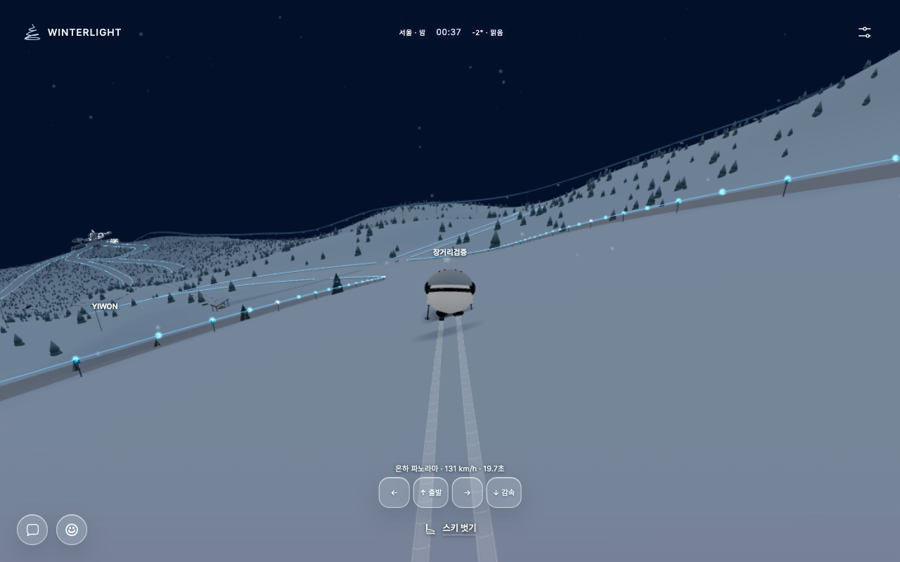
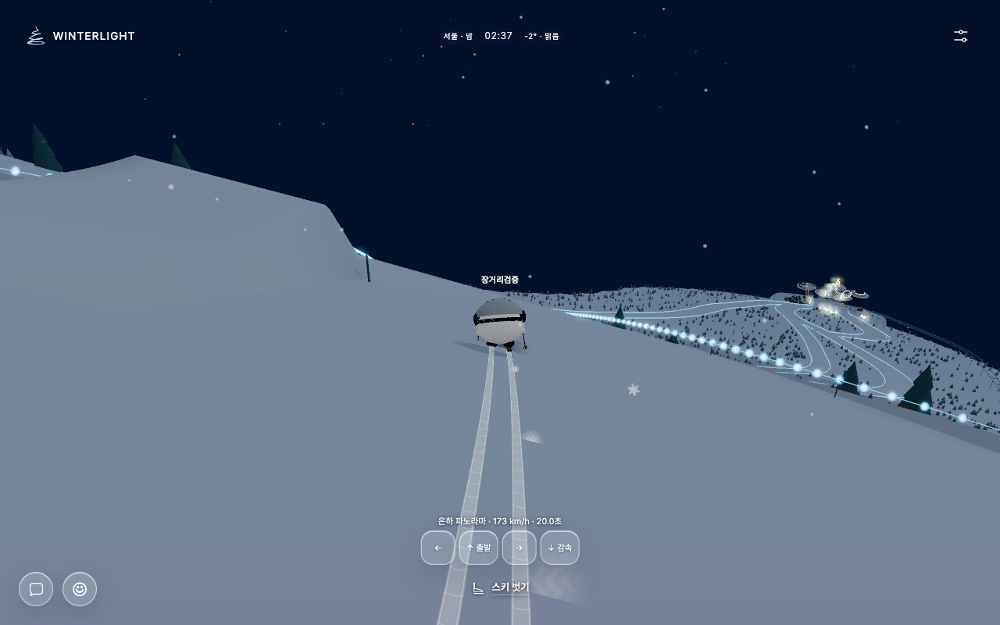
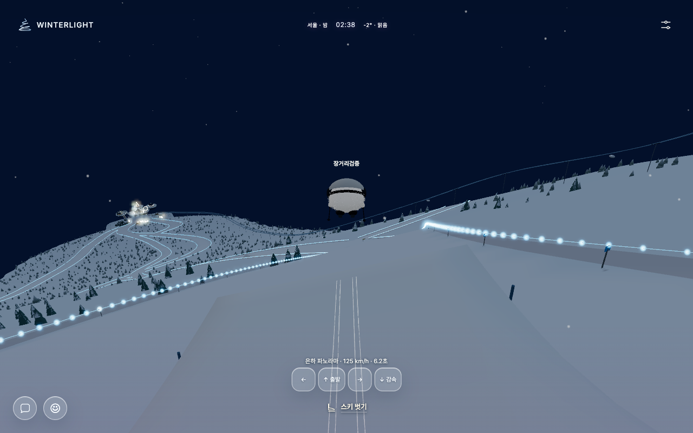
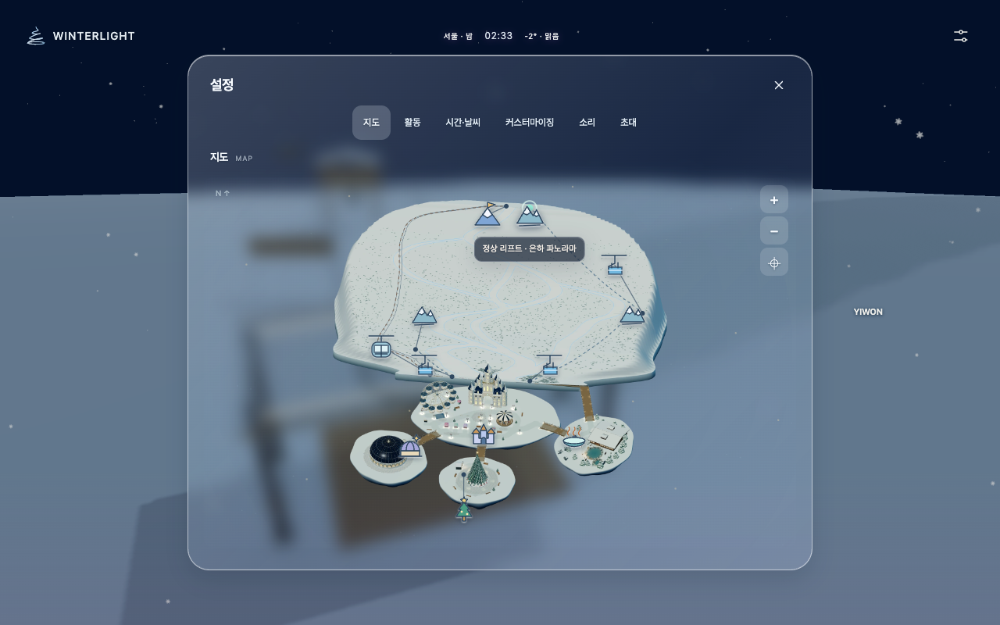
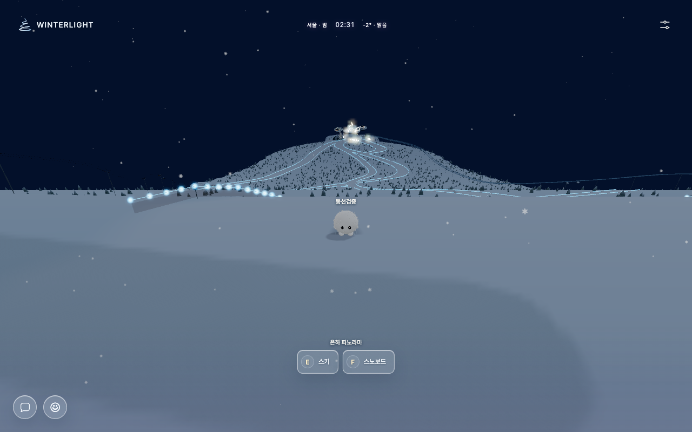
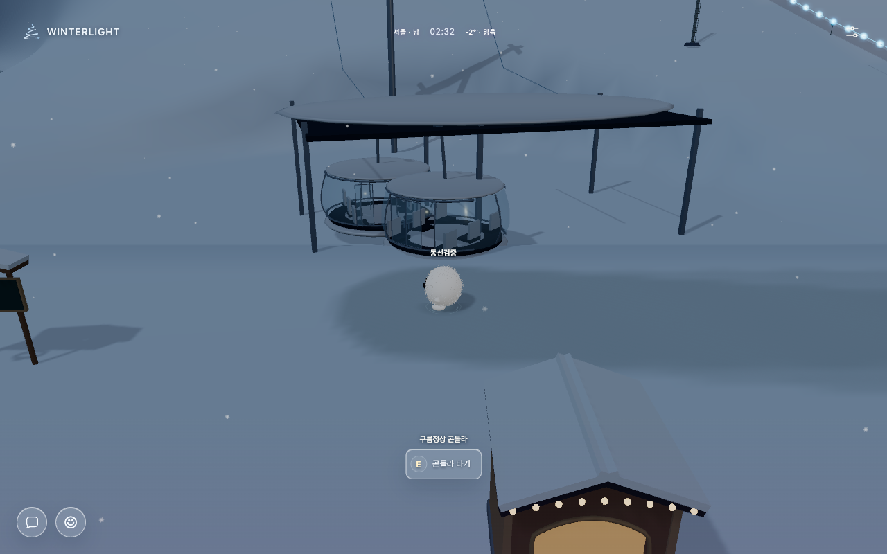
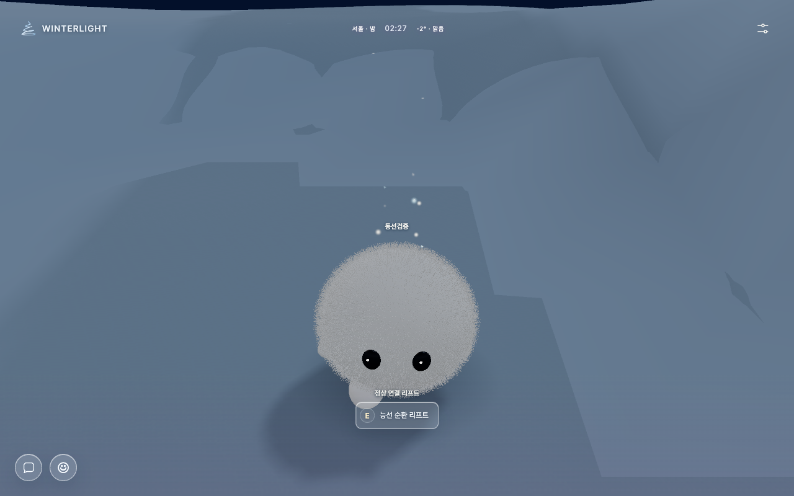
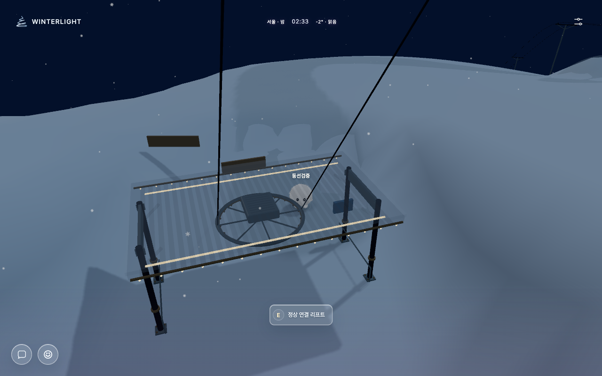

# v50 — 짧고 빠른 테마파크 스키장

상태: 로컬 검증 완료, main·운영 배포 없음. 최신 사용자 지시에 따라 이후 작업 범위는 스키장으로 한정했다. 기존 불꽃놀이·음악 수정본은 보존하고 추가 편집하지 않았다.

## 변경 이유와 범위

이전 5.6km 코스는 실제 완주 182.61초로, 테마파크의 한 시설로 즐기기에는 길었다. 곤돌라까지 이동하는 보행 거리도 불필요하게 길었다. 속도만 올리는 대신 지형과 동선을 함께 압축했다.

- `mountain-layout.js`: 베이스 Z -260 이후 산 길이를 62%, 산 폭을 최대 72%로 조정했다. 놀이공원 연결부·기존 베이스·다른 섬은 그대로다. 베이스 서쪽 경계를 소폭 넓혀 승차장 외곽 여유를 확보했다. 코스·테라스·승강장·콜라이더·지도는 같은 좌표를 사용한다. 의자·캐릭터·활강 너비는 축소하지 않는다.
- 메인 실제 3D 거리 3,721.60m, 낙차 1,404m. 길이 대비 낙차가 커져 경사는 더 가팔라졌다. 다섯 코스와 중턱 출발, 중간 리프트를 유지한다.
- 곤돌라 탑승장은 로컬 (-190,-381)에서 (-116,-210)으로, 좌우 리프트 하단은 X -84/+98에서 -72/+72로 이동했다. 베이스에서 세 탑승장을 찾는 데 필요한 거리를 줄였다. 어묵·마시멜로·모닥불은 유지했다.
- 리프트 이동 시간은 왼쪽 95→45초, 오른쪽 210→80초, 중간 쉼터→정상 리프트 105→65초. 곤돌라는 360→110초이며 승하차 대기·문 열림·귀환 동작은 보존했다. 물리적인 케이블 경로를 따라 이동한다.
- 정류장 바닥을 평탄하게 하고 케이블의 급격한 기울기 변화를 완화했다. 여러 자리의 높이와 서버 예약 위치도 같은 경로에서 계산한다.
- 활강 가속과 최고 속도를 올렸다(스키 56m/s, 보드 54m/s 한도). 최대치가 고정 주행 속도는 아니며 경사·조향·제동에 따라 달라진다.
- 점프대는 4→7개. 직선 진입과 착지 여유가 있는 구간을 골랐고 중앙 우회선은 열어 두었다. 급경사에서 기존의 절대 상향 충격량만 쓰면 과하게 오래 떠 있던 문제를 고쳐, 경사면의 진행 속도와 점프대 기울기를 함께 반영한다.

## 승차장 접근·정상 개방 후속 수정

- 협곡처럼 보인 원인은 슬로프 옆에 별도로 더하던 높은 능선·봉우리와 정상 뒤쪽 높이였다. 해당 추가 높이를 제거하고, 슬로프 종단 경사와 연결되는 열린 설면으로 바꿨다. 정상 위로 솟는 주변 설벽도 제거했다.
- 왼쪽 하단 `(-72,-188)`→초급 하차장 `(-229,-669.2)`, 오른쪽 하단 `(72,-202)`→중간 쉼터 `(581.6,-1599.2)`로 케이블을 조정했다. 표의 좌표는 모두 구역 로컬 좌표다. 월드 Z는 +90이다.
- 중간 쉼터의 정상 리프트는 `(631.6,-1633.2)`→`(134.52,-3118.4)`로 연결한다. 곤돌라와 같은 주 정상에 도착하므로 곤돌라만 정상에 가는 구조가 아니다. 오른쪽 리프트에서 내린 뒤 같은 쉼터 내의 보행로로 환승한다. 두 정류장 중심 간 거리는 약 60m이며 기둥을 우회하는 진입로를 제공한다.
- 곤돌라 하단은 `(-116,-210)`으로 이동했다. 캐빈 문과 승강장 앞쪽 방향을 맞추고, 실제 입구 좌표를 승강장 방향에서 계산한다. 로지 옆 넓은 산책로에서 들어가며 자연석·나무 사이로 비집고 가지 않는다.
- 곤돌라와 초급 리프트는 공용 진입로에서 갈라진다. 기존 직선 초급 진입로는 마시멜로 트럭의 충돌 범위를 지나고 있었다. 트럭을 보존하고 통로를 옆으로 정리했다. 매표소는 `(-110,-187)`로 이동했고 대응 모델이 없는 오래된 가로등 콜라이더 한 개를 제거했다.
- 모든 케이블 중심선에 대해 기존 지형 경계 함수의 여유가 45m 이상인지 검사한다. 활강 경로와의 간격, 캐빈 폭 및 왕복선의 지면 간격도 함께 검사한다. 경계 함수 값은 수평 외곽 여유이며 경사진 표면을 따라 잰 실제 거리와 같지 않다.
- 지도 아이콘의 기준점을 실제 승차장·하차장 케이블 끝점으로 분리했다. 클릭 도착점은 안전한 대기 위치를 계속 사용한다. 실제 노선도 지도에 표시하며, 가까운 아이콘은 연결선을 두고 겹치지 않도록 배치한다. 정적 지도 이미지를 현재 월드에서 재생성했다.
- 지도 정상 이동 시 저장된 시선 방향을 적용하지 않던 부분을 고쳤다. 정상에서 하행 방향이 보이도록 하고, 높은 설면 근처에서 카메라가 캐릭터 쪽으로 급히 당겨지는 대신 지면 위로 올라가도록 기존 스키 카메라 처리를 재사용한다.
- 환승장 보행 검증에서 지붕이 카메라를 약 6m까지 밀어내는 문제가 재현됐다. 승강장 지붕·상부 부품만 별도 배치 속성으로 구분해 시야를 가릴 때 투명해지도록 했다. 같은 환승 도착점에서 카메라 거리 26m 유지를 실제로 확인했다. 기둥과 벽의 카메라 충돌은 유지하고 공유 머티리얼은 복제·복원한다. 안내 명칭도 ‘정상 연결 리프트’로 통일했다.
- 곤돌라의 선분 경계에서 방향이 순간적으로 바뀌며 귀환 캐빈이 옆으로 튀던 문제는 인접 선분 방향의 보간으로 수정했다. 좌석·예약 위치도 같은 공유 계산을 쓴다.

## 장식과 최적화

- 승강장·갈림길·쉼터에 작은 목재 이정표 8개, 눈 덮인 지붕·리스·작은 전구를 더했다. 각 표지의 충돌 범위는 주행선 밖이다. 안내용 팝업/시설은 추가하지 않았다.
- 기존 펜스 지주 간격은 유지하면서 전구를 8m마다 1개에서 2m마다 1개로 보강했다. 파란색 발광은 강화하되 먼 산 안개에 따라 감쇠해 다른 구역 하늘에 선이 뜨지 않게 했다.
- 코스 주변 침엽수에 얼음빛·샴페인색 미세한 반짝임을 배치했다. 한 개의 공유 Points/GPU 셰이더, 최대 220그루×42개다. 매 프레임 위치 버퍼를 다시 만들지 않으며 저품질 35%, 중간 65%, 고품질 100%, 모션 감소 시 정지한다. 동적 조명은 추가하지 않았다.
- 곤돌라 장식 캐빈 수를 새 왕복 주기에 맞춰 줄였다. 예전 756초 반복값을 남겨 동일 구간에 캐빈이 중복 생성되는 문제를 제거했다.
- 스키 전용 지도와 실제 월드 지도 이미지를 새 좌표에서 다시 만들었다.

## 실제 브라우저 측정

Mac Apple Silicon / Chrome headless / 1280×800 / 자동 조향, 시간 가속 없음. 다른 검증 프로세스를 마친 뒤 자동 그래픽 품질 정책을 사용한 전체 코스 측정이다. FPS·프레임 시간은 requestAnimationFrame 간격이며 GPU 실행 시간을 직접 측정한 값은 아니다. 이전 기록과 코스·장면·렌더링 수정이 함께 달라 단일 최적화의 효과로 해석하지 않는다.

| 항목 | 이전 v48 | 축소 v50 |
|---|---:|---:|
| 정상→베이스 | 182.61초 | 91.71초 |
| 평균 FPS | 39.14 | 60.01 |
| 평균 프레임 | 25.55ms | 16.67ms |
| p95 프레임 | 50ms | 16.70ms |
| Draw calls 범위 | 100–1,245 | 112–1,176 |
| Triangles 범위 | 455,911–5,218,271 | 382,442–5,264,828 |
| 최대 상세 지형 타일 | 28 | 28 |

완주 후 속도 0, 장비 해제와 일반 보행 복귀를 확인했다. 스키·보드 점프 각각 공중 213/213, 376/376프레임 동안 캐릭터가 화면 안에 유지됐다. 해당 브라우저 오류 0건. 자료: `qa/alpine-v50/desktop-descent-final.json`, `racing-jump-*.json`.

## 회귀·보행·탑승 검증

- `npm test`: 523/523 PASS. 기본 실행 환경에서 로컬 Worker 기동을 기다리던 회차는 중단하고, 로컬 소켓 실행이 가능한 환경에서 전체를 다시 통과했다. 검사 내용을 생략하지 않았다.
- `npm run check`: JavaScript 모듈 287개 구문 검사 PASS. 별도 TypeScript·Lint 명령이 없는 프로젝트이므로 이를 실행했다고 표시하지 않는다.
- `npm run build`, `build:realtime`, `build:vercel`, `test:budget`: PASS. 빌드만 수행했으며 배포는 하지 않았다. 배포 정적 자원 22,736,417 bytes / 코드 gzip 1,058,167 bytes로 기존 예산 안이다.
- 실제 브라우저 보행: 산책로→초급 리프트 앞, 같은 길→곤돌라 정면, 중간 쉼터→정상 연결 리프트 환승 경로 PASS. 곤돌라 버튼으로 서버 예약·탑승도 성공했다. 지도 목적지 8곳의 실제 클릭 도착과 정상 전방·좌우 시점, 환승장 카메라 거리 유지 PASS. [기록](../qa/alpine-v50/access-final/access.json).
- 두 독립 게스트 세션: 같은 곤돌라의 서로 다른 좌석에 동승하고, 110초 운행과 5초 탑승 구간을 실제 시간으로 완료했다. 채팅 공유, 정상 안전 위치 하차, 두 예약 모두 해제 PASS. [기록](../qa/alpine-v50/transport-final/integration.json). 로컬 HTTP presence 검증이며 운영 Cloudflare 부하 검증으로 해석하지 않는다.
- PC/터치 리프트: 왼쪽 45초, 오른쪽 80초, 중간 쉼터→정상 65초를 시간 가속 없이 탑승·자동 하차했다. 좌석 예약 해제와 정상 상태 복귀 PASS.
- 터치 화면: 390×844에서 경계 밖 조이스틱 입력 1.0 유지, 카메라 동시 조작, 브레이크·점프·장비 해제 PASS. [기록](../qa/alpine-v50/transport-final/mobile-controls.json). 이는 macOS Chrome 터치 에뮬레이션이며 휴대전화 하드웨어 성능 검증이 아니다.

 물리적인 Windows PC·iPhone·Galaxy, GPU 메모리, 장시간 운영 WebSocket 검증은 UNKNOWN이다. 터치 에뮬레이션을 실제 휴대전화 검사로 표시하지 않는다.

## 화면 비교

이전 정상 활강: 
축소 후 20초 지점: 

두 코스 길이가 다르므로 위 화면은 같은 경과 시간의 플레이 장면이며 같은 월드 좌표 비교는 아니다.

환승장 같은 보행 도착점·1280×800에서 지붕 카메라 처리 전후:

## 보관 상태

`codex/alpine-resort-v48` 작업본에 보관했다. 관련 신규 커밋은 아직 없으며 main 병합·GitHub push·Vercel/Sites/Cloudflare 운영 배포를 수행하지 않았다. 기존 다른 작업의 미커밋 변경은 보존했다. 로컬 미리보기는 `http://127.0.0.1:4191`, 검증 데이터는 별도 로컬 SQLite를 사용한다.
