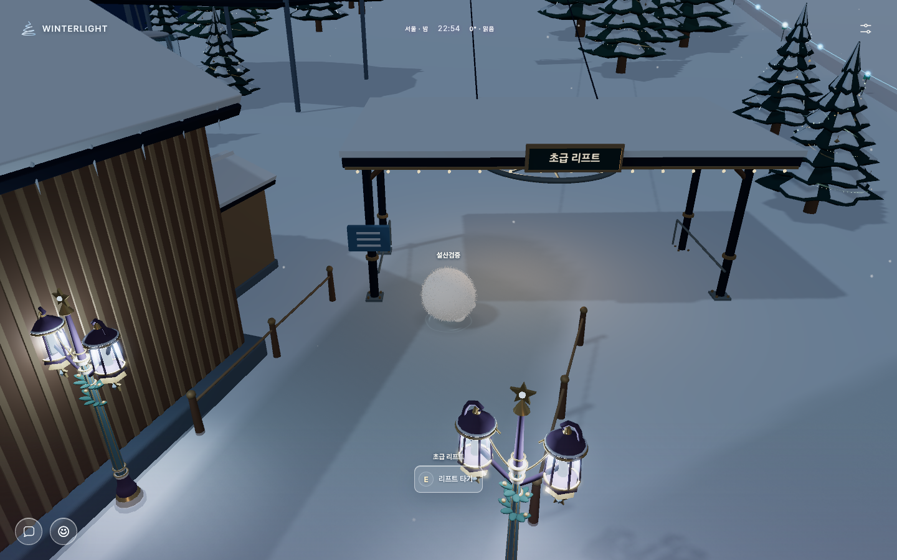
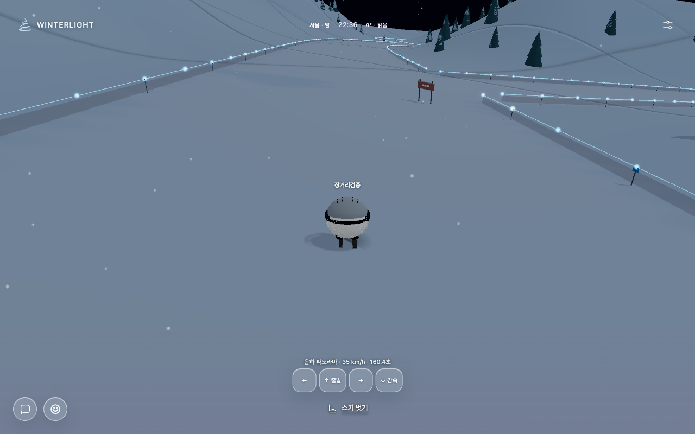
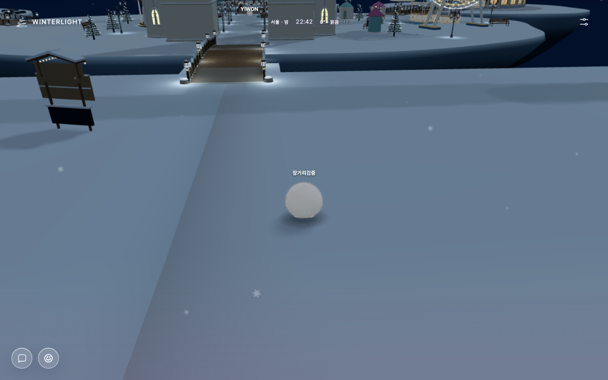
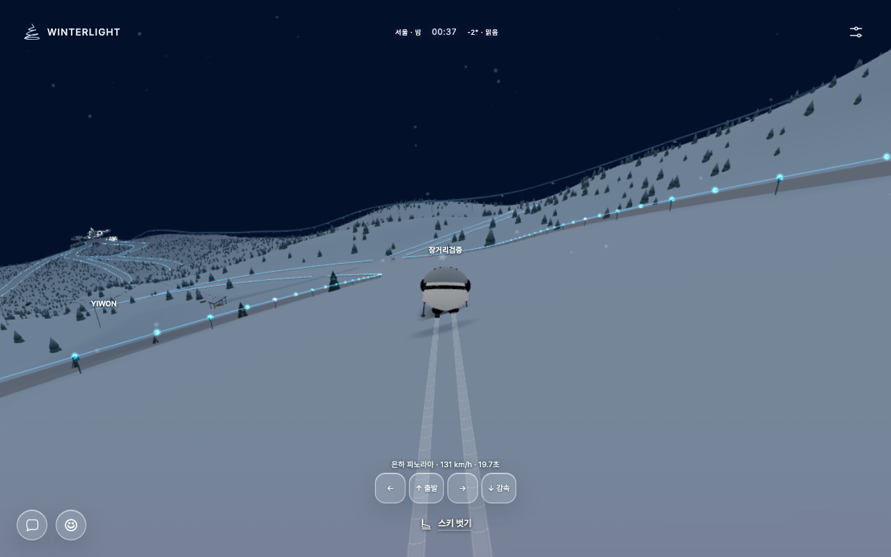
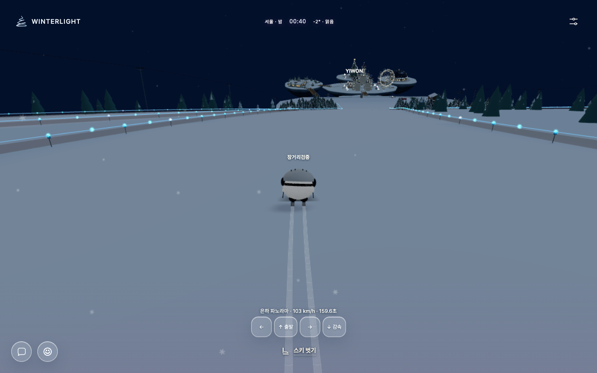
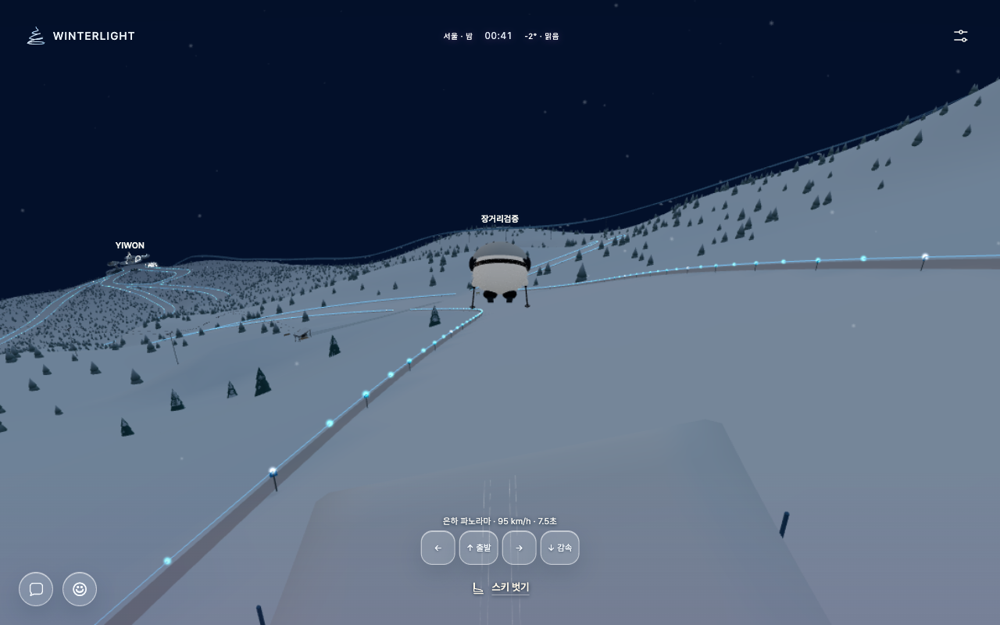
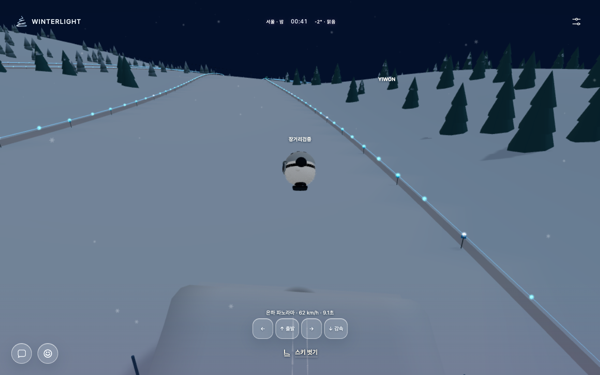
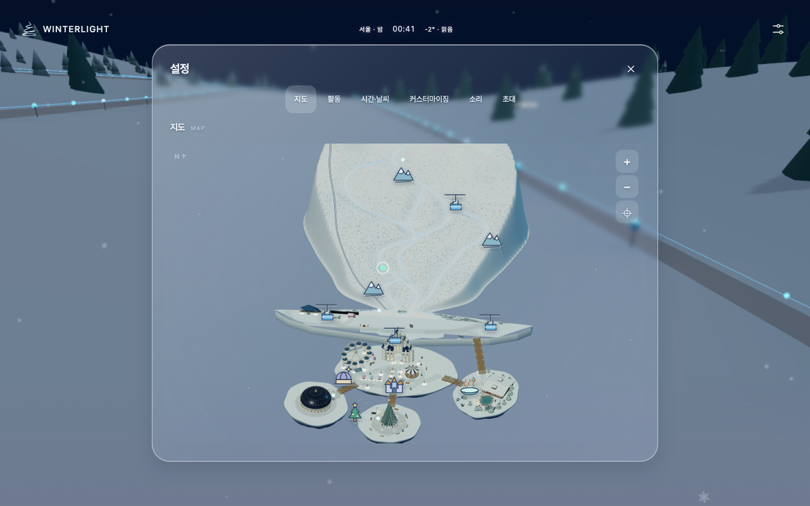

# v48 — 실제 설산 스키 리조트 검증 브랜치

상태: `codex/alpine-resort-v48`에서 구현·검증 중. 기준 소스 `02fbfb8`. GitHub main, Vercel, Sites, Cloudflare 운영에는 반영하지 않았다. 다른 월드 섬·시설 위치와 기존 게스트/소원 데이터는 유지한다.

## 설계 기준

[모나 용평 공식 슬로프 소개](https://www.yongpyong.co.kr/kor/skiNboard/slope/introduce.do)와 [공식 슬로프 지도](https://www.yongpyong.co.kr/kor/skiNboard/slope/slopeMap.do)의 긴 하산 코스·분기·리프트 정보 구조를 참고했다. 레인보우 파라다이스의 5,600m/702m를 규모 기준으로 삼았으며 원본 지도 이미지, 브랜드, 시설 모델은 복제하지 않았다.

실제 3D 길이를 5,600m로 계산한 자체 코스와 1,800m 낙차를 사용한다. 단순 Z축 거리나 표시 문구를 늘린 구현이 아니다. `mountain-layout.js`의 미터 단위 좌표가 지형, 주행, 충돌, 지도, 케이블, 서버 검증을 함께 결정한다. 기존 베이스는 로컬 Z -170m, 공개 월드 Z -80m에 남는다. 산은 북쪽으로 약 5.2km 확장된다.

## 11월 20일 중간 피드백 반영

최신 사용자 피드백은 초기 6–10분 목표보다 우선한다. 최대 5분, 정상 기준 3–4분의 빠른 게임 플레이를 목표로 **실제 낙차를 1,800m로 높였다**. 하단 베이스 위치는 유지하고 코스 전체 경사를 조정했다. 메인 3D 호 길이는 다시 풀어 5,600.00m로 유지했다.

스키/보드 항력 0.0038/0.0044, 마찰 0.035/0.032, 속도 상한 46/44m/s, 제동 17/16m/s², 경사 가속 계수 12.75를 사용한다. 출발 밀기 가속은 6m/s²에서 속도 12m/s까지 점차 줄어든다. 30Hz 자동 조향 물리 검사: 스키 **180.50초**, 보드 **193.70초**, 최고 속도 **38.20/35.59m/s**. 이는 렌더링 FPS나 실제 기기 결과가 아니다.

- 메인 직선부 네 곳에 눈 점프대(22m 진입, 폭 12m, 높이 4.6m)를 중앙 주행선 양옆에 교대로 배치했다. 중앙과 옆길은 그대로 통과할 수 있다.
- 점프대 끝을 충분한 속도로 넘으면 한 번 이륙한다. 제동하거나 느리게 지나면 그대로 넘어간다. 착지는 월드 높이와 중력으로 계산하며 자동 순간이동이 없다.
- 지형 LOD가 점프대 형상을 뭉개지 않도록 별도의 작은 정설 메시를 쓰며 실제 높이/서버 검증/지도는 같은 데이터다.
- 기존 수직 카메라 제한 10m/s는 빠른 급경사에서 캐릭터를 놓치는 원인이었다. 스키 60m/s 한도와 감쇠 추적, 비행 중 캐릭터 중심으로 보정했다. 급경사 뒤쪽 눈과 겹칠 때에는 카메라를 캐릭터 쪽으로 당기지 않고 시선을 지면 위로 올려 거리를 보존한다. 강제 FOV 변경이나 흔들림은 추가하지 않았다.
- 점프 높이 허용은 스키 코스 안에서 제한하고, 점프대 근처와 일반 구간을 구분한다. 임의의 공중 위치는 계속 거절한다.

- 기존 하단 초급 리프트와 오른쪽 포레스트 리프트를 보존한다.
- 메인 중턱 Z -3200m에서 상단 Z -4050m로 되올라가는 `ridgelift`를 추가한다. 2인 자동 배정·공유 시계·서버 거리 검증·퇴장 처리를 동일하게 적용한다.
- 양 끝에는 코스로 걸어갈 수 있는 눈길을 연결한다. 하단·중간 쉼터·상단 능선 등 여러 높이에서 장비를 선택할 수 있다.
- 곤돌라는 서쪽 외곽으로 분리하고 승강장을 로컬 (-190, -390)으로 옮긴다. 다른 리프트와 최소 수평 간격은 30m 이상이며 노선이 교차하지 않는다.
- 곤돌라 귀환 차선은 상행보다 12m 안쪽이다. 상행 중심만 검사하던 높이 계산을 양방향 차선과 캐빈 폭으로 확장하고 하단 회차장을 평탄하게 처리했다.
- 승강장 연결 눈길과 겹치는 펜스 구간은 열어 둔다. 시설 안내, 안전 이동 마커, 전용 슬로프 지도는 같은 좌표를 사용한다.
- 반복 지지대는 위치별로 묶고 작은 롤러·전구의 세분 수를 줄여, 새 리프트 추가 후에도 기존 전체 메시·삼각형 예산을 유지한다.

## 코스와 지형

- 은하 파노라마: 구름정상 → 베이스, 중급 메인 5.60km.
- 눈꽃 메도우: 하부 완만한 초급 분기.
- 실버 포레스트: 오른쪽 숲을 지나는 초중급 코스.
- 크리스털 리지: 중상단에서 분기하여 메인으로 합류하는 상급 코스.
- 구름숲 연결로: 상단 왼쪽 계곡을 돌아 메인으로 합류. 연결로 끝에서 장비를 해제하지 않는다.

정상, 중간 쉼터, 초급 하차장에는 평탄한 접근 공간이 있다. 좌우의 넓은 산등성이와 숲은 코스 밖에서 형성하고, 코스 중심과 폭은 같은 높이 함수로 정설한다. 이전 작은 스키장 뒤에 놓였던 배경 전용 산은 새 활강 구간과 겹쳐 제거했다. 기존 어묵·마시멜로 트럭, 모닥불, 휴식 기능은 베이스에 남긴다.

눈 표면의 경계 삼각형은 충돌 경계에 맞춰 잘라 낙하 경계 밖으로 튀어나온 직사각형 설면을 막는다. 인접 청크의 노멀은 동일한 높이 미분으로 계산한다.

## 주행과 카메라

스키와 스노보드는 중력, 항력, 마찰, 조향 응답, 제동, 최대 속도를 각각 가진다. 물리 적분은 최대 25ms씩 나누며 외부 프레임 속도에 종속되지 않는다. 스노보드에는 옆으로 선 자세·바인딩·에지 회전, 스키에는 독립 스키와 폴을 적용했다. 점프 후 중력으로 착지하고 눈자국/분말 효과는 기존 시스템을 재사용한다.

경계를 벗어나면 감속한다. 자동 순간이동 대신 사용자가 선택하는 마지막 안전 지점 복귀만 제공한다. 정상에서 실제 서 있는 지점으로 주행을 시작한다. 모든 코스의 하단 완료 시 장비·속도·임시 조작을 해제하고 걷기로 돌아온다.

기존 단일 카메라 정책을 유지한다. 스키는 진행 방향을 부드럽게 보간하며 직접 회전하면 사용자 시선을 우선한다. 리프트·곤돌라 좌표는 케이블의 3D 호 길이를 따라 계산하여 샘플 간격에 따른 속도 튐을 제거했다. 높은 곳에서도 하늘·오로라가 잘리지 않도록 하늘 원경의 위치와 카메라 원거리 범위를 조정했다.

## 곤돌라와 좌석

곡면 유리, 둥근 외피, 실버 프레임, 실내 조명, 6개 실제 좌석, 열리는 문, 연결 행거를 가진 자체 절차형 모델이다. 케이블 양쪽 선과 승강장·지지대는 같은 노선 방향을 사용한다.

18초 간격 캐빈, 하단 5초 탑승창, 상행 360초, 정상 12초 정차, 9.5초씩 회차, 하행 360초의 756초 순환이다. 정차 때만 정상 하차를 제공하며 계속 타고 있으면 하단으로 돌아온다. 두 기존 리프트는 초급 95초·포레스트 210초로 연장했다. 중턱 능선 순환 리프트는 105초이며 2인 좌석을 사용한다.

`ride_seats`의 UNIQUE 제약과 원자적 INSERT로 동시 배정을 처리한다. 6인 캐빈이 꽉 차면 추가 입장을 거절한다. 서버는 유효한 좌석 예약과 실제 좌석 위치를 함께 검증한다. 송신 순간의 좌석을 다시 계산하고, 최대 8초의 전송 지연 범위 안에서만 검사한 뒤 공유 위치는 현재 서버 시각의 좌석으로 덮어쓴다. 임의 위치나 다른 좌석으로 이동할 수 있는 허용 범위는 늘리지 않는다. 클라이언트는 개별 캐빈 위치를 네트워크로 보내지 않는다. 재접속/예약 만료 처리에 곤돌라를 포함했다. 채팅·메뉴가 열려도 움직이는 공유 시설의 시뮬레이션은 계속되며, 직접 이동 입력만 차단한다. 기존에는 채팅이 캐릭터의 시뮬레이션까지 멈춰 캐빈과 분리되고 예약이 만료되는 문제가 있었다.

`0018_gondola_seats.sql`은 기존 좌석 데이터를 보존하면서 허용 종류와 좌석 범위를 확장한다. 격리 DB로 검증하며 운영 DB에는 적용하지 않았다.

## 지도와 성능

전용 슬로프 지도는 실제 공유 경로, 난이도, 계산된 거리·낙차, 합류, 세 리프트, 곤돌라, 쉼터와 현재 위치를 표시한다. 일반 월드맵의 안전 이동 마커도 같은 좌표를 사용한다. 좁은 모바일 화면에서 12개 마커가 겹치면 충분한 간격의 격자로 배치하고 실제 위치까지 연결선을 남긴다. 월드맵은 긴 설산만 수평 폭을 베이스 0.5배에서 깊이에 따라 0.09배로 완만하게 좁히고, 길이 0.045·높이 0.055로 축약한 지도 투영이며 원본 공간의 미터 거리를 표현하는 축척도가 아니다. 별도 실시간 WebGL 지도를 추가하지 않았다.

128m 청크, 상시 저해상도 산맥 1개와 가까운 상세 청크를 사용한다. 일반 품질 최대 28개, 낮은 품질 최대 12개 주변 청크와 진행 방향 선로딩을 유지한다. 원거리 숲은 합친 메시, 근거리 숲은 공유 Geometry/Material의 InstancedMesh다. 지형 버퍼는 Web Worker에서 계산해 전달하고, 화면 스레드는 준비된 청크만 설치한다. Worker 미지원 시 같은 계산의 순차 fallback을 사용한다. 이전 청크 Geometry·InstancedMesh 전용 버퍼와 종료 Worker를 정리한다. 공유 Geometry/Material은 청크별로 해제하지 않는다. 원거리 지형은 128m당 6분할이고 근거리는 일반 40분할/낮음 24분할이다.

지도 재생성: 라이브 서버를 실행한 후 `PLAYWRIGHT_PATH=… PROFILE_URL=http://127.0.0.1:4191 MAP_OUTPUT=qa/alpine-v48/map-render npm run build:map`. 결과 `dist/map-atlas.js`와 `dist/textures/winter-world-map.webp`는 함께 갱신한다.

## 검증 기록

- 실제 브라우저, 1280×800, 자동 조향으로 메인 코스 실시간 완주: 약 524.34초. 시계 가속 없음. 하단 장비 해제·속도 0·걷기 복귀 확인, 예외 0. 이 측정은 Worker 전환 및 마지막 산등성이 보강 전 단계의 결과다. 원시 24,865 프레임은 로컬에 보존하고 저장소에는 요약을 남긴다.
- 최종 순수 물리 검사: 스키·보드 5.5–5.7km 실제 이동, 3분 00.5초/3분 13.7초 완주, 메인 경계 접촉 0. 점프대 4곳 × 두 장비 착지/서버 위치 허용 확인. 30/60/120Hz 점프 일관성 검사.
- 좌석 검사: 6명 원자 배정, 7번째 거절, 중복 요청·반납·만료·승강장 거리·756초 양방향 좌석 검증.
- 공유 높이 검사: 각 코스 전체 폭, 하차장 접근, 케이블 양쪽 지면 간격, 렌더된 설면과 실제 보행 높이.
- 두 실제 브라우저 게스트: 같은 캐빈/서로 다른 좌석, 채팅 수신, 368초 실제 경과 후 두 명 모두 정상 하차·좌석 반납, 브라우저 예외 0. 데스크톱 1440×900과 터치 에뮬레이션 390×844. 최종 1,800m 지형과 폭을 정렬한 캐빈으로 재검증했다.
- 모바일 화면의 세 리프트/조작 검사와 최종 두 게스트 곤돌라 검사를 통과했다. 최종 활강 프레임 측정과 전체 회귀 결과는 아래에 별도로 기록한다.

실물 Windows, iPhone Safari, Android Chrome, 실제 키보드·GPU 메모리 수치, 운영 다중 접속 성능은 **UNKNOWN**. Chrome 모바일 화면 에뮬레이션을 실물 모바일 검사로 부르지 않는다.

## 브라우저 검사 재현

격리 DB를 사용하는 로컬 서버에서만 실행한다. 별도 테스트용 Playwright 경로는 `PLAYWRIGHT_PATH`, Chrome 실행 경로는 `CHROME_PATH`로 전달한다. 실제 운영 서버에 테스트 채팅/게스트를 생성하지 않도록 localhost만 허용한다.

- `node scripts/verify-alpine-transport.mjs`: 두 별도 게스트의 같은 캐빈/다른 좌석, 채팅, 실시간 6분 상행, 정상 하차와 좌석 반납, 모바일 화면 지도.
- `node scripts/verify-alpine-mobile.mjs`: 세 리프트 실시간 탑승/하차, 모바일 화면·네이티브 터치 이벤트로 원 밖 조이스틱·동시 카메라·제동·점프·장비 해제 검사.
- `node scripts/verify-alpine-descent.mjs`: 실제 브라우저 1280×800에서 5.6km 자동 조향 완주, 프레임 통계, 하단 걷기 복귀. 게임 시계 가속 없이 실행한다.
- 성능을 측정할 때 다른 브라우저 QA 및 CPU scene 테스트를 동시에 실행하지 않는다. 원시 프레임은 선택적으로 `QA_RAW_OUTPUT`에 남기고 저장소에는 요약만 보존한다.

## 증거

[브라우저 활강 측정](../qa/alpine-v48/desktop-descent.json), [브라우저 동승 검사](../qa/alpine-v48/integration.json).

위 스크린샷 중 활강 이미지는 초기 검증 시점의 모습이다. 최종 이미지와 성능 결과는 검증 완료 후 별도로 정리한다.

## 최종 검증 메모 (11월 20일)

- 최신 모바일 화면(Chrome 390×844 에뮬레이션)에서 좌/우/중턱 리프트를 실제 경과 시간으로 탑승하고 하차, 좌석 반납을 확인했다. 세 번 모두 성공했다.
- 같은 환경의 조이스틱 원 밖 입력 강도 1.0, 두 손가락 이동+카메라 동시 조작, 브레이크 감속, 보드 점프/착지, 종료 후 장비·속도·입력 0을 확인했다. 브라우저/API 오류 0. [기록](../qa/alpine-v48/mobile-controls.json).
- 초기 전체 회귀 510개 중 6개 실패: 새 지도 마커 개수, 구형 고도 고정 Ray, 가상 DOM의 지형 계산, 케이블 인접 구간 검증, 메시 예산, 모바일 마커 겹침. 각각 원인을 수정했고 해당 검사를 재실행해 통과했다. 최종 전체 실행 결과는 별도로 남긴다.
- 가상 DOM 검사는 GPU만 대체하고 Three.js 및 순수 지형 계산은 실제 native 모듈을 사용하도록 바꿨다. cross-realm Math 호출이 수백만 번 발생하는 테스트 전용 지연을 줄이며, 실제 브라우저 시작 시간과 혼동하지 않는다.
- 정적 지도 이미지에는 움직이는 Points/Sprite를 렌더하지 않는다. 투영 후 잘못된 그림자와 사각형 파티클이 남는 문제를 제거하며, 실제 게임의 VFX는 유지한다.
- `npm run check`, Vercel production build, asset budget, realtime Worker build 통과. 빌드 성공은 배포 완료를 의미하지 않는다.

최종 scene 17개·runtime 1개 검사는 각각 통과했다. 정적 전체 월드 995 Mesh, 217 Material, 4,494,989 triangles로 기존 예산을 유지한다. 이 수치는 동적으로 로딩한 청크나 실제 Draw Call을 의미하지 않는다. 최종 활강·점프 카메라 측정 및 전체 회귀 결과를 아래에 기록한다. 실물 모바일·Windows GPU는 계속 UNKNOWN이다.

### 최종 브라우저 실측 — 급경사·레이싱 조정 후

macOS arm64의 headless Chrome, 1280×800, DPR 1에서 시계 가속 없이 자동 조향했다. 이 활강 측정 동안 다른 자체 브라우저 검사·CPU scene 검사는 종료했다.

| 항목 | 결과 |
|---|---:|
| 정상 → 베이스 실제 활강 | **182.61초 (3분 2.6초)** |
| RAF 표본 | 7,147 |
| 평균 FPS | 39.14 |
| 프레임 평균 / p50 / p95 | 25.55 / 16.70 / 50.00ms |
| 프레임당 Draw Calls 범위 | 100–1,245 |
| 렌더 triangles 범위 | 455,911–5,218,271 |
| 상세 지형 청크 최대 상주 | 28 |
| 도착 상태 | 걷기, 속도 0, 장비 자동 해제 |
| 활강 중 브라우저 예외 | 0 |

[최종 측정 JSON](../qa/alpine-v48/desktop-descent-final.json). 앞선 700m 낙차/Worker 적용 버전은 521.57초, 평균 46.05FPS, p95 33.4ms였다([이전 측정](../qa/alpine-v48/desktop-descent-pre-speed.json)). 화면 크기는 같지만 경사·곡률·주행 속도·보이는 풍경이 달라졌으므로 동일 장면 최적화 비교로 보지 않는다. **주행 시간은 요청 범위로 줄었으나, 이 표본의 렌더 프레임은 더 느리다. 전 기기 60FPS 또는 성능 개선으로 보고하지 않는다.** 실물 Windows/모바일 성능은 UNKNOWN이다.

실제 브라우저에서 첫 번째 점프대는 스키, 네 번째는 보드로 진입했다. 비행 중 캐릭터 중심이 화면 안에 있던 표본은 각각 154/154·170/170, 최고 지면 간격은 22.01/9.81m, 착지 속도는 18.84/14.69m/s였다. 자동 조향용 입력만 주입했고 물리 시계와 카메라는 실제 게임 코드다. 나머지 점프대와 30/60/120Hz 일관성은 자동 물리 검사로 확인했다.

[스키 점프 기록](../qa/alpine-v48/racing-jump-ski.json) · [보드 점프 기록](../qa/alpine-v48/racing-jump-board.json).

초기/최종 코스 곡률이 달라 주행 스크린샷은 완전히 같은 위치 비교가 아니다. 검증 브랜치의 라이브 주소는 `http://127.0.0.1:4191`이며 운영 주소를 대체하지 않는다.

### 후속 지도·하늘·공연 검사

v48 단독 최종 자동 회귀는 **511/511 PASS**였다. 이후 사용자가 요청한 지도 받침 형태, 트리 시점 복귀, 채팅·이름표, 고지대 달·오로라, 성 공연의 변경과 추가 검사 결과는 [v49 기록](castle-show-v49.md)에 이어서 남긴다. 위 옛 지도 스크린샷보다 해당 기록의 새 지도 이미지가 최신이다.
