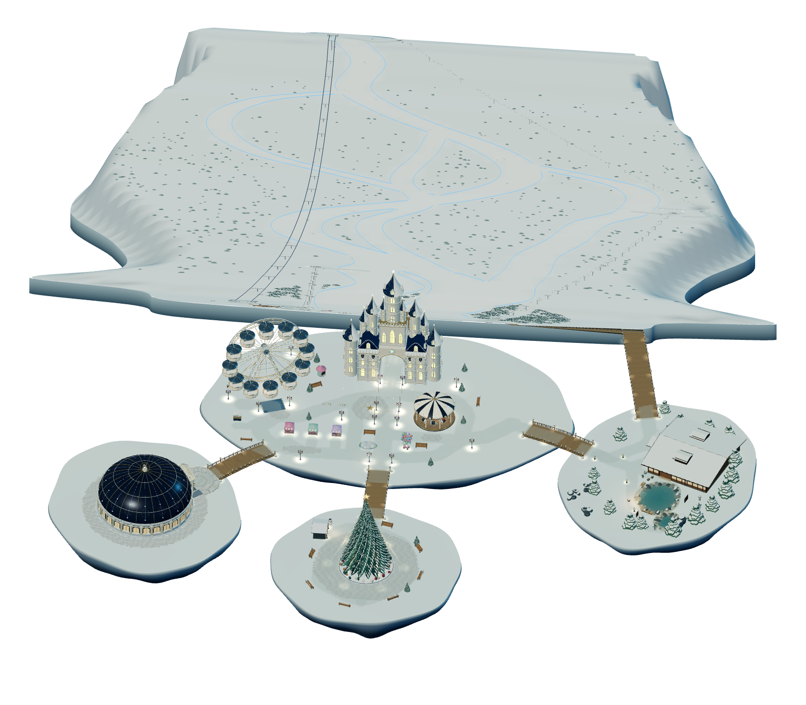
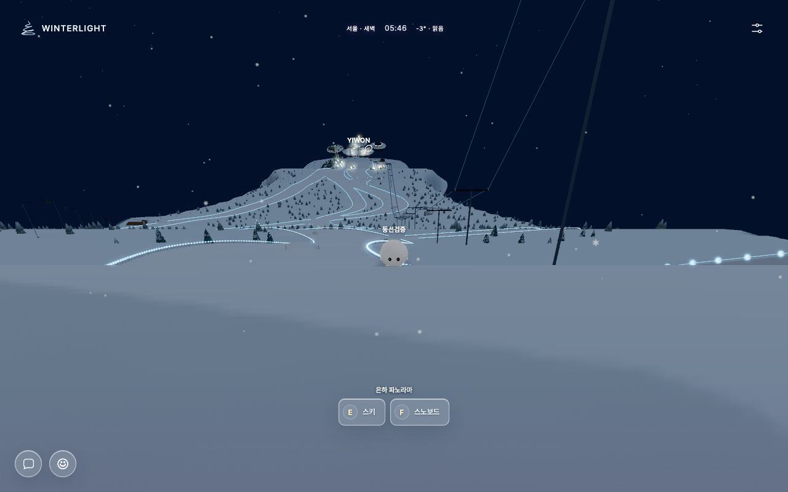
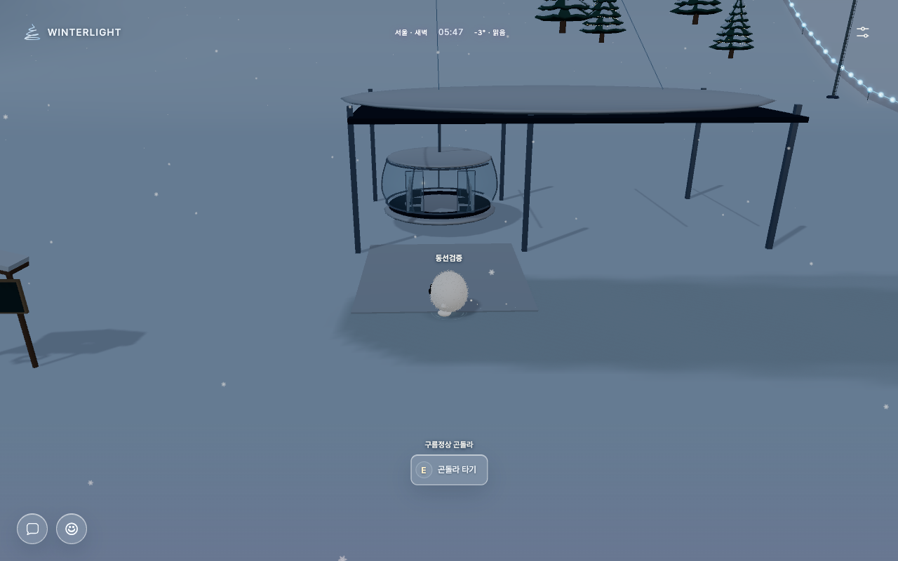
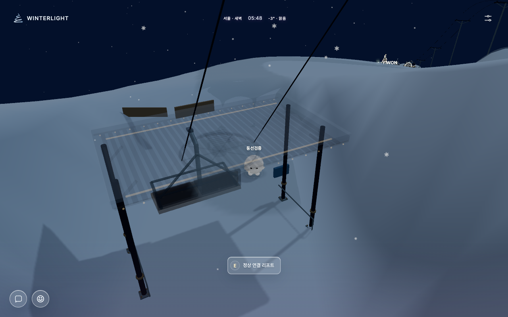
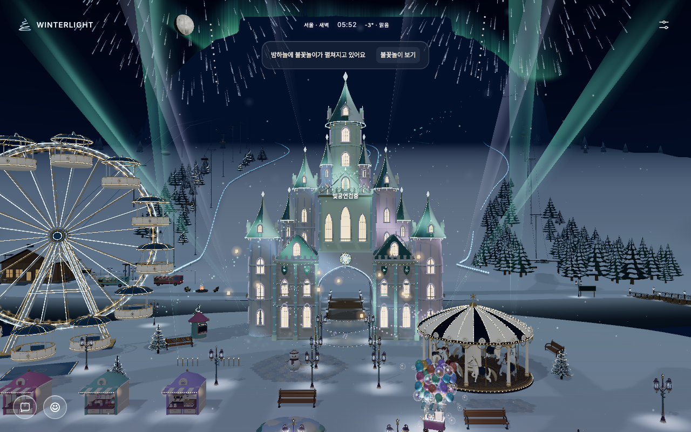
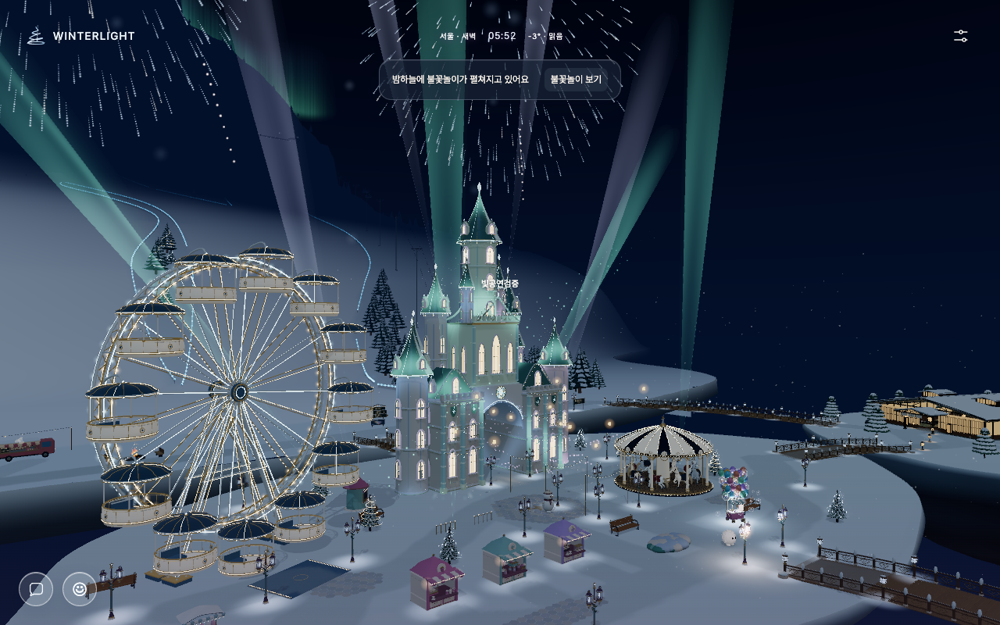

# v51 — 1분 설산·곤돌라 오류 수정·성 야간 공연

2026-11-20, `codex/alpine-resort-v48` 로컬 수정본. 최신 요청에 따라 스키장과 성 공연을 함께 개선한다. 다른 섬·시설 배치, 음악, 운영 서버 데이터는 유지한다. GitHub main 통합·운영 배포는 보류 상태다.

## 스키장: 원인과 수정

- **객실 중복:** 기존 256초 순환을 18초 간격으로 `ceil(256/18)=15`대 생성했다. 270초 분량을 256초 주기에 넣어 마지막 객실이 이미 승차장으로 돌아왔을 때 새 객실이 겹쳤다. 예약별 시작 시각도 별도 시각 객체로 추가했다. 이제 162초 순환/18초 간격/고정 9대 ID를 서버와 클라이언트가 공유한다. 예약은 같은 객실을 사용하며 새로운 시각 객체를 추가하지 않는다.
- **꺾이는 곤돌라:** 지형을 따라 좌우로 휘던 spline을 직선 노선으로 교체했다. 높이는 실제 지지대 사이의 직선 span으로 계산하고, 두 차선과 객실 폭의 눈 간섭을 검사한다. 활강로 위는 공중으로 건너고 지지대는 코스 바깥에만 둔다. 객실 왕복과 문·좌석·공유 시계는 유지한다.
- **꺼진 승차장:** 좁은 역 주변만 낮춰 생기던 웅덩이형 지형을 제거했다. 하단 전체를 같은 높이의 보행 광장으로 만들고 72m의 부드러운 전이 구간으로 설면과 잇는다. 충돌 높이와 렌더 높이를 함께 바꾼다.
- **너무 긴 활강:** 정상 코스 3D 길이를 3,721.60m → **2,336.85m**, 낙차 1,404m → **900m**로 줄였다. 주 코스 폭은 64m로 확보해 축소된 회전에서도 스키와 보드가 벽에 걸리지 않는다. 7개 선택 점프대를 새 코스에 맞춰 옮기고 재검사했다.
- 곤돌라 65초, 왼쪽 리프트 28초, 오른쪽 46초, 정상 연결 38초. 곤돌라는 별도로 승차 5초·정상 정차 8초·각 터미널 회전 9.5초가 있다.
- 기존 베이스·다리·어묵·모닥불 유지. 중간 쉼터의 벤치/건물/이정표를 코스 밖으로 맞췄다. 실제 역, 트리거, 안전 도착점, 지도 마커/이미지를 같은 레이아웃으로 갱신했다.
- **환승장 카메라:** 실제 접근 검사에서 대기 중 지나가는 의자와 머리 위 보강대, 지름 약 5cm 케이블이 시야 거리를 줄이는 것을 확인했다. 움직이는 객실/의자와 천장 구조만 가림 시 옅어지며, 얇은 케이블은 카메라 충돌 대상에서 제외한다. 높은 구조물은 중심점이 아니라 전체 경계로 분류하고, 병합 후에도 분류를 보존한다. 땅에 닿는 기둥·벽의 충돌은 유지한다.

주요 파일: `dist/mountain-layout.js`, `alpine-gondola.js`, `ride-seats.js`, `resort-blueprint.js`, `winter-rides.js`, `path-routes.js`, `map-atlas.js`, `textures/winter-world-map.webp`.

### 실제 활강 측정

macOS Chrome, 1280×800, 자동 방향 입력, 실제 시간. 시뮬레이션 시계를 가속하지 않았다. 스키/보드 단위 물리 완주도 각각 58.23/59.30초였다.

| 항목 | v50 | v51 |
| --- | ---: | ---: |
| 실제 스키 완주 | 91.71초 | **58.21초** |
| 평균 FPS | 60.01 | 59.99 |
| 평균 프레임 | 16.67ms | 16.67ms |
| p95 프레임 | 16.7ms | 16.7ms |
| Draw Calls 범위 | 112–1,176 | 88–1,238 |
| Triangles 범위 | 382,442–5,264,828 | 358,504–5,130,171 |
| 상주 지형 타일 최대 | 28 | 28 |

경로와 가시 영역이 달라졌으므로 위 수치로 단일 렌더 최적화 효과를 주장하지 않는다. 종료 후 장비 해제·일반 이동·속도 0 확인. 실제 점프 검사에서 스키 191/191, 보드 316/316 공중 프레임 모두 화면 안에 있었다. [실측 JSON](../qa/alpine-v51/desktop-descent-final.json).

## 성 공연: 구조와 연출

이전에는 15개 빔의 원점이 세 첨탑에 몰리고, 같은 색 수식과 큰 emissive가 외벽 전반에 적용됐다. 새 연출은 기존 재질의 네 배치를 유지하면서 **10개 건축 구역 속성**을 넣는다. 중앙/좌우 탑, 지붕, 벽, 창문, 기둥, 아치, 정문 장식, 금속 세부의 강도를 별도로 제어한다. 바탕 석재 음영은 유지하고 움직이는 패턴이 색을 전달한다.

- `castle-show-score.js`: 5개 구간의 시작/길이, 3색 팔레트, 구역별 강도, 프로젝션, 빔 그룹/폭/방향/박자, 입자, 불꽃 큐, 선택적 구도 정보, 품질 단계. 기존 음악 파일/곡은 수정하지 않았다. 현 음악의 120BPM 기준을 데이터로 명시했다. 오디오 자동 분석/새 음악 선택은 하지 않는다.
- `firework-score.js`: 같은 시드와 기존 52발을 구간별 데이터에서 읽는다. 모든 클라이언트가 서버 시작 시각으로 같은 구간을 계산한다. 카메라 metadata는 자동 이동을 하지 않는다.
- 관람 종료와 음원 정리도 고정된 74초 상수 대신 서버 `endsAt`과 공통 공연 길이를 따른다. 현재 74초 연출·기존 음표·선택 곡은 동일하다. 앞으로 큐 길이를 바꿀 때 종료 조건을 여러 파일에서 다시 맞출 필요가 없다.
- `castle-model.js`: 실제 파트에 `showRegion` 정점 속성을 남긴다. 별도 건물 복제/평면 영상/렌더 타깃을 만들지 않는다.
- `castle-show.js`: 실제 외벽 표면에 얼음 결정, 아치 흐름, 지붕 오로라, 탑 나선, 별 반짝임을 합성한다. 외벽을 관통하는 평면 투사가 없다. 구간 전환은 1.4초 보간이다.
- 지상 광장/성벽 뒤/정문/창문/후면/탑의 24개 fixture를 교차하는 부드러운 빔으로 한 번에 그린다. 넓은 빛은 천천히 움직이고, 레이저는 지정 구간의 박자에만 켜진다. 신규 실시간 광원은 없다.
- 새로운 GPU 빛 알갱이 720/420/180개(고/중/저), 한 개 고정 버퍼. 상승·아치·박자 확산의 세 움직임, 크기/속도/감쇠를 구분한다. `Reduced Motion`은 90개 이하와 고정 빔, 레이저 끄기를 적용한다.
- 불꽃의 핵심 입자만 조금 굵게 하고 기존 짧은 꼬리·낙하/소멸 시간을 유지한다. 서버 신청, 권한, cooldown, 저장, 음악, 카메라 로직은 변경하지 않았다.
- 종료 시 draw 범위/가시성을 끄고 버퍼를 재사용한다. dispose 시 두 신규 draw의 geometry/material과 재질 hook을 복구한다.

## 검증 상태

- 실제 PC: 공연 시작·중반·골든·피날레, 정면/양옆 확인. WebGL/브라우저 오류 0.
- 최종 성능은 각 구간 4초 표본이며, 아래 표와 원시 JSON을 따른다. 초기 실행의 약 60FPS 수치를 최종 PC 결과로 사용하지 않는다.
- 빠른 공연 6회 재시작/종료 후 geometry·texture 수 증가 없음. 최초 사용 뒤 재사용 리소스가 남는 것은 의도한 풀링이다. 장시간 누수 부재를 증명한 것은 아니다.
- 단위 검사: 객실 2주기 전체 간격, 고정 ID 연속성, 직선 정렬, 지지대와 코스 이격, 바닥, 10구역·6발사 그룹, 7점프대와 서버 좌표, 보행·지도·연결 검사.
- 실제 모바일 기기, Windows GPU, iPhone Safari, Galaxy, GPU 메모리 바이트, 발열, 장시간 운영: **UNKNOWN**.

### 실제 통합 검사

- **공유 곤돌라:** PC/터치 화면의 두 익명 게스트가 같은 객실의 0·1번 좌석에 탑승, 실제 65초 상승, 채팅 전파, 정상 하차, 양쪽 예약 해제 통과. [기록](../qa/alpine-v51/transport/integration.json). 별도 카메라 진단이 함께 실행된 구간의 FPS는 성능 비교에서 제외한다.
- **리프트·터치:** 초급 28초, 포레스트 46초, 중턱→정상 38초 실제 승하차, 원 밖 조이스틱 입력 1 유지, 카메라 멀티터치, 제동·점프, 장비 해제와 정지 통과. [기록](../qa/alpine-v51/mobile-final/mobile-controls.json). macOS Chrome의 390×844 터치 에뮬레이션이며 실물 휴대폰 검사가 아니다.
- **공유 공연:** 별도 SQLite/HTTP presence 서버에서 PC·터치 게스트와 늦은 접속자 3명이 같은 ID/시드를 유지했다. 두 화면의 불꽃/성 셰이더 시각이 일치했고, 늦은 접속은 현재 시점부터 재생됐다. 일반 게스트 관리자 API 403, 타인 카메라 유지, 자연 종료·자발적으로 선택한 관람 시야 복구·플레이어 좌표 보존 통과. [기록](../qa/castle-show-v51/sync.json). 운영 Cloudflare WebSocket 부하 검사를 대신하지 않는다.
- 전체 자동 검사 1차: 527개 중 526개 통과. 남은 1개는 축소 전 숲 좌표가 이제 산 밖에 놓여 발생한 테스트 fixture 오류였다. 현재 산의 실제 두 숲 타일을 선택하도록 고쳤고, 해당 리소스 해제 검사 2개는 재실행 통과했다. 최종 전체 실행 결과는 아래에 기록한다.

- **보행·지도:** 정상 정면/좌우, 주요 산책로→초급 리프트→곤돌라 정면 승차, 포레스트 하차점→정상 연결 리프트, 8개 지도 이동점 통과. 환승장에서 실제 30초/1,654프레임 동안 시야 거리는 26m로 유지됐다. [최종 기록](../qa/alpine-v51/access-final/access.json). 초기 실패 기록과 진단은 별도 폴더에 보존했다.
- **전체 자동 검사: 527/527 PASS.** 이후 공통 종료 시각 연결의 관련 검사 **35/35 PASS**. 289개 JavaScript 구문 검사, 기본 Worker build, WebSocket Worker build, Vercel build, 성능 용량 예산 검사 모두 PASS. 별도 TypeScript/Lint 스크립트가 없는 프로젝트이므로 실행했다고 표시하지 않는다. [검증 요약·소스 해시](../qa/alpine-v51/verification-summary.json), [전체 검사 로그](../qa/alpine-v51/logs/full-tests.log).
- 배포 자원 22,749,950 bytes / 코드 gzip 1,061,966 bytes. 상한 25,165,824 / 1,280,000 bytes 이내. 배포 산출물 생성만 했으며 업로드/프로덕션 변경은 없다.

### 최종 공연 화면·성능

다른 자동 브라우저 검사와 CPU 테스트를 종료한 뒤, 별도 로컬 DB/서버의 같은 장면에서 순차 측정했다. Mac Chrome, DPR 1, PC 1280×800 / 터치 390×844. 각 구간 약 4초, 실제 `requestAnimationFrame` 간격이다. 운영 화면이나 실물 휴대전화 결과는 아니다.

| 조건 | 공연 전 FPS | 피날레 FPS | 피날레 p95 | 피날레 Draw Calls | 피날레 Triangles | 성 빛 입자 |
| --- | ---: | ---: | ---: | ---: | ---: | ---: |
| PC high | 47.14 | 50.32 | 33.4ms | 1,137–1,538 | 4,821,681–7,985,165 | 720 |
| 모바일 화면 medium | 60.01 | 57.01 | 33.3ms | 942–1,346 | 4,246,141–7,409,965 | 420 |
| 모바일 화면 low | 60.23 | 60.25 | 16.7ms | 936–1,337 | 4,224,671–7,388,155 | 180 |

그림자 갱신과 가시 객체 때문에 프레임별 Draw Calls/삼각형 범위가 크다. PC도 60FPS 고정이라고 주장하지 않는다. 전후 짧은 표본의 변동으로 성능 향상률을 계산하지 않는다. 성 공연의 추가 볼류메트릭 빔과 빛 알갱이는 각각 한 draw이며 실시간 광원/반사 타깃은 추가하지 않았다.

- 시작·중반·골든·피날레, 정면·양옆을 세 품질 화면에서 확인했다. WebGL·페이지 오류 0.
- 각 화면에서 공연 시작/종료 6회 후 geometry/texture 수가 각각 PC **931/37**, 모바일 medium **834/34**, low **827/33**으로 유지됐다. 종료 후 불꽃 draw range 0, 성 VFX 숨김, active false. 초기 구역 로딩/풀 준비로 수가 늘 수 있으며, 반복 구간의 안정성을 검사했다. GPU 메모리 바이트와 장시간 누수는 UNKNOWN.
- 최초 공유 미리보기 검사에서는 타인/월드 갱신이 함께 있어 전체 geometry가 947→950으로 증가했고 검사가 실패했다. 이를 공연 누수로 단정하거나 지우지 않고 [해당 기록](../qa/castle-show-v51/desktop-shared-preview.json)을 보존했다. 별도 월드에서 위 조건으로 다시 검증했다.
- [PC 원시 측정](../qa/castle-show-v51/desktop.json), [모바일 화면 medium](../qa/castle-show-v51/mobile.json), [모바일 화면 low](../qa/castle-show-v51/mobile-low.json).
- 공연 비교 스크린샷은 QA에서 고정 관람 카메라를 사용했다. 이 카메라만 테스트에서 덮어써 화면 중앙의 닉네임이 본래 캐릭터 위치와 어긋나 보일 수 있다. 제품 카메라 자동 이동을 추가한 것이 아니다.

## 화면 증거

이전 스키/공연 스크린샷은 [v50](alpine-compact-v50.md)과 [v49](castle-show-v49.md)에 보존했다. 지형이 바뀌었으므로 이전/이후 화면이 완전히 같은 가시 객체 조건은 아니다.

관련 커밋: 아직 없음. 수정본은 로컬 브랜치에 보관하며 main·Vercel·Sites·Cloudflare 운영 반영은 하지 않았다.
