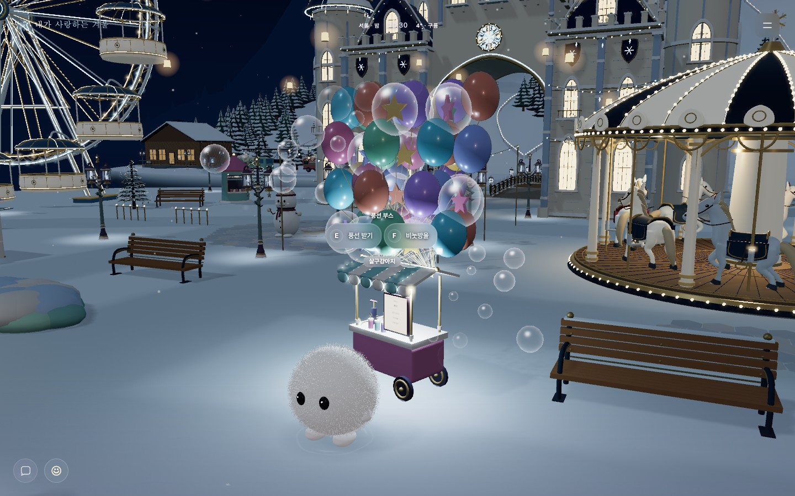

# v37 — 랜덤 풍선과 이동 반응

기존 풍선 부스 위치·충돌·다섯 섬 구조는 유지한다. 부스에는 48개 풍선을 층별로 묶고 일반 유광 풍선과 투명 장식 풍선을 섞었다. 주변 비눗방울은 고정 InstancedMesh에서 GPU로 이동하며 품질별 28/18/8개다. 투명 껍질은 Fresnel·하이라이트·얕은 무지개색을 사용하고 별도 굴절 렌더러를 만들지 않는다.

사용자 최신 지시대로 버튼은 **풍선 받기** 하나다. 매번 일반/별 장식/눈꽃 장식 3종 중 하나와 7색 중 하나를 무작위로 받는다. 색은 직전 색을 제외한다. 종류별 선택 버튼은 없으며 비눗방울 막대 받기는 별도 행동으로 유지한다.

`held-balloon.js`는 실제 이동 속도에 따라 풍선이 늦게 따라오는 감쇠 스프링을 계산한다. 관성은 월드 좌표에 보관한 뒤 캐릭터 좌표로 변환하므로 방향 전환 때 풍선이 즉시 회전하지 않는다. 약 2.3m의 유연한 끈은 25개 정점 버퍼를 재사용한다. 정지 후 잔진동, 속도에 따른 기울기, 약한 부력 움직임을 갖는다. 순간이동/프레임 중단 때 관성을 초기화하며 Reduced Motion에서는 고정한다.

종류와 색은 기존 서버 활동 상태에 `balloon-{style}-{tone}` 형태의 제한된 21개 값으로 저장한다. 서버의 기존 허용 목록 검증과 방문자 동기화를 재사용한다. 새 DB 필드나 프레임별 풍선 좌표 전송은 없다. 다른 물건을 들면 풍선과 관련 업데이트가 종료된다.

검증 기록: [PC](../qa/browser-v37/balloons.json), [모바일 에뮬레이션](../qa/browser-v37/balloons-mobile.json). 실제 버튼, 서버/다른 세션에서 같은 종류·색 확인, 키보드/조이스틱 이동, 비눗방울로 교체 및 E/터치 해제를 검사한다. 단위 검사는 전체 21개 조합, 난수 경계, 관성·버퍼 재사용·순간이동·모션 감소를 검사한다. 실제 휴대폰 및 운영 사용자 간 화면 검사는 UNKNOWN이다.

렌더링 비용은 신규 부스 InstancedMesh 3개와 비눗방울 1개, 손의 소형 메시/끈으로 제한한다. 최종 프레임 측정은 v37 성능 보고서에 기록한다.
