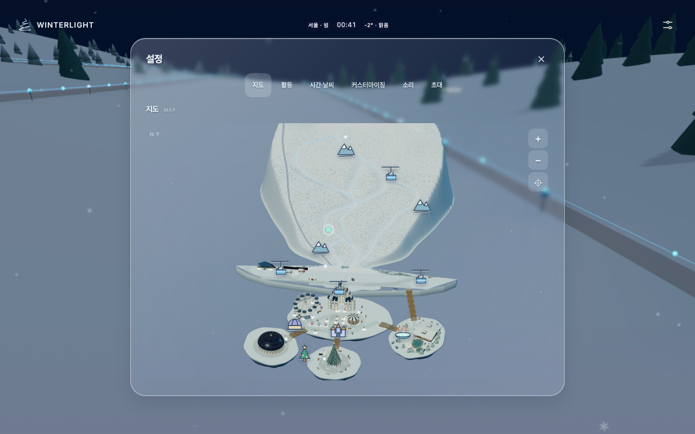
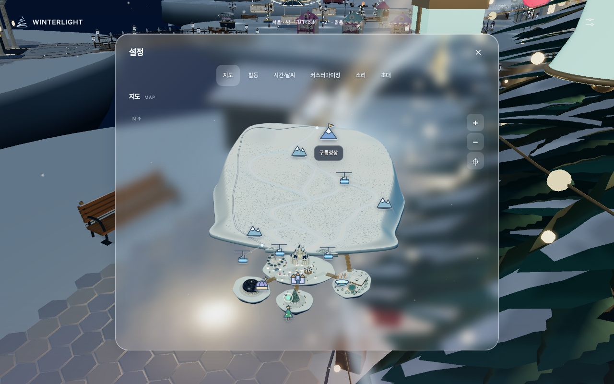
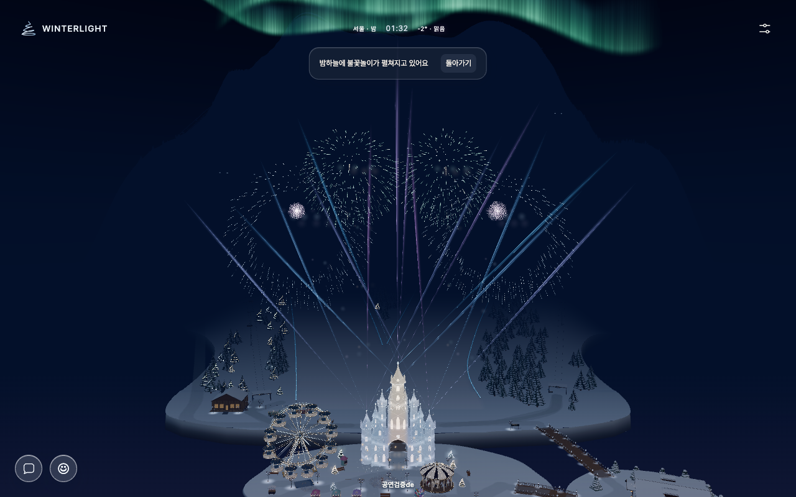
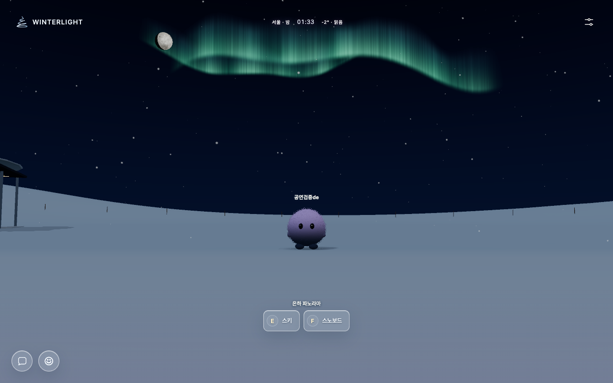
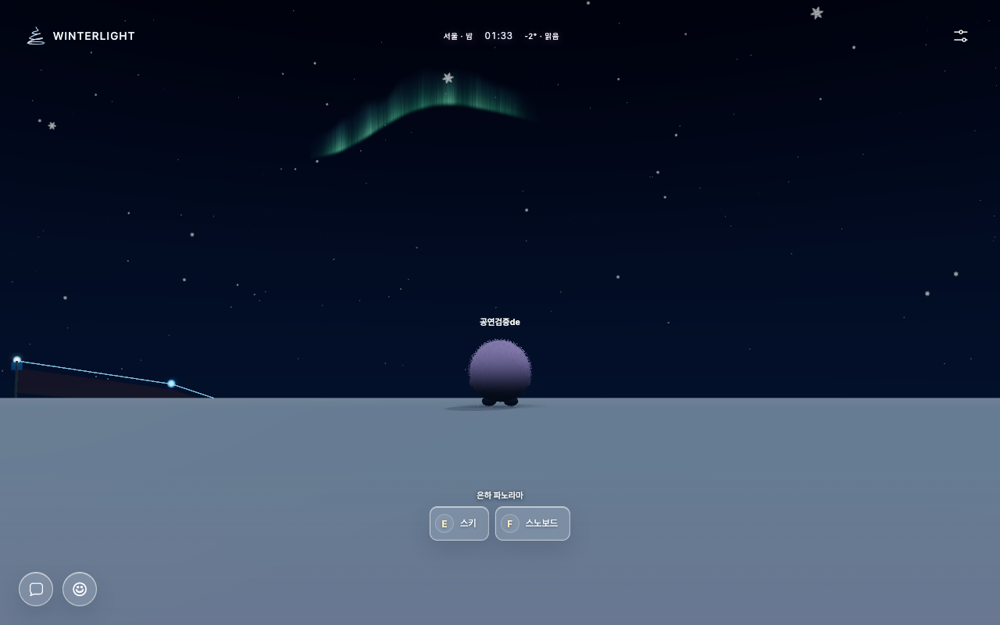
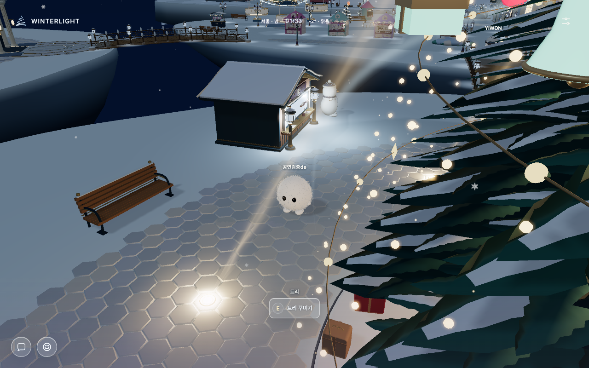
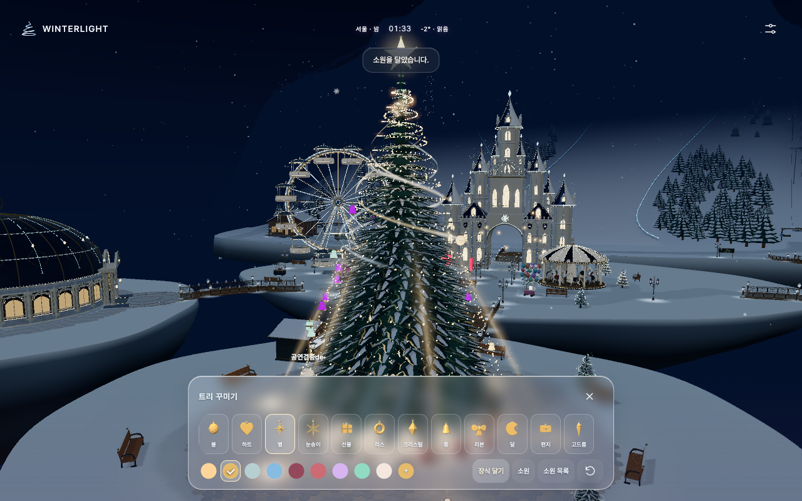
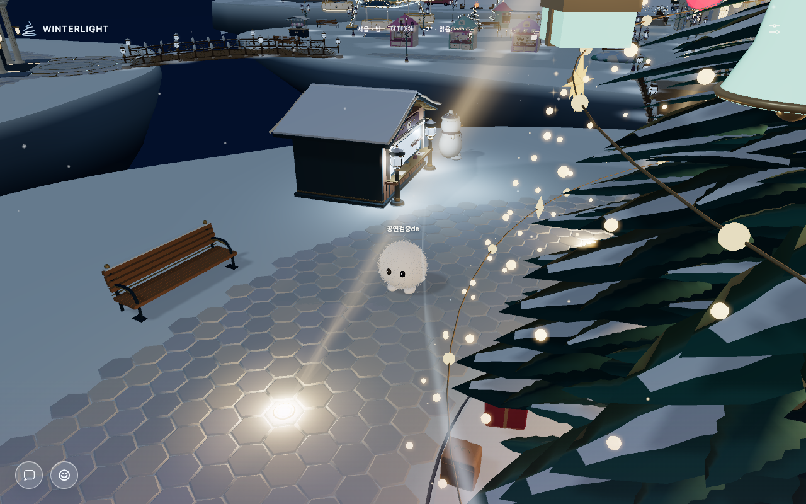

# v49 — 성 공연, 지도·트리 카메라 및 설산 하늘

작업 위치: `codex/alpine-resort-v48`, v48 설산 수정본 위의 후속 변경. 운영 GitHub main/Vercel/Sites/Cloudflare에는 배포하지 않았다. 기존 성·다른 섬 위치, 소원 저장, 공개 입장과 관리자 권한을 유지한다.

## 실제 원인과 수정

- **지도 하단이 항아리·받침처럼 보임:** 긴 산의 X/Z/높이를 축약할 때 베이스는 원래 폭, 바로 뒤 산은 0.1배 폭이었다. 깊은 암반의 긴 삼각형까지 서로 다른 축척으로 투영되어 넓은 받침과 좁은 목이 생겼다. 기존 월드 지형을 옮기지 않고 지도 제작 단계의 연속 폭 함수와 투영 후 암반 두께를 수정했다. 지도 이미지와 마커 모두 동일한 생성 메타데이터를 사용한다.
- **트리 편집 종료 후 먼 시점 유지:** 사용자가 트리 편집 중 회전/줌하면 임시 전체 트리 구도가 기본 카메라 요청으로 복사됐다. 편집 시작 시 저장한 시점을 첫 세션 내내 보존하고 직접 닫을 때 복원한다. 연속 등록으로 저장된 원래 시점이 덮어써지지 않는다. 캐릭터를 이동시키지 않는다.
- **연속 꾸미기의 저장 제한:** 서버에 남아 있던 전체 160개 등록 제한을 제거했다. 1초 연속 요청 방지는 유지하고 기존 기록은 삭제하지 않는다. GPU·응답 크기 보호를 위해 월드에는 최신 160개를 표시하며, 영구 저장 개수와 동시 표시 예산을 분리했다. 160개를 넘긴 저장·최신 장식 수신·기존 기록 보존·연속 요청 차단을 격리 DB로 검사한다. 모든 과거 장식을 무제한으로 동시에 렌더링한다는 의미는 아니다.
- **읽기 어려운 지도 이름표:** 불꽃 알림과 같은 `rgba(24,35,54,.7)` 배경, 아이보리 글자, 미세한 테두리/하이라이트를 공통 적용했다. 마커 자체의 색과 투명 배경은 유지한다. 최상단 이름표는 아래쪽으로 표시한다.
- **채팅:** 입력 행에서 ‘닫기’ 버튼과 차지하던 열을 제거했다. 채팅 아이콘 및 Escape로 닫으며 입력 중 기록·머리 위 말풍선은 보존한다.
- **고지대 달·오로라:** 작은 이전 월드 좌표에 놓인 하늘 효과가 1,800m 정상에서 낮거나 가까워 보일 수 있었다. 달·오로라를 카메라 평행이동 기준 원경으로 만들고 각 크기는 보존했다. 바라보는 방향으로 회전시키지 않으므로 세계 방위는 유지된다. 남쪽 하산 방향에도 커튼 한 겹이 보이며 저품질에서도 북/남 양쪽 커튼을 유지한다. 별은 4km 반경 상공으로 옮겼다.
- **설산 펜스의 떠 있는 불빛:** 원래 전구 shader는 지형 안개와 무관하게 최소 픽셀 크기를 유지했다. 수 km로 커진 설산에서는 산이 가려져도 조명 선만 밤하늘에 남았다. 지형과 같은 안개 및 350~900m 거리 감쇠를 적용해 가까운 파란 전구는 유지하고 먼 윤곽은 자연스럽게 사라지게 했다.
- **색상 호환:** 기본 sRGB/ACES 출력을 유지한다. 기존 저품질 경로는 기본 framebuffer에서 물체별 보정 뒤 fog를 섞었고, HDR 경로는 fog를 섞은 선형 장면에 한 번 보정해 색이 달랐다. 모든 품질에서 장면을 선형 버퍼에 그린 후 한 번 보정하도록 통일했다. 저품질은 Bloom 샘플링을 생략하며, float buffer 미지원 기기는 8비트 선형 버퍼를 쓴다. 이 대체 경로는 과도한 HDR 발광의 범위까지 동일하다는 뜻은 아니다. 저품질에 화면 합성 1 Draw Call과 장면 버퍼 메모리 비용이 추가된다. Native 색상 선택기가 `input` 없이 `change`만 발행해도 반영하고 중복 저장을 피한다. 실제 Windows 기기를 대신한 검증은 아니다.

주요 파일: `camera-policy.js`, `park.js`, `social.js`, `resort-ui-v43.css`, `studio.js`, `winter-sky.js`, `themepark-world.js`, `world-map.js`, `map-atlas.js`, `scripts/render-world-map.mjs`.

## 공연 구조

74초 공연의 서버 ID·시작 시각·시드를 그대로 쓴다. 기존 10초 예고, 일반 방문자 15분 대기, 관리자 실행, 중복 생성 방지·취소·늦은 접속 정책은 변경하지 않았다.

- `firework-score.js`: 자체 제작한 52발 시퀀스. Opening → 양쪽 교차 → 큰 중앙/좌우 폭발 → Willow → Finale. 구형, Peony, Willow, Ring, Glitter, Star 6패턴.
- `winter-fireworks.js`: 최대 18개 동시 슬롯, 280/160/80개 입자, 입자당 10개 지연 샘플. 3D 속도·항력·중력·감쇠를 GPU에서 계산한다. 현재 활성 슬롯이 변할 때만 고정 버퍼를 채운다. 피날레 최대 동시 17발을 담으며 오래된 불꽃을 잘라 버리지 않는다. 입자가 소멸할 때 꼬리도 종료되어 긴 수직 샤워가 남지 않는다.
- 연기: 슬롯당 최대 6개, 총 108개 공유 Points. 발사·폭발 지점에서 6초 이내 부드럽게 퍼지고 소멸한다. 신규 실시간 광원은 추가하지 않고 기존 fill에 최대 0.3의 짧은 색 변화만 더한다.
- `castle-show.js`: 기존 석재·금속·지붕·창문 배치의 shader에 건물 로컬 좌표 기반 색 흐름/얼음 결정/광선/아치 패턴을 합성한다. 별도 투영용 대형 평면·렌더 타깃을 만들지 않는다. 중앙/좌우 첨탑의 15/9/6개 레이저를 하나의 교차 띠 Mesh로 그린다. 종료 시 원래 재질로 돌아가고 해제 시 shader hook을 복구한다.
- `firework-music.js`: 외부 음원·샘플을 쓰지 않은 120BPM 자체 합성 스코어. 벨·피아노형 잔향, 필터를 거친 지속음과 피날레 화음을 같은 서버 시계로 예약한다. 최대 48음, 짧은 look-ahead, 늦은 접속은 지난 음을 재생하지 않는다. 기존 음악 설정/음소거를 따르며 배경 음악은 공연 중만 낮춘다. 오케스트라 실연 녹음은 아니다.
- 감상 시점은 최신 첨부의 요청대로 사용자가 ‘불꽃놀이 보기’를 눌렀을 때만 적용한다. 원래 플레이어 좌표는 유지한다. 직접 회전하면 고정 구도를 해제하고 현재 감상 중심에서 자유롭게 둘러본다. 돌아가기/이동/공연 종료/시설 입장 시 원래 시점으로 복귀한다.
- Reduced Motion/효과 감소 시 레이저 이동과 강한 섬광을 줄인다. 저품질도 공연 주요 효과를 유지한다. 첫 발사 때 GPU compile이 끊기지 않도록 로딩 중 공연 shader를 준비한다.

## 성능과 검증

실제 macOS Chrome에서 로컬 격리 DB를 이용했다. 브라우저 QA는 사용자 기기의 Windows/iPhone/Android 검사를 대신하지 않는다. 각 공연 단계는 같은 감상 시점에서 4초 RAF 표본으로 측정하며 전체 장시간 플레이 평균이 아니다.

실시간 알림의 `backdrop-filter`를 켜고 끄는 분리 실험에서 비용을 확인했다. Apple M2 / Chrome 1280×800, 동일 감상 거리 260, 동일 64초 피날레를 반복해서 측정한 결과는 아래와 같다. 각 표본은 4초이며 브라우저·GPU 부하에 따라 달라진다. 움직이는 WebGL 배경을 계속 재필터링하지 않도록 작은 알림은 반투명 색/테두리/하이라이트로 유리 표현을 유지한다. 설정창의 기존 디자인은 그대로다.

| 동일 피날레 | 평균 FPS | p95 프레임 시간 | Draw Calls |
| --- | ---: | ---: | ---: |
| 알림 blur(12px), 반복 표본 | 34.51 | 33.4ms | 1063~1135 |
| 알림 반투명 색만, 반복 표본 | 57.74 | 16.8ms | 1063~1135 |
| 공연 효과 제외 + 알림 blur | 33.93 | 33.4ms | 1060~1132 |
| 공연 효과 제외 + 알림 반투명 색만 | 59.98 | 16.8ms | 1060~1132 |

근거: [분리 실험 JSON](../qa/castle-show-v49/probe.json), `scripts/profile-show-compositing.mjs`. 첫 표본은 아직 일부 지형을 준비하므로 비교 표에서는 동일 Draw Call 범위가 확보된 반복 표본을 사용했다.

SwiftShader 소프트웨어 WebGL은 초기 화면에서 약 0.31FPS를 기록했고 screenshot 30초 시간 초과로 중단됐다. 전체 장면이 정상 실행된 검사로 취급하지 않는다. 이 경로에서 발생한 shader 오류는 수집되지 않았으나, 그 사실만으로 정상 렌더링을 보장하지 않는다. [실패 기록](../qa/castle-show-v49/software.json).

최종 자동 검사·빌드와 모바일/저사양 직접 렌더 경로 결과는 검사 완료 후 이 절에 기록한다.

실물 Windows/ANGLE D3D, iPhone Safari, Galaxy Chrome, GPU 사용량·GPU 메모리 바이트, 발열, 장시간 공연 반복은 **UNKNOWN**. 반복 6회 버퍼/렌더 리소스 수가 안정적이라는 검사는 장시간 누수가 전혀 없다는 보장이 아니다.

## 재현과 증거

- `node scripts/verify-castle-show.mjs`: 실제 Mac Chrome, 공연 단계/반복 해제, 연속 두 장식 저장·원래 카메라 복귀, 채팅, 지도 12마커/이름표, native 색상 commit, 그라데이션 저장, 베이스/정상/하산 하늘.
- `QA_MOBILE=1`은 390×844 Chrome 터치 에뮬레이션이다.
- `QA_LOW=1`은 같은 Mac GPU의 Bloom 없는 저품질 렌더 경로다.
- `QA_SOFTWARE=1`은 Chrome SwiftShader 저품질 소프트웨어 WebGL이다. Windows GPU 검사가 아니다.
- `qa/castle-show-v49/*.json`에 측정값·브라우저 오류를 남긴다. 테스트 장식만 생성하고 해당 ID만 삭제한다. 운영 API에는 호출하지 않는다.

지도 변경 전후는 같은 앱/해상도지만 배경 플레이어 위치와 이전 기본 줌이 달라 픽셀 단위 A/B는 아니다. 트리 전후는 같은 플레이어 위치·해상도·기본 시점이다. 사용자 제공 원본 스크린샷은 별도 재배포하지 않았다.
