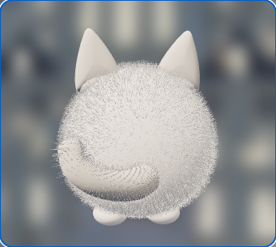
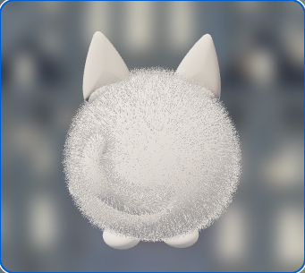
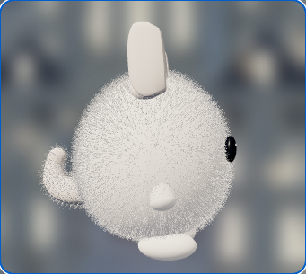
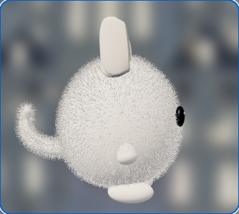
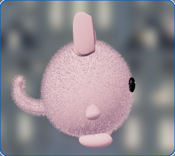
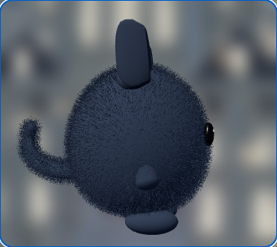
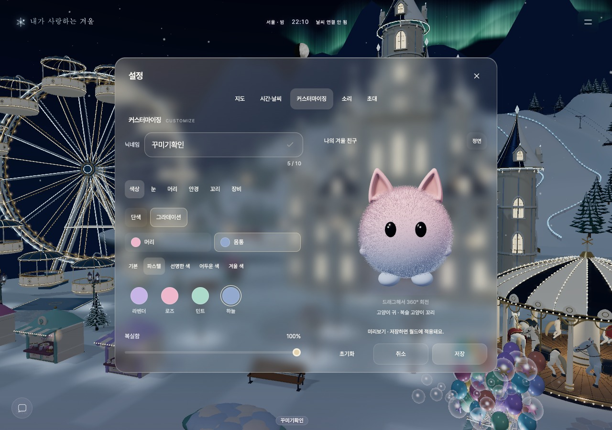
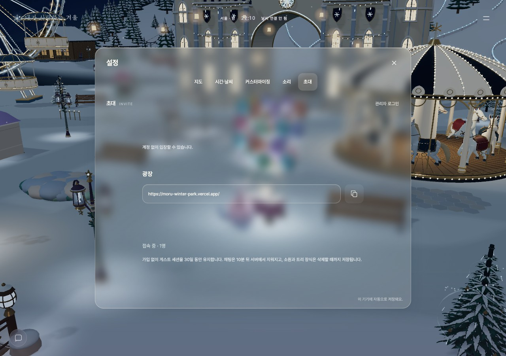

# v38 — 커스터마이징·모바일 조작·꼬리 후속 수정

기준 소스: v37 `0720494`. 월드 시설·섬·다리·지도 이동 좌표는 유지한다. 같은 작업 중 사용자가 정정한 선택지와 마지막 꼬리 요청을 우선 적용했다.

## 원인과 변경

### 꾸미기와 저장

기존에는 선택 즉시 월드 외형이 바뀌고 목·몸 장식이 허리띠처럼 보였으며 머리 슬롯끼리 겹쳤다. `wardrobe.js`의 공통 카탈로그로 색상·눈·머리·안경·꼬리·장비를 구성한다. 귀·모자·머리 장식은 한 슬롯이고 다른 슬롯은 함께 착용한다. 목·몸, 비니·베레모·겨울 모자·털모자·별핀·리본·졸린 눈·장난스러운 눈은 선택 목록에서 제거했다. 구형 세션 ID는 허용 후 정규화하며, 기존 저장 자료를 일괄 삭제하지 않는다.

PC는 선택 영역 왼쪽/실제 캐릭터 미리보기 오른쪽, 모바일은 미리보기 위/선택 영역 아래다. 동일한 `createCompanion` 모델을 사용한다. 드래그 회전·정면 복귀·저장·취소·초기화를 제공한다. 닉네임은 펼치기 없이 입력과 체크 저장으로 표시하며 10자 검증을 유지한다.

`appearance-draft.js`는 편집/저장 값을 분리한다. `/api/appearance`가 세션·Origin·허용 ID·색·수치를 확인하고 저장에 성공해야 월드에 적용한다. 중복 저장 및 저장 중 presence 덮어쓰기를 방지한다. 실패 시 이전 외형과 편집값을 보존하고 재시도한다. 이 경로를 Vercel 프록시 허용 목록에도 추가했다.

머리와 몸통에 서로 다른 색을 고르는 그라데이션은 `fur-gradient.js`의 캐릭터 로컬 높이 기반 GPU 보간이다. 몸통·털·팔에 같은 색을 적용하고 귀 바깥은 위쪽 색, 발·꼬리는 아래쪽 색을 따른다. 색 변경은 uniform 변경이며 메시를 다시 만들지 않는다. `visitors.color_top` nullable 열을 추가하는 `0010_loose_kronos.sql`로 기존 단색은 그대로 유지한다. 세션 복원과 다른 사용자에게 선택값만 전달한다.

### 얼굴·귀·털

고양이 귀는 두께·오목한 안쪽·넓은 밑부분이 있는 좌우 대칭 모델이다. 토끼 귀도 둥근 입체형으로 다시 만들었다. 귀 간격은 좁은 기본값 하나만 제공한다. 고글 등 불투명 안경에서는 하트·별 눈이 튀어나오지 않게 숨긴다. 하트 안경의 눈 중심을 맞추고 검은 테두리 눈알 안경을 추가했다. 눈동자 이동은 프레임 안으로 제한하고 움직임 줄이기에서는 고정한다. 윗부분이 평평한 엄근진 눈을 별도로 유지한다.

어두운 털의 흰 윤곽은 흰색 sheen 혼합과 굵은 삼각 털의 대비에서 발생했다. 기본 몸 색과 같은 grazing highlight, 가는 짧은 털과 완만한 색 변화로 조정했다. 몸 비율은 바꾸지 않았다.

### 고양이 꼬리 — 마지막 정정

긴 수직 S자와 그 뒤의 너무 짧고 굵은 모델 모두 폐기했다. 몸 뒤로 완만하게 휘는 둥근 단면으로 다시 만들었다. 루트 `(0,-.3,-.59)`, 끝 `(.49,.42,-.67)`, 반경 `.085 → .071`이며 끝에는 같은 반경의 둥근 캡이 있다. 본체와 동그란 꼬리 비율은 유지한다.

털이 띠 모양으로 몰리던 원인은 길이·각도 샘플의 상관관계와 프레임 노멀의 계단식 선택이었다. 서로 독립적인 seeded 분포와 보간 노멀로 바꾸고 끝 반구에도 털을 배치했다. 몸통과 동일한 fibre Geometry, 하단 털색, diffuse/emissive 보정 및 sheen을 사용한다. 별도의 분홍색 상수는 없었으며, 재질 차이와 성긴 털이 매끈하고 진한 속살처럼 보이는 원인으로 판단했다. 분홍색·네이비 실제 화면을 별도로 비교했다.

털 최대 수는 근거리 PC 4,200 / 모바일 3,000 / 원격 650이며 화면 투영 크기에 따라 줄인다. 털 길이는 기존 복슬복슬 슬라이더와 함께 변경한다. 공유 Geometry와 고정 instance buffer를 재사용한다. 작은 몸통 회전 지연과 끝부분 GPU 변형을 털·몸체·그림자에 동일 적용하며 매 프레임 행렬을 다시 만들지 않는다.

| 변경 전 | 변경 후 |
|---|---|
|  |  |
|  |  |
|  |  |

### 모바일 조작

`game-input.js`에서 입력 반경과 화면 손잡이 제한을 분리했다. 360도 아날로그 방향, dead zone `.08`, 최대 입력 1, 원 밖 드래그의 pointer capture, 손가락별 ID 분리, 취소·blur·화면 회전 초기화를 유지한다. 걷기/달리기 최대 속도는 기존 이동 모드가 결정한다.

대시 위치 오류는 기존 `glass.css`의 절대 위치가 새 모바일 배치에도 적용됐기 때문이다. 대시/점프를 같은 하단 행에 놓고 채팅/감정 표현을 위 행에 둔다. 비눗방울 버튼도 별도 높이로 배치했다. 조이스틱은 112px 터치 영역/80px 링이며 고빈도 입력에 React 렌더를 사용하지 않는다. 모바일 말풍선·이름·상호작용 글자와 지도 여백을 줄였다.

### 로딩·소리·관리자 로그인

첫 방문은 현재 게임 장면을 직접 캡처한 작은 WebP를 흐리게 표시한다. 이후에는 첫 렌더 직후 저장한 480px 이하 JPEG를 세션 동안 재사용한다. DOM·채팅·닉네임은 캡처하지 않는다. 실제 월드가 준비되면 live backdrop blur를 사용한다. 기존 나선 트리와 `Loading ...`는 유지한다. 화면과 서버의 실제 준비 상태가 모두 완료되면 사라지고 30초 오류/재시도를 유지한다. 무거운 최초 WebGL 컴파일 중 8초짜리 세션 요청이 먼저 끊기던 현상은 access/join만 로딩 제한과 같은 30초로 맞췄다. 모든 초기화가 비동기로 분할된 것은 아니므로 최초 컴파일 동안 애니메이션 정지 가능성은 남아 있다.

점프는 짧게 올라갔다 내려오는 sine 음 두 겹의 ‘뿅’ 소리로 바꾸고, 착지는 조용한 눈 소리로 분리했다. 기존 걷기 표면음·음량·음소거 정책을 유지한다.

관리자 로그인은 **초대 제목 오른쪽**으로 이동했다. `community-ui.js`가 로그인 링크를 시간·날씨 탭으로 다시 옮기던 코드가 실제 원인이었다. 그 코드를 제거했으며 다른 탭과 관리자 로그인 완료 상태에서는 링크를 숨긴다. 인증 주소와 서버 권한 검증은 유지한다. 로컬 개발 서버에는 ChatGPT 인증 제공자가 없으므로 실제 관리자 로그인 완료는 운영 호스트에서 확인해야 한다.

## 검증 자료와 한계

- 최종 전체 자동 검사 **362/362 통과** (`node --experimental-vm-modules --test --test-concurrency=2 tests/*.test.mjs`). `npm run build`, `npm run build:vercel`, `npm run test:budget` 통과. 로그인 이동의 마지막 수정 후 관련 15개 검사도 통과했고, 최종 털 수정 및 음악 순서 변경 후 전체 362개를 다시 통과했다. 별도 lint/typecheck 명령은 없다.
- `qa/browser-v38/verification.json`: 편집 격리, 저장/취소/실패/재시도/초기화, 두 클라이언트 외형 동기화, 여섯 화면 크기의 겹침·가로 넘침, 옵션 반복 전환.
- `qa/browser-v38/mobile/verification.json`: 실제 Chrome touch 이벤트로 경계 밖 조이스틱·카메라 동시 조작·달리기·터치 취소·채팅·두 번 터치 지도 이동, 저장한 새 꼬리의 월드 카메라 화면, 실제 점프/착지 소리 이벤트, 초대 로그인 정렬.
- `qa/browser-v38/final/verification.json`: 최종 꼬리 4방향·로즈/네이비, 걷기/달리기, 머리/몸통 두 색 저장·복원·동기화, 초대 제목/로그인 정렬, 로딩 snapshot 및 live blur.
- 워밍업 후 옵션 반복 변경에서 GPU buffer 생성 수 173→173. 미리보기 RAF 측정은 PC/모바일 크기 모두 약 60fps(180표본); 월드 전체나 실물 모바일 성능을 의미하지 않는다.
- 테스트는 분리된 로컬 DB와 가상 게스트를 사용했다. 운영 소원·트리 자료는 변경하지 않았다.
- **실물 iPhone/Safari·Android·앱 내 브라우저, 장시간 발열·배터리는 UNKNOWN**. Chrome의 모바일 에뮬레이션을 실물 기기 검증으로 표시하지 않는다.

## 성능 측정 — Chrome 모바일 에뮬레이션

Apple M2 / Chrome 157 / 390×844 / 기기 DPR 3 / 자동 품질 / 구역별 4초 표본. 기준은 v38 모바일 조정 전 작업 트리이며 순수 v37 커밋이 아니다. 구역·동선은 같지만 자동 품질 단계와 OS 부하가 달라 고정 품질의 인과 비교로 해석하지 않는다. 기준은 GPU timer를 끈 실행, 이후는 켠 실행이다.

| 구역 | 이전 FPS / p95 ms | 이후 FPS / p95 ms | 이후 GPU ms | 이후 DPR |
|---|---:|---:|---:|---:|
| tree | 58.0 / 16.8 | 58.5 / 16.8 | 11.93 | 1.5 |
| castle | 50.8 / 33.4 | 51.8 / 33.4 | 12.37 | 1.25 |
| ferris | 60.0 / 16.8 | 58.8 / 16.8 | 5.78 | 1.25 |
| lift | 59.8 / 16.8 | 60.0 / 16.8 | 5.56 | 1.5 |
| ski | 40.1 / 50.0 | 60.0 / 16.7 | 8.26 | 1.5 |
| onsen | 59.8 / 16.8 | 60.0 / 16.7 | 5.29 | 1.5 |
| crowd | 45.3 / 33.4 | 60.0 / 16.7 | 10.45 | 1.5 |
| fireworks | 59.3 / 16.7 | 60.0 / 16.7 | 8.52 | 1.5 |
| fireworks-off | 58.3 / 16.8 | 60.0 / 16.7 | 7.88 | 1.5 |

이번 실행의 성 구역은 약 52fps이며 여전히 프레임 지연이 있다. 나머지 표본은 약 59–60fps였다. 이 수치를 실제 휴대폰 성능이나 장시간 안정성으로 보장하지 않는다. 최초 준비 시간은 이전 10.6초/이후 12.2초로 **로딩 속도 향상으로 보고하지 않는다**. 최초 렌더 컴파일 지연은 남은 최적화 대상이다.

모바일 DPR 하한을 0.75에서 1로 높이고 저품질 단계에서는 Bloom/그림자 갱신 비용을 먼저 낮춘다. 그림자 해상도와 갱신 주기를 품질별로 분리하며 가까운 털만 고밀도로 표시한다. 추가 실시간 광원이나 렌더러는 만들지 않았다.

아래 성능 실행은 최종 꼬리 수정 전이며 꼬리를 착용하지 않은 장면이다. 최종 비교와 꼬리 군중 부하는 [PERFORMANCE.md](PERFORMANCE.md)에 별도로 남긴다. 이번 성능 실행은 page error/시나리오 오류 0건. 11명 원격 게스트가 실제 접속한 군중 장면을 포함했다. 불꽃놀이 전후 geometry 추정량은 218.57MiB로 같았고 JS heap은 384.99→383.81MiB였다. 전체 수치는 `qa/browser-v38/mobile-after.json`에 남긴다. 이전 실행에는 정리 단계의 일시적 QA heartbeat 오류가 있으므로 오류 없는 기준 실행으로 표현하지 않는다.

## 추가 요청

Ethereal Winter Ballet Instrumental 02 — alanajordan을 첫 곡으로 이동했다. 나머지 순서, 11개 실제 음원, 저장한 곡 ID·음량·크로스페이드는 유지한다. 기존 사용자의 마지막 선택 곡을 강제로 덮어쓰지 않는다.

구현 커밋: `275cdb7`, 꼬리 `6017e44`, 음악 `8d31278`. 최종 배포 상태는 [DEPLOYMENT.md](DEPLOYMENT.md), 검증 범위는 [TESTING.md](TESTING.md)를 따른다.
