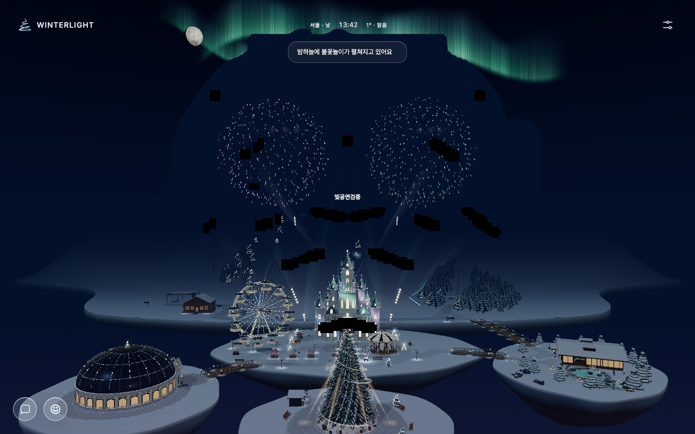
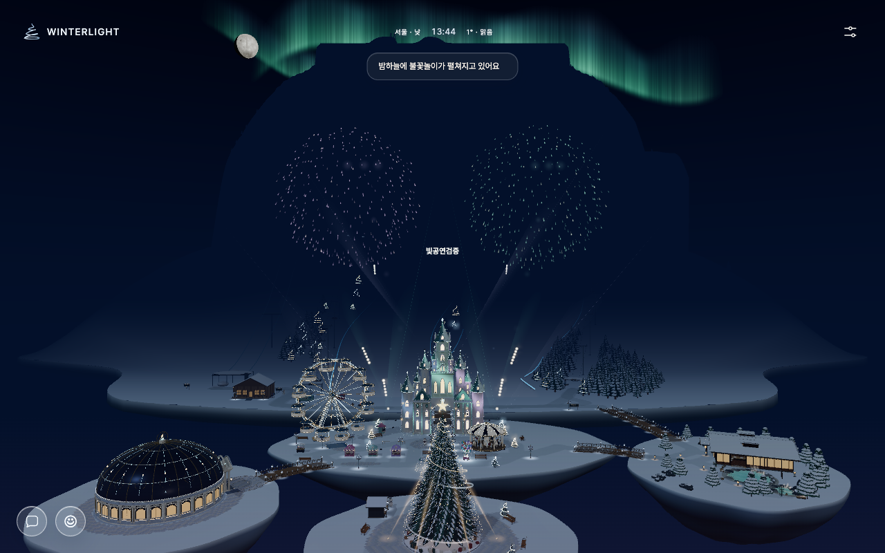
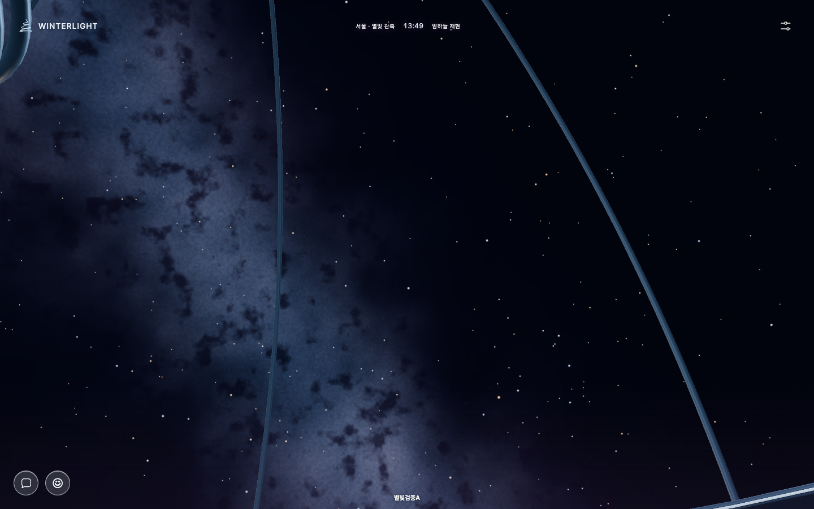
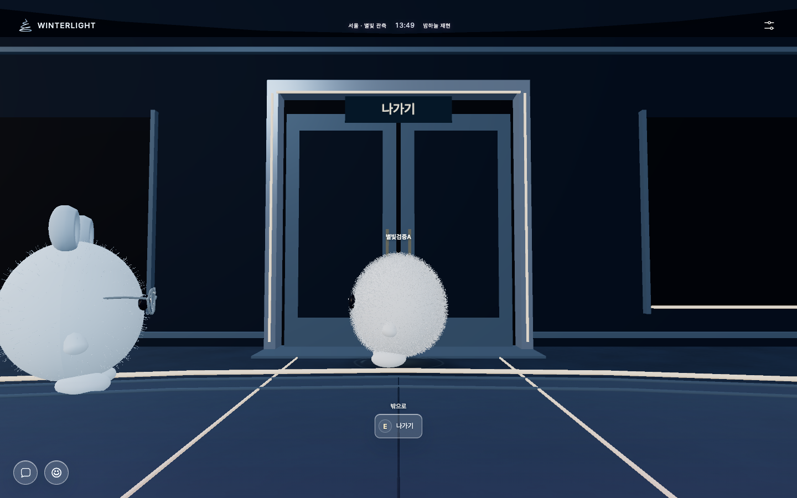
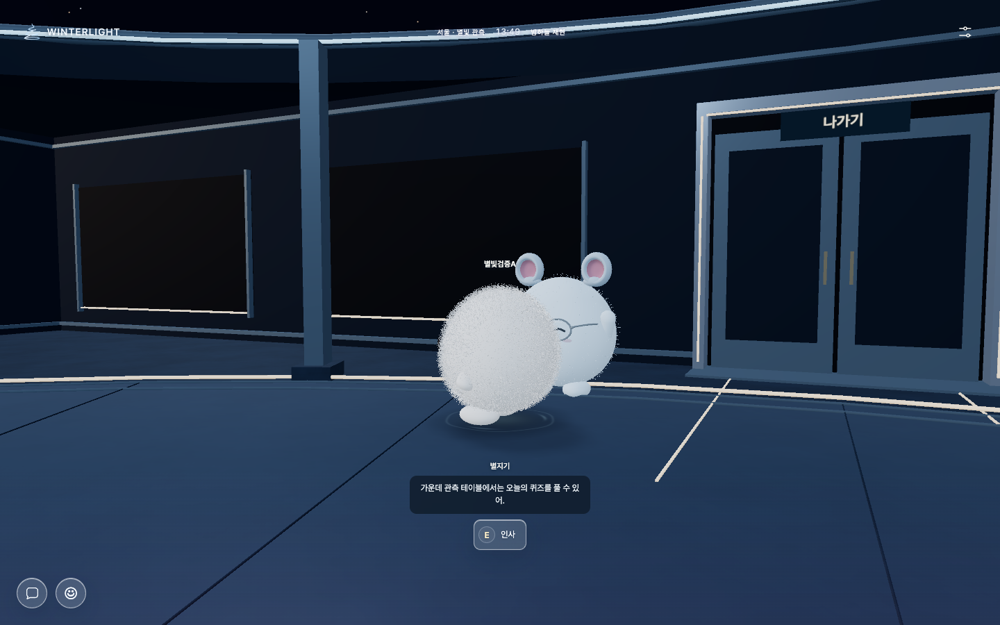
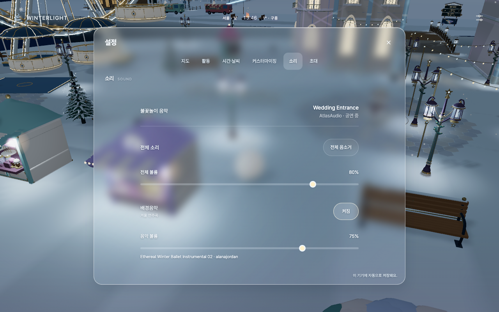
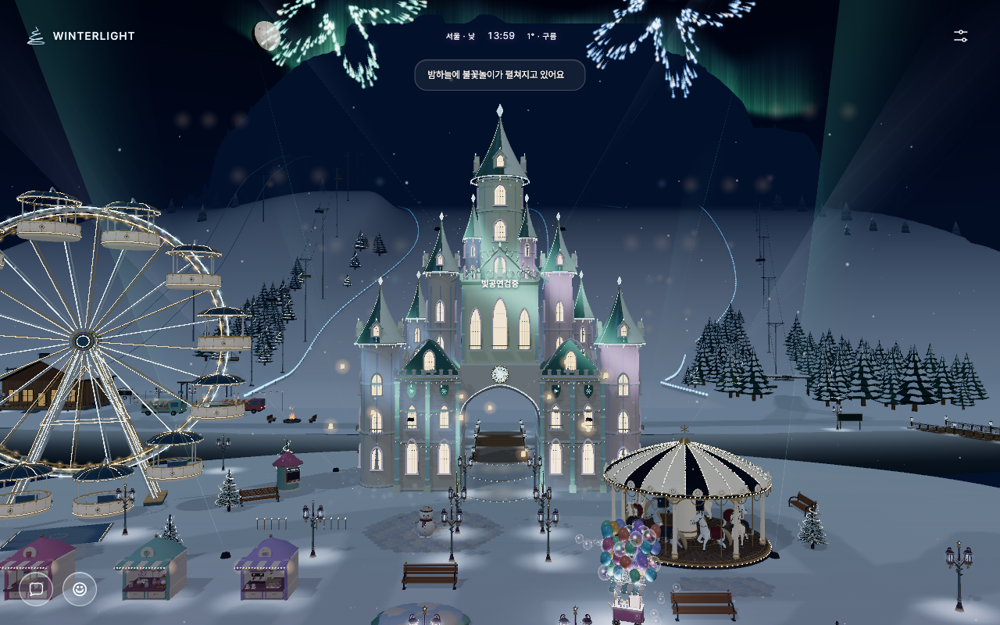
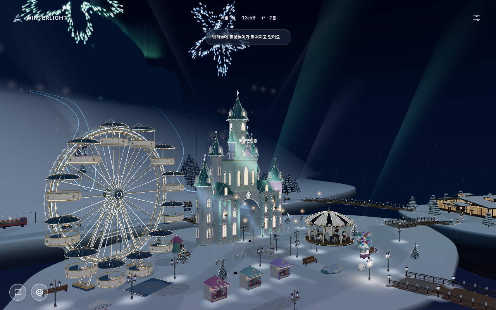
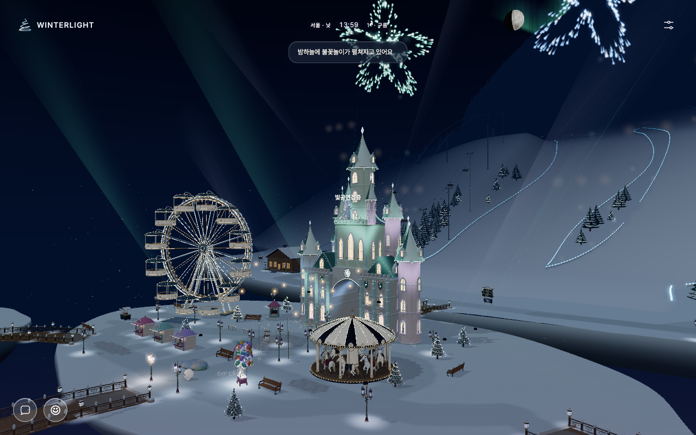
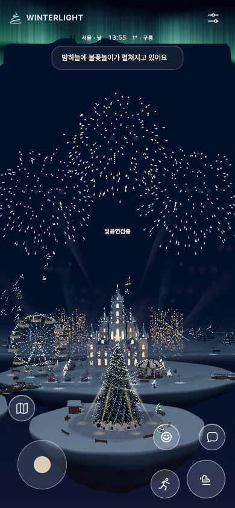

# v55 — 천문대 관측 동선과 공연 안정화

2026-11-20. v54 천문대 개선을 포함하여 같은 공식 주소에 배포한다. 기존 별·별자리 데이터, 중앙 퀴즈, 개인 기록, 소유자 인증, 실시간 서버와 시설 배치는 유지한다. 별 데이터·광학 구조의 설계와 이전 성능은 [v54](observatory-v54.md)에 기록했다.

## 확인한 원인과 수정

- **관측 시야**: 별이 없는 문제가 아니라 내부 불투명 셔터와 돔 드럼이 상부 하늘을 가렸다. 셔터를 높이 6m 아래의 외곽 링으로 정리했다. 돔 프레임·바닥·벽·충돌은 유지했다. 실제 별 위치와 6개 별자리, 천천히 변하는 은하수·성운, 드문 유성은 유지하고 밝은 항성의 광채만 절제해 추가했다.
- **불필요한 벤치**: 천문대의 공원형 벤치 2개와 충돌·탑승 항목을 제거했다. 필터는 기존 좌석 번호를 부여한 뒤 적용하여 다른 시설의 예약 번호가 바뀌지 않는다.
- **출구와 안내자**: 기존 서쪽 출구 위치에 손잡이·문틀·낮은 바닥 유도선·작은 ‘나가기’ 표지를 둔다. 같은 캐릭터 렌더러의 곰 귀·은색 안경 안내자는 출구 옆에 서서 눈 깜빡임·드문 손 인사와 가까운 사람을 향한 시선 반응을 한다. 대화는 짧은 안내 두 문장뿐이며 퀴즈는 중앙에만 남는다. 기본 동작은 공유 시간으로 재현하고 시선과 인사는 로컬 반응이므로 매 프레임 네트워크 전송이 없다.
- **레이저**: 24개 빔을 한 메시로 유지하면서 기존 4개 교차면을 카메라를 향하는 1개 면으로 줄였다. 지상·외벽·입구·창문·뒤편·일부 탑의 실제 조명 위치에서 서치라이트, 부채꼴 빔, 좁은 레이저를 구분한다. 워시와 프로젝션은 기존 실제 성 표면의 10개 영역을 사용한다. 16박 구간의 순차 점등과 정적 구간, 곡별 피날레를 공통 타임라인으로 재현한다. 현재 곡에서 좁은 레이저의 점멸은 최대 1.25Hz이며 모션·섬광 감소 시 꺼진다.
- **검은 띠 오류**: 실제 GPU 장면에서 재현하고 불꽃·연기·레이저를 각각 분리해 레이저에서 발생함을 확인했다. 빔 끝의 소수 지수 감쇠는 보간 오차로 음수 입력을 받을 수 있어 HDR에서 비정상 픽셀을 만든다. 감쇠 입력을 0~1로 제한하고 유효한 알파만 그린다. 같은 관람 위치의 중반 장면 비교 영역에서 검은 픽셀 13,824 → 0. 애니메이션이 진행 중인 서로 다른 프레임이며 정확히 같은 프레임의 화질 점수는 아니다.
- **음악이 바뀌지 않음**: 사용 중인 4191 로컬 서버는 예전 모듈을 메모리에 유지하여 제거된 `joyful-piano-orchestra` / timeline 52를 계속 내려보냈다. 최신 클라이언트는 제거한 곡을 재생하지 않으므로 BGM이 남았다. 기존 DB·로컬 인증 설정을 유지해 서버를 재시작하고 개발 명령에 Node watch를 적용했다. 운영 공연곡은 기존 확정대로 **Love / Wedding Entrance** 2곡이며 서버가 선택한다. 반복 금지나 임의 곡 교체는 추가하지 않았다.
- **현재 곡 안내**: 공연 중 설정 → 소리에서 제목과 작가를 볼 수 있다. 월드의 알림은 공연 상태만 표시하며 곡명은 노출하지 않는다. 종료·중지 시 곡명 줄이 사라진다.

## 실제 검증

- 실제 Chrome GPU에서 두 녹음의 재생 시간 진행과 디코딩된 신호를 확인했다. RMS 0.096 / 0.106, 공연 음원 1개, 배경음악 gain 0, 종료 시 BGM 복구. 설정 곡명·월드 알림 분리, 오류 0. [8개 검사](../qa/experience-v55/audio/report.json).
- 천문대 실제 PC/390×844 터치/가로 화면: 8방향 회전, 안내 문구·인사, E 출구, 중앙 퀴즈·서버 채점·개인 지식집, 두 방문자의 위치·시간·채팅·말풍선, 터치 카메라, 실내외 카메라 복구, 3회 방문·해제. [원본](../qa/experience-v55/observatory/report.json).
- 반복 방문 후 GPU geometry 596 / texture 21 / program 205로 세 번 모두 동일했다.
- 자동 검사의 안내 접근점 충돌 2건은 NPC 앞 빈 공간으로 분리해 수정했고 관련 검사 21개를 재실행하여 통과했다. 이후 전체 `npm test`도 **550/550 PASS**, 실패·건너뜀 0, 150.07초로 통과했다. [검증 요약](../qa/experience-v55/verification.json).
- 레이저 중앙선은 실제 성 geometry를 대상으로 전체 곡 길이에서 1,080회 raycast 검사했다. 결정적 방향·정적 구간·감소 설정·잔광 종료도 검증한다. 넓은 빔의 모든 부피에 대한 연속 충돌 증명을 뜻하지 않으며 정면·좌우 실제 화면을 함께 확인한다.
- **실물 Windows/Edge, Galaxy/Samsung Browser, iPhone Safari, 실제 가상 키보드·발열·장시간 내구 시험은 UNKNOWN**이다. 모바일 결과는 Mac Chrome 터치 화면 에뮬레이션이며 모든 기기의 동일 FPS를 보장하지 않는다.

## 변경 파일

`observatory-interior/layout/sky/guide.js`, `interior-layout.js`, `bench-layout.js`, `winter-experience.js`, `castle-lighting.js`, `castle-show-score.js`, `castle-show.js`, `fireworks-request.js`, `ui-system.css`, 개발 서버 실행 명령. 신규 production dependency와 DB migration은 없다.

## 화면 비교

| 이전 오류 | 수정 후 |
| --- | --- |
|  |  |

## 성능 실측

같은 Mac Chrome GPU, medium 품질과 같은 관람 위치에서 v54와 v55를 각각 측정했다. 모바일은 390×844 터치 화면 에뮬레이션이다.

| 천문대 | v54 평균 FPS / p95 | v55 평균 FPS / p95 | Draw Calls 전→후 | Triangles 전→후 |
| --- | --- | --- | --- | --- |
| PC 1440×900 | 60.00 / 16.7ms | 60.00 / 16.7ms | 39 → 49 | 442,437 → 474,021 |
| 모바일 화면 | 60.00 / 16.7ms | 60.00 / 16.8ms | 25 → 23 | 254,609 → 265,853 |

[전](../qa/experience-v55/performance/before/report.json) · [후](../qa/experience-v55/performance/after/report.json). Draw Calls/Triangles는 마지막 한 프레임의 값이며 그림자 갱신 위상에 따라 달라진다. FPS는 화면 갱신율에 제한되므로 개선 배수로 해석하지 않는다.

성 공연은 PC 1280×800 high에서 시작/중반/골든/피날레 각각 **46.84 / 47.73 / 47.50 / 47.38 FPS**, 모바일 화면 medium에서 **60.25 / 60.23 / 60.25 / 60.19 FPS**였다. 이 두 조건은 해상도와 품질이 달라 서로 성능 비교가 아니다. [PC 원본](../qa/experience-v55/show/desktop.json) · [모바일 화면 원본](../qa/experience-v55/show/mobile.json). 검은 픽셀은 각 시점의 검사 영역에서 모두 0, 브라우저/WebGL 오류도 0이었다. 두 환경의 6회 재시작 후 각각 자원이 일정했고 종료 뒤 입자와 빔이 남지 않았다. GPU 시간과 메모리 byte·실제 모바일 발열은 UNKNOWN이다.

`npm run check` 318개 JS 모듈, Worker·Vercel·realtime 빌드, 용량 검사도 PASS. core 26,728,698 bytes / 공연 음원 8,258,036 bytes / 코드 gzip 1,166,126 bytes로 기존 한도 이내다. 운영 배포 결과는 [DEPLOYMENT](DEPLOYMENT.md)에 기록한다.
