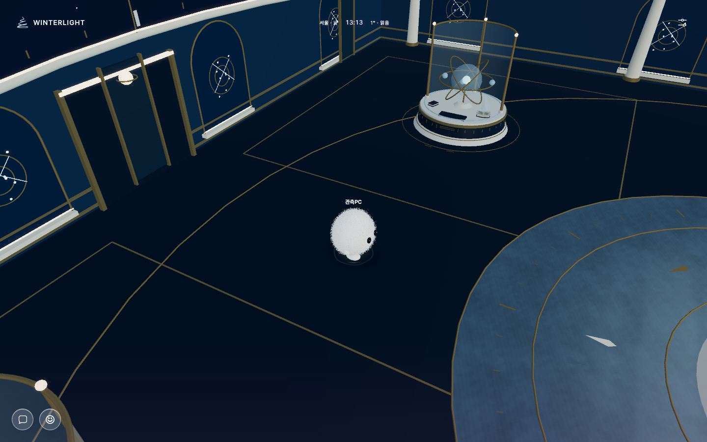
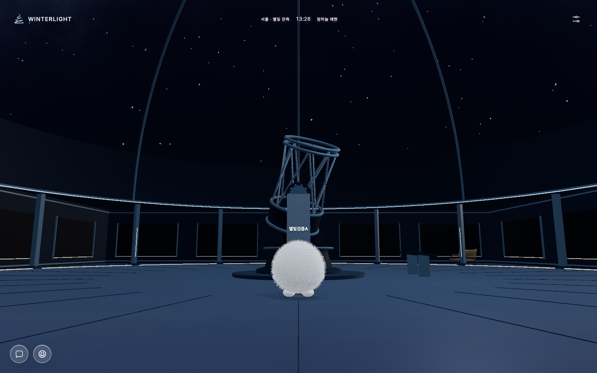
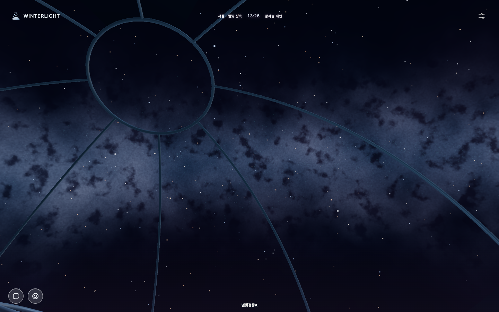
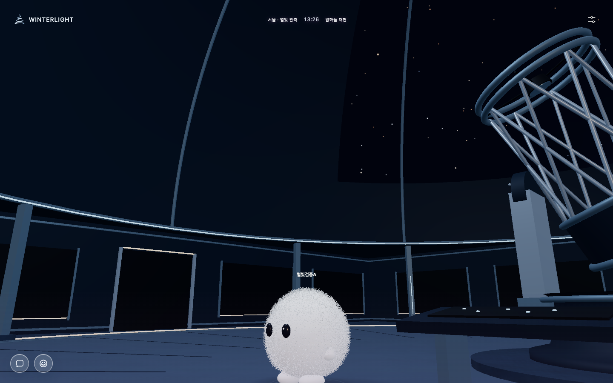
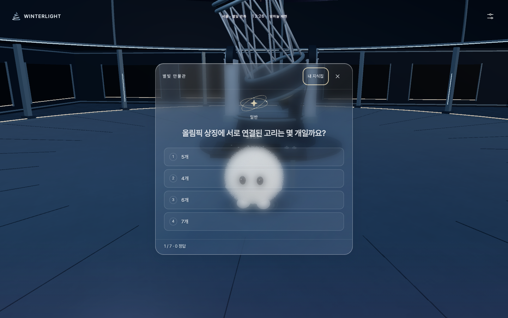
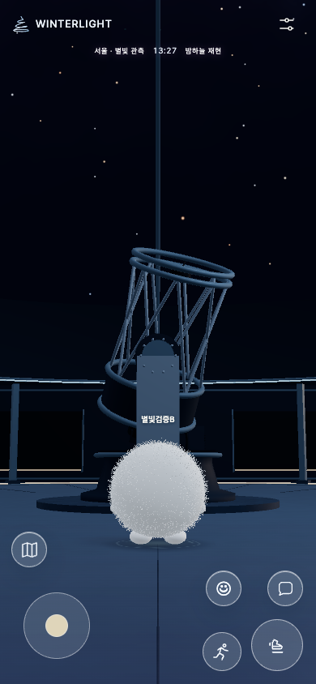
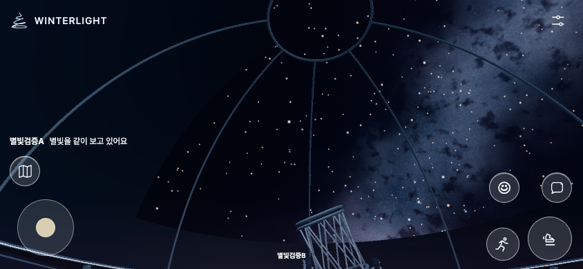

# v54 — 별빛 만물관 관측 홀

## 범위와 판단

기존 천문대 내부의 금색 공중 궤도, 네 개의 작은 전시대와 중복 퀴즈 유도가 공간의 중심과 하늘을 가렸다. 내부를 반지름 22m의 돔 관측 홀과 중앙 반사망원경으로 교체했다. 외부 천문대 건물, 출입구·지도 위치, 다른 시설, 음악, 서버 인증과 개인 기록 스키마는 유지한다. v53의 Love / Wedding Entrance 공연도 그대로다.

사용자가 제공한 네 장의 참고 사진에서 망원경과 넓게 열린 하늘, 원형 홀의 간접조명, 천장을 감싸는 우주 공간감을 참고했다. 사진을 텍스처로 복제하거나 원본 사진의 권리를 주장하지 않는다. 사진처럼 과장된 천체 확대 영상을 실제 관측 좌표와 혼동하지 않도록 별 데이터와 미술 표현을 분리했다.

## 공간과 장비

- `dist/observatory-interior.js`: 네이비 석재·실버 프레임·절제한 샴페인 마감. 곡면 돔의 프레임, 한쪽으로 물러난 셔터, 열린 중앙 관측부, 벽면의 낮은 간접조명. 기존 벤치와 출구는 유지한다.
- 중앙 장비: 오목한 주경, 부경과 지지대, 삼각 트러스, 고도축 베어링·포크와 방위각 구동부, 케이블·작은 상태등을 갖춘 반사망원경. 실제 촬영/추적 장비를 제어하는 기능은 아니다.
- `dist/observatory-layout.js`의 망원경·관측 테이블·기둥 위치를 모델, 충돌과 상호작용에서 함께 사용한다. 입구를 막던 서쪽 기둥을 비워 첫 시점의 갑작스러운 카메라 밀림을 제거했다.
- 실내 조명은 두 개, 새 실시간 그림자는 생성하지 않는다. 재질별 정적 메시를 합치고 개별 별 Mesh를 만들지 않는다. 새 production dependency 없음.

## 실제 천문 데이터와 연출의 구분

`observatory-catalog.js`는 HYG v4.1의 실제 HIP 별 5,041개와 Stellarium 서양식 별자리 여섯 개를 담는다. [출처·저자·라이선스·고정 데이터 해시](observatory-data-v54.md). 오리온, 카시오페이아, 북두칠성, 페가수스, 백조, 거문고 구성별은 HIP 번호로 연결한다. 별자리 선은 해당 방향을 잠시 바라볼 때만 얇게 나타나고 사라진다.

`observatory-astronomy.js`는 J2000 좌표를 IAU 1976 세차로 관측일의 평균 적도 좌표로 바꾼 뒤 GMST와 서울 위도·경도로 수평 좌표를 계산한다. 모든 방문자는 기존 서버 시계를 공유한다. 개인의 외부 날씨/조명 설정은 관측 시간을 바꾸지 않는다. 상단에 **서울 · 별빛 관측 / 밤하늘 재현**을 표시한다. 낮에도 감상할 수 있도록 낮의 밝기와 광공해는 재현하지 않는다.

UTC를 UT1/TT 대신 사용하는 교육용 근사다. 장동·고유운동·연주광행차·시차·대기 굴절·광공해·현장 지형·정밀 광학 응답을 포함하지 않는다. 정밀 관측 장비의 정확도를 주장하지 않는다. B−V 화면 색도 근사이며 실제 천체 사진의 RGB가 아니다.

`observatory-sky.js`의 은하수 구름·미해상 별빛·성운·유성은 **시각 연출**이다. 은하 평면 방향은 별도로 사용하되 구름을 실제 관측 사진이나 임의 입자를 실제 HIP 별로 표시하지 않는다. 유성은 공유 시간 슬롯과 결정적 시드를 사용하며 0.9초 이내에 사라진다. 개별 별·입자 위치를 네트워크로 전송하지 않는다. 대부분의 별은 안정적으로 빛나고 일부만 미세하게 반짝인다.

## 퀴즈와 카메라

중앙 테이블 앞 한 곳, 실제 2m 범위에서만 **퀴즈 풀기**가 나타난다. E·클릭·터치 진입과 기존 중앙 퀴즈 UI, 서버 채점, 해설·출처, 개인 지식집 저장을 유지한다. 입장 시 자동 팝업과 전시물별 퀴즈는 제거했다. 지식집은 어디서든 읽을 수 있지만 재도전은 같은 중앙 지점에서 시작한다. 한 방문자의 퀴즈가 다른 사람의 이동이나 관측을 잠그지 않는다.

천문대 기본 시점은 망원경과 캐릭터가 함께 보이는 거리다. 천문대에서만 약 81도 위까지 볼 수 있다. 외부·내부 카메라 설정을 분리해 퇴장 시 외부 시점, 재입장 시 사용자가 마지막으로 선택한 내부 시점을 복구한다. 새로운 시야 버튼은 없다.

## 최적화와 측정

실제 별은 1개 Points, 미해상 별빛은 1개 Points, 성운은 단일 구면 shader다. 실제 별 low/medium/high는 1,800/3,200/5,041개, 연출 별빛은 5,000/10,000/18,000개다. 시간 행렬은 최대 30Hz로 갱신한다. 기존 실내 lazy 생성·해제 경로를 사용하고 보이지 않을 때 갱신하지 않는다.

Mac Chrome, PC 1440×900 / 터치 화면 390×844, 같은 medium 품질·카메라·300 프레임 조건. 변경 전은 `e547724`의 원본 모듈을 응답 교체하여 측정했다. 평균 FPS는 모두 약 60으로 디스플레이 갱신율 상한에 도달했다. 수치와 한계는 [PERFORMANCE](PERFORMANCE.md), 원본은 [변경 전](../qa/observatory-v54/controlled-before/report.json) / [변경 후](../qa/observatory-v54/controlled-after/report.json)를 따른다. Draw Call/Triangles는 마지막 한 프레임의 표본이며 그림자 갱신 주기의 영향을 받으므로 평균 감소율이나 모든 기기의 성능 보장으로 해석하지 않는다.

## 실제 검증

- 자동 검사 548/548 PASS, 실패·건너뜀 0. 별 카탈로그·좌표 변환·유성, 건축·충돌·동선, 한 곳 퀴즈, 기존 시설·입력·권한·저장 회귀 포함.
- 실제 Mac Chrome GPU에서 PC 입구·홀·천정·별자리·은하수·망원경·퀴즈 접근/열림, 모바일 세로·가로 화면을 촬영했다. CDP 실제 터치 이벤트로 카메라 회전 확인.
- 두 게스트의 위치·같은 관측 시각·유성 슬롯·채팅·자기 말풍선 확인. 서버 채점과 개인 해설/출처 기록 확인.
- 세 번 퇴장·자원 해제·재입장 후 해제된 상태의 geometry/texture는 594/21로 일정했고 program은 205→207→207로 두 번째 방문 후 일정했다. 이 검사는 수 시간 누수 시험이나 GPU byte 측정을 대신하지 않는다.
- 브라우저·shader 오류 0. [체험 검사 원본](../qa/observatory-v54/experience/report.json). [배포·운영 재검증](DEPLOYMENT.md).
- **UNKNOWN**: 실제 Windows Chrome/Edge, iPhone Safari, Galaxy/Samsung Browser, 모바일 발열·장시간 플레이·GPU 메모리 byte·현장 하늘의 정밀 각거리 오차. 모바일 결과는 Mac에서 실행한 터치 화면 에뮬레이션이다.

## 실제 렌더링 비교

변경 전 입구:

변경 후 입구:

은하수 방향:

중앙 망원경:

중앙 퀴즈:

모바일 세로 / 가로:

