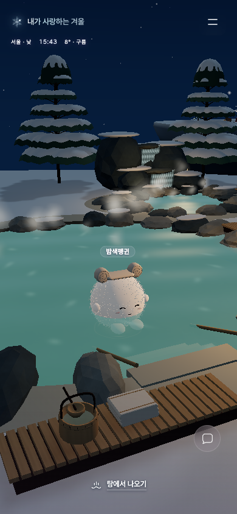
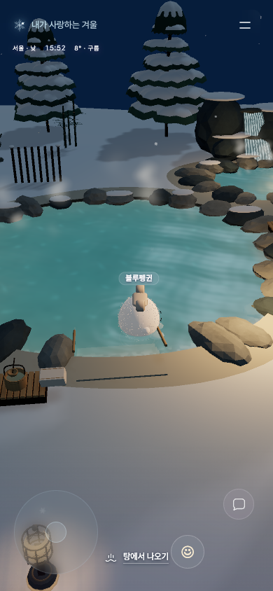
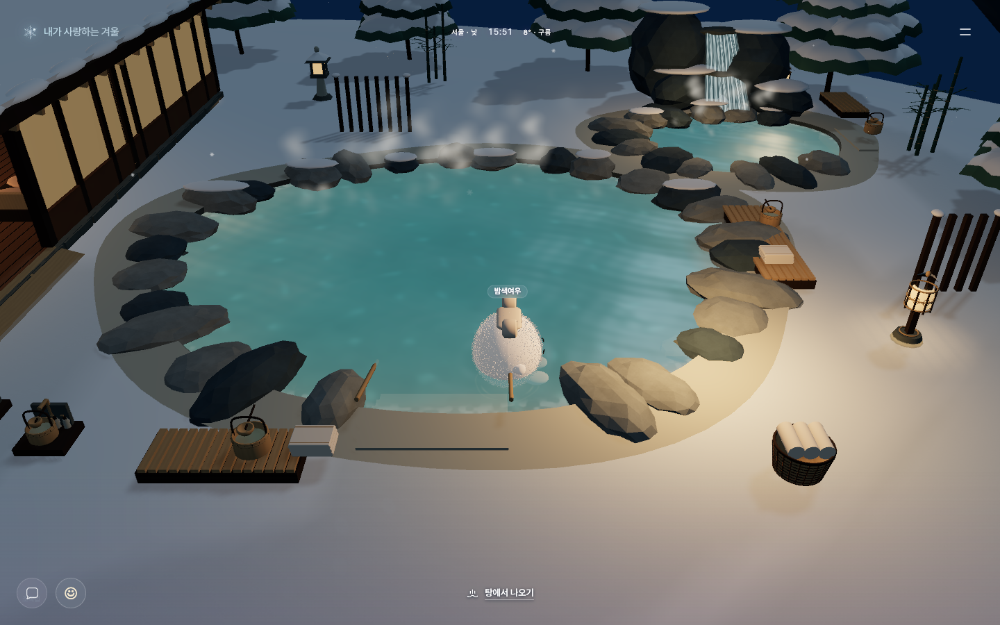

# v34 — 노천탕 진입·물 흐름 수정

기준 코드: `fb5f0827` / 문서 기준: `a7a5ec1`. 2026-11-18.

## 재현과 원인

- **재현됨 — 모바일 수중 조작 불가:** `game-input.js`에서 `bath`를 고정 탑승 `ride`로 변환했다. 이 모드에서는 조이스틱이 CSS로 숨겨지고 입력도 차단된다. 실제 모바일 에뮬레이션에서 탕에 들어간 다음 조이스틱의 표시 영역이 없는 상태를 확인했다.
- **확인됨 — 입구·판정 불일치:** 탕 둘레 12개씩의 임의 지점에서 이용 안내가 뜨고, 어느 쪽에서 눌러도 고정된 물속 좌표로 즉시 이동했다. 큰 탕 계단에 휴식 데크가 걸쳐 있고 작은 탕에는 입구를 비운 돌 배치가 없었다. 물 전체를 덮은 클릭 메시도 큰 탕에만 있었다.
- **재현되지 않음 — PC 정면 입장 전체 실패:** 수정 전 실제 정면 접근 후 버튼으로 입장·퇴장은 성공했다. 모든 사용자의 모든 입장이 실패한다고 단정하지 않는다. 수정 전 검사에 강제 `experience.show()`를 사용하지 않았다.
- **확인됨 — 폭포 위쪽 흐름:** 기존 PlaneGeometry는 UV.y가 위로 증가한다. `sin(vUv.y * 27. - time * 3.)`의 일정한 위상은 시간이 지날수록 위쪽으로 이동한다. 동일 부호가 세로 물줄기 무늬에도 사용됐다.
- **확인됨 — 수면:** 두 개의 얕은 파동과 일정한 틴트/투명도만 사용해 물 깊이와 캐릭터 움직임을 반영하지 않았다.

## 입구와 상태 처리

`onsen-layout.js`에서 기존 두 탕의 입구, 통로 폭, 잠기는 계단의 끝과 높이를 정의한다. 모델의 빈 돌 틈·계단·클릭 판정, 자동 접근 안내, 컨트롤러, 서버 위치 검사가 이 데이터를 함께 사용한다. 새 시설이나 섬은 추가하지 않는다.

- 큰 탕 입구 `(92, -20.9)`, 수중 도착 `(92, -17.6)`.
- 작은 탕 입구 `(78, -5)`, 수중 도착 `(81.2, -5)`.
- 입구 반경 2.9m에서 ‘온천 이용하기’가 표시된다. 서로 다른 좌우 접근 위치도 허용한다.
- `Entering → Active → Exiting → Idle`. 계단을 따라 일정한 속도로 이동하고 점진적으로 몸 높이를 낮춘다.
- 서버는 기존 탕 내부 판정과 추가된 **계단 구간·너비·기대 높이**만 허용한다. 임의 위치와 높이를 허용하지 않는다.
- 종료 시 입구로 되돌아오고 이동·점프·일반 카메라를 복원한다. 완료 안내를 자동으로 다시 띄우지 않으며, 입구 영역을 떠났다가 돌아오면 다시 이용할 수 있다.
- 노천탕에만 `wade` 터치 모드를 적용한다. 조이스틱·카메라 회전을 유지하고 점프·달리기는 숨긴다. 실내 족욕과 기존 탑승 모드는 유지한다.
- 입장 시 현재 카메라 방향을 유지한다. 가까운 돌에 의해 시점이 급격하게 줄어드는 것을 완화하도록 높은 관람 각도와 실제 캐릭터 기준 가림 검사를 사용한다. 퇴장 시 원래 카메라 설정을 복원한다.

## 물과 폭포

- `onsen-waterfall.js`: 두 낙차의 상단·하단 앵커를 명시하고 UV.y를 **위에서 아래로** 정의한다. 일정 위상이 아래로 전파되는 UV 흐름, 가속 낙하 입자, 낙수 지점의 짧은 포물선 물보라를 구분한다.
- `onsen-water.js`: 여러 방향의 저진폭 파동 법선, 깊이별 흡수색, 시선각 Fresnel, 석등 방향의 황금빛 반사, 굴절된 바닥 무늬·caustics, 국소적인 가장자리/낙수 거품을 사용한다.
- 반사와 굴절은 저비용 근사다. 주변 장면의 실시간 반사 렌더나 전체 유체 시뮬레이션이 아니다.
- `onsen-response.js`: 입장·이동·퇴장에 반응하는 최대 8개 파동과 32개 물방울 풀. 정지하면 입력 파동이 감쇠하며 기본 수면만 계속 움직인다. 낮은 품질에서는 파동 4개와 적은 입자를 사용한다.
- 기존 수증기와 물 환경음, 볼륨 설정을 유지한다. 추가 PointLight나 실시간 반사 렌더러는 없다. 보이지 않는 온천 구역의 업데이트를 생략하고 모션 감소 설정을 존중한다.

## 검증

수정 전 자료: `qa/browser-v34/before`. 실제 입퇴장·물결·모바일 검사는 `scripts/verify-onsen-v34.mjs`. 순수 상태·충돌·서버 높이·물 방향·리소스 수와 터치 입력은 회귀 검사에 포함한다.

실행 결과와 측정한 성능을 아래에 기록한다. 실제 휴대폰·장시간 발열은 미검증이다.

## 측정된 성능

Apple M2 / Chrome, 장면별 8초. PC 1280×800·고품질, 모바일 에뮬레이션 390×844 DPR 3·중간 품질. 수정 전 모듈은 `a7a5ec1`에서 읽어 동일 서버로 제공했다. 카메라 구도 자체가 바뀌었으므로 draw call 차이를 일반적인 최적화 개선율로 해석하지 않는다. 짧은 측정이며 실물 휴대폰의 프레임 보장은 아니다.

| 환경 | 장면 | 이전 FPS | 이후 FPS | 이후 p95 ms | 이전 게임 CPU ms | 이후 게임 CPU ms |
|---|---|---:|---:|---:|---:|---:|
| desktop | bath | 60.0 | 60.0 | 16.7 | 3.02 | 2.98 |
| desktop | spa-garden | 60.0 | 60.0 | 16.7 | 3.20 | 3.38 |
| mobile | bath | 60.0 | 60.0 | 16.7 | 2.88 | 3.25 |
| mobile | spa-garden | 60.0 | 60.0 | 16.8 | 2.33 | 2.55 |

GPU 타이머·물리 GPU 메모리·실제 휴대폰 발열은 측정하지 않았다. 원본: `qa/browser-v34/performance-{before,after}-{desktop,mobile}.json`.

## 실행 결과

- 전체 자동 검사 **316/316 통과**. 새 입구·서버 검증·폭포 하향 축·파동 풀·모바일 wade 및 카메라 복귀 속도 검사를 포함한다.
- PC·모바일에서 두 탕 입구의 서로 다른 접근 위치로 직접 걸어간 후 버튼으로 입장·이동·정지·퇴장. 자동 안내를 강제로 노출하지 않는다.
- 모바일에서 조이스틱 이동과 다른 손가락의 카메라 회전 동시 사용. 터치 해제 후 이동 입력 정리.
- 실제 입장 도중 계단 높이와 수중 이동 좌표를 `/api/presence`에 보내 서버의 HTTP 200 확인.
- 정지 후 3.9초가 지나면 사용자 파동 수 0. 큰 탕·작은 탕 이용 후 전용 종료 UI 숨김.
- 기존 료칸 입장·퇴장 유지. 브라우저 런타임·WebGL/셰이더 오류 0.
- 폭포 정면·측면·상단 비교 화면: `qa/browser-v34/after/waterfall-*`.
- 생산용 빌드와 파일 크기 예산 검사 통과. 새 production dependency 없음.
- 마지막 카메라 전환 속도 조정 후 관련 검사 **11/11 재통과**. 온천에서 가림 해제 후 복귀는 최대 4m/s, 입퇴장 줌 변화는 최대 3m/s로 제한한다.
- 압축된 `web-dist`를 실제 브라우저로 실행하여 입장·이동·퇴장 재검증. 오류 0 (`qa/browser-v34/production-smoke.json`).
- 실제 렌더링에서 정면·측면·상단을 각 3초씩 기록한 [폭포 움직임 영상](../qa/browser-v34/waterfall-motion.webm). 영상은 실제 프레임이며 별도 방향 표시를 덧씌우지 않았다.

## 변경 파일

- `onsen-layout.js`, `spa-resort.js`: 입구·클릭 영역·계단·돌·데크·폭포 모델.
- `spa-experience.js`, `winter-experience.js`, `resort-layout.js`: 입퇴장·현재 위치 판정·서버의 유효 위치.
- `game-input.js`, `metaverse.css`: 노천탕 모바일 조작 모드.
- `park.js`, `camera-clearance.js`: 시점 보존·복원·가림 후 복귀 속도.
- `onsen-water.js`, `onsen-waterfall.js`, `onsen-response.js`: 수면·낙수·이벤트 효과.
- `index.html`, `sw.js`: v34 캐시와 신규 모듈.
- 회귀 검사, 브라우저·성능·빌드 기록 및 README/변경 이력.
