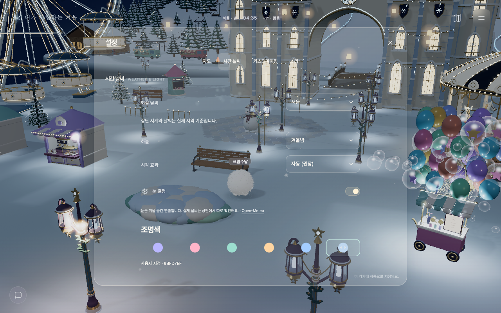
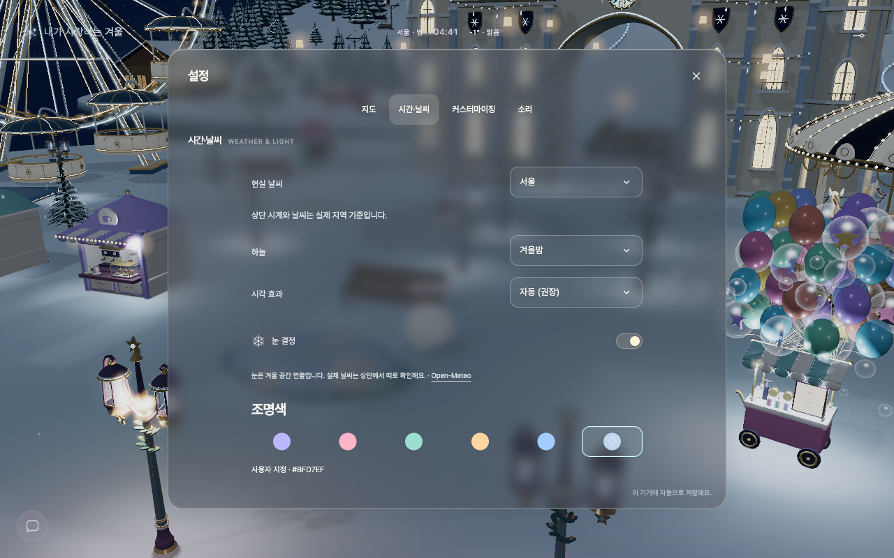
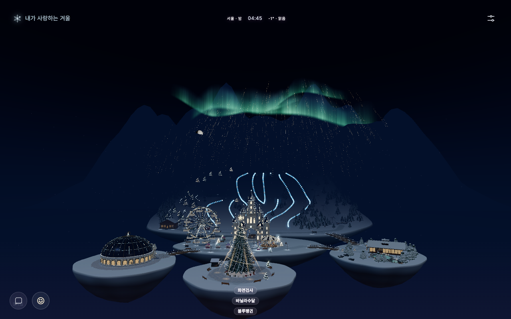
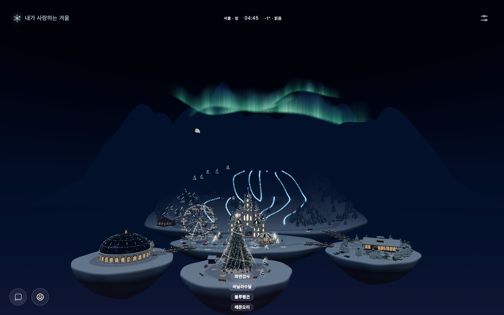

# v42 · Windows 모션 정지와 UI 일관성 — 2026-11-19

월드 배치·시설·저장 스키마·서버 권한·공유 월드 ID는 변경하지 않았다.

## 확인된 원인과 변경

`park.js`가 OS `prefers-reduced-motion`과 앱의 `body.still`을 OR로 검사하여, 사용자가 설정에서 움직임 줄이기를 꺼도 OS 값이 다시 전체 월드의 애니메이션을 중단했다. `companion.js`는 발 보행까지 `!still`에 묶었고, `winter-sky.js`는 눈 위치 계산의 시간을 0으로 고정했다. Windows에만 있는 코드가 아니라 동일한 OS 접근성 설정에서 재현되는 결함이다. 사용자의 실제 Windows 설정이나 GPU가 이 조건이었다고 확정하지 않는다.

- 앱은 저장한 선택이 있으면 그 값을 사용하고, 없으면 OS 설정을 따른다. OS 변경은 명시적 선택이 없을 때만 반영한다. 월드 렌더러는 이 해석된 상태 하나를 사용한다.
- 움직임 감소 중에도 입력을 알리는 발 보행과 눈의 수직 낙하는 유지한다. 몸통 흔들림·눈 회전/바람·장식 효과는 줄인다. 눈 결정 설정을 끄면 기존대로 눈 자체를 숨긴다.
- UI의 OS 접근성 전환/스크롤 감소는 유지한다. 게임의 전체 모션 선택을 OS 자체 설정 변경으로 처리하지 않는다.

## 지도·설정

화면 위 햄버거를 클릭 한 번에 설정을 여는 버튼으로 교체했다. Esc 설정, M 지도, 설정 내부 지도 탭을 유지한다. 지도 바로가기는 터치 화면 또는 폭 650px 이하의 모바일 배치에서만 하단 중앙에 표시한다. 설정·트리 도크·채팅 입력·탑승 종료 UI와 함께 노출되어 조작을 가리지 않도록 숨김 조건을 둔다. 소유자만 보이는 관리 버튼은 **설정 → 초대 → 관리**로 이동했고 열릴 때 설정창을 닫는다. 서버 인증은 변경하지 않았다.

## 색상

기존 high/low에서 설정 blur가 10px/0px, 모바일에서는 5~6px로 달랐다. blur 미지원 시 다른 불투명 회색 배경으로 바꾸는 fallback도 있었다. 이제 공통 색·8px blur·같은 투명 베이스를 사용하며 지원 여부가 팔레트를 바꾸지 않는다. 제목도 번들 서체를 사용한다. OS의 투명도 감소 요청은 계속 존중한다. 화면 밝기·색 프로필·HDR·True Tone·제조사 디스플레이 모드까지 동일 픽셀로 강제하지 않으며 물리 기기 비교는 UNKNOWN이다.

## 불꽃

Willow 10→5.6초, Glitter 7.4→4.2초, 기타 6.3→3.8초로 최대 입자 수명을 줄였다. 개별 입자에 작은 수명 차이를 주고, 꼬리 지연은 최대 0.935→0.55초로 줄였다. 꼬리는 자기 발광점과 함께 소멸한다. 5가지 3D 패턴·중력·서버 공연 시각/시드·74초 공연·효과음·수동 시작 권한은 유지한다. 파티클 버퍼 74,880개 용량과 하나의 Points draw 구조를 재사용하며 새 광원은 추가하지 않았다.

## 검증

- `npm test`: **382/382 PASS**, 34.63초. `npm run build`, `npm run build:vercel`, `npm run test:budget`, `git diff --check` PASS. 별도 lint/typecheck 명령 없음.
- Mac Chrome에서 OS 모션 감소를 에뮬레이션. 수정 전 걷기 중 발 z 범위 **0**, 이후 **0.39746 world units**. 전체 모션 선택 후 오로라 shader time은 이전 **0**, 이후 **2.7998초**로 진행.
- 이후 눈 좌표는 카메라 기준 높이를 제외한 값으로 **16.44146→15.02433**으로 하강. 이전 raw 눈 좌표는 카메라 이동을 포함하므로 이 숫자와 직접 비교하지 않는다. 고정 target에서 눈 낙하/회전 감소 자동 검사도 통과.
- high/low의 실제 계산된 패널 배경·글자색·8px blur 동일. 1280×800에서 모바일 지도 숨김.
- 320×568, 390×844, 844×390 터치 화면에서 지도·조이스틱·달리기·점프·채팅 사각형 겹침 없음, 지도 터치 정상. 소유자 관리 진입/설정 중복 모달 없음, 게스트 관리 숨김, Esc 열기/닫기와 M 지도 PASS. 페이지·WebGL 오류 0.
- 같은 seed=42/카메라/1280×800/공연 45·49·52초로 이전·이후 불꽃 비교. 52초에 이전 Willow의 긴 수직 꼬리가 남아 있고 이후에는 소멸함을 확인. 이 캡처의 이전 버전은 불꽃 두 모듈만 `4af6a06`으로 대체했으며 월드는 동일하다.
- 단위 검사의 최초 보수적 속도 상한 검사 1개 실패는 실제 생성 속도·개별 수명을 반영하지 못한 QA 계산이었다. 실제 GPU attribute의 궤적으로 수정했고 최종 전체 검사 통과. 테스트를 위해 불꽃 수명을 다시 바꾸지는 않았다.

근거: [모션 이전](../qa/browser-v42/before/report.json), [이후](../qa/browser-v42/after/report.json), [화면·메뉴 검사](../qa/browser-v42/layout/report.json).

로컬 재현: 격리 guest 4187/owner fixture 4188을 준비하고 `node scripts/verify-motion-ui.mjs`, `node scripts/verify-navigation-fireworks.mjs`. 테스트 초대는 로컬에서 메모리에만 생성한다. 실제 Windows·갤럭시·iPhone, 새 FPS/GPU 시간/장시간 발열은 **UNKNOWN**. 이번 수정으로 모든 기기의 성능이 같다고 주장하지 않는다. 운영 배포는 [DEPLOYMENT](DEPLOYMENT.md)에 별도 기록한다.
