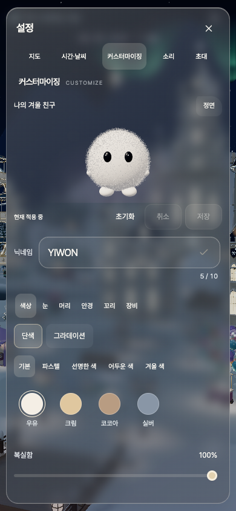
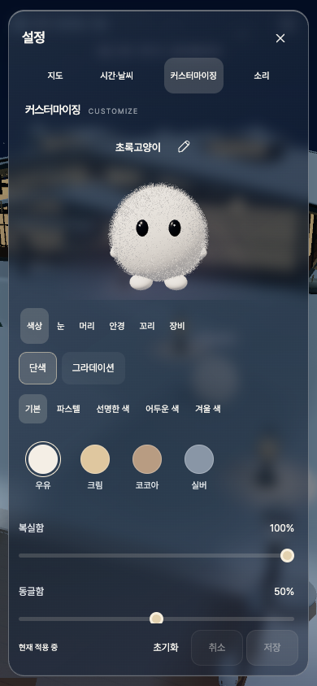
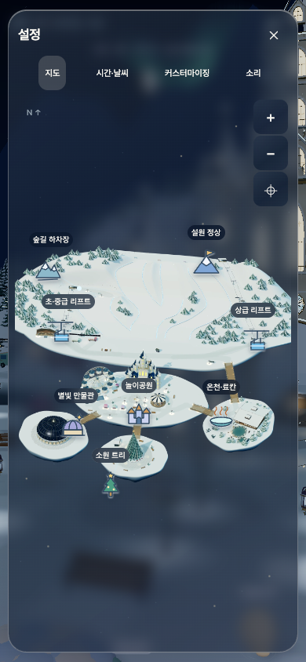
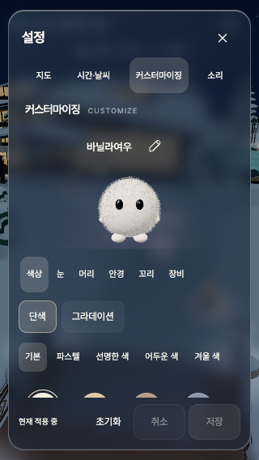

# v43 공개 월드 · 입력과 모바일 UX 안정화

**배포 보류:** 사용자 요청으로 기존 이름/로고를 유지한 수정본만 `codex/public-world-v43-release`에 보관한다. 운영 사이트 검증은 NOT RUN. 최신 로컬 전체 검사 385/385, 두 build와 용량 검사 PASS.

2026-11-19. 비교 기준 `46dc322`. 이번 요청의 **공개 입장**이 이전 v39 초대 전용 정책을 대체한다. 월드 좌표·지형·시설·캐릭터 모델·VFX 디자인은 변경하지 않았다.

## 확인한 원인과 한계

- **FACT:** 이전 새 브라우저에서 초대 없이 접속하면 `invite-gate`가 유지된다. 월드가 렌더링되어도 WASD를 막으며 실제 좌표 변화가 없었다. Windows UA를 지정한 Mac Chrome 재현이며 물리 Windows 원인의 전부라고 단정하지 않는다.
- **FACT:** UI 진입 시 로컬 속도를 지워도 공개된 `labPlayerState.speed`가 남을 수 있었다. 이제 입력 초기화와 동시에 전송 속도를 0으로 만든다.
- **FACT:** 텍스트 포커스, 주요 dialog, 메뉴의 차단 조건이 서로 달랐다. 공통 입력 허용 판정과 닫힘·포커스 변경 초기화를 사용한다.
- **FACT:** 모바일 커마의 닉네임은 선택 패널에 있었고 저장 영역이 미리보기 안에 섞였다. 닉네임/미리보기, 선택 목록, 고정 저장 영역을 분리했다.
- **UNKNOWN:** 실제 Windows Chrome/Edge의 드라이버·터치 노트북·키보드 환경, iPhone Safari, Galaxy/Android Chrome의 물리 기기 성능. 에뮬레이션을 실물 결과로 간주하지 않는다.

## 공개 입장과 관리자

공개 주소는 https://moru-winter-park.vercel.app 이다. 익명 서버 세션을 자동 발급하고 기본 닉네임으로 같은 `winter-plaza`에 입장한다. 색상·닉네임 사전 선택을 강제하지 않는다. 이전 초대 URL도 토큰을 저장하거나 재전송하지 않고 같은 공개 광장으로 연결한다.

관리자 진입은 https://moru-winter-park.vercel.app/admin 이며 기존 Sites `/admin`으로 연결된다. 해당 경로에서 소유자 로그인 후 같은 월드의 햄버거 메뉴 → 관리에 접근한다. 일반 공개 페이지에는 관리자 로그인 안내가 없다. 경로 자체에는 권한이 없다.

`server/invitations.js:isOwner`가 Sites가 검증한 사용자 ID를 DB `space_owner`와 비교한다. 최초 소유자 등록은 서버의 기존 OWNER_EMAIL과 검증된 이메일이 일치해야 한다. `server/vercel-proxy.js`는 클라이언트가 보내는 Sites 인증 헤더를 전달하지 않는다. 관리자 API는 매번 이 권한을 검사한다. 실제 소유자 로그인은 사용자가 직접 수행하며 QA owner fixture를 실제 소유자 인증으로 표현하지 않는다.

기존 정원 12명(게스트 최대 11명 + 관리자 자리)을 유지한다. 초과 시 다른 방으로 분산하지 않고 정원 메시지를 표시한다. 이 한도를 새 실물 기기 부하 시험으로 재산정하지 않았다. 관리자 퇴장 후 두 게스트의 이동·채팅을 확인했다.

기존 소원·장식·외형과 DB는 유지한다. 유효한 기존 세션은 공개 입장 시 동일한 ID와 외형을 보존한다. 과거 초대 API는 호환 목적으로 owner 전용으로 남아 있지만 UI에서 생성·폐기 기능은 제거했다. 새 공개 세션은 초대 만료·취소에 의존하지 않는다. 차단·강퇴·rate limit·CSRF 검사는 유지한다. 계정 없는 세션 차단은 브라우저 저장소를 삭제한 동일 인물까지 식별하는 영구 신원 차단은 아니다.

## 입력·카메라

`dist/game-input.js`의 `worldInputBlocked`가 텍스트 포커스·지도/설정/커마·채팅·메뉴·백그라운드를 공통 판정한다. 물리 KeyW/A/S/D와 방향키는 OS/터치 여부로 비활성화하지 않는다. UI 열기·닫기, blur, visibility, 터치 취소에 입력과 전송 속도를 초기화한다. 한글 IME를 사용하더라도 텍스트 편집 밖에서는 물리 키로 이동한다.

기본은 드래그 카메라다. 햄버거 → 마우스 자유시점에서만 Pointer Lock을 요청하고 Esc/메뉴/포커스 이탈로 해제한다. 닫은 메뉴가 자동으로 포인터를 다시 잠그지 않는다. Pointer Lock 미지원 시 드래그를 계속 사용할 수 있다. 키보드 이동은 Pointer Lock과 독립이다.

조이스틱 기존 360도 정규화·반경 밖 입력·pointer ID 소유권을 보존한다. 점프 60px, 달리기 44px과 별도 간격, 지도/채팅/상호작용 안전 영역을 적용한다. 주요 패널에서는 게임 조작 UI를 숨기고 입력을 차단한다.

## 화면 구성

- 햄버거: 설정·커스터마이징·선택적 자유시점, 실제 owner만 관리.
- 모바일 지도: 별도 하단 버튼, 짧은 이름 상시 표시, 구역 아이콘 한 번 탭해 이동. 확인창 없음. 실제 안전 도착 좌표는 기존 데이터 사용.
- 커마: 닉네임 작은 표시/명시적 편집 → 실제 캐릭터 미리보기 → 옵션 스크롤 → 고정 저장·취소. ‘나의 겨울친구’, ‘정면’ 제거, 드래그 회전 유지.
- 채팅: 최근 모바일 2개 표시 후 페이드, 펼치면 기록과 입력. 개인 숨김은 메시지·말풍선에만 적용하며 상대 캐릭터는 유지한다. 신고는 기존 서버 API와 연동한다.
- 음악: 44px 터치 영역 안에 17px 아이콘·11px 보조 글씨. 기존 Audio 두 개의 교차 재생 구조 유지, 패널 전환 시 새 객체 생성 없음.
- 마이크 버튼·음성 초기화·성능 진단 UI 제거. 과거 캐시와의 호환을 위해 voice module은 무동작 함수만 남겼다. 내부 `labPerformance` 측정은 유지.
- 같은 네이비/아이스 유리 토큰·8px blur와 번들 글꼴을 사용한다. 화면 프로필에 따른 물리적인 색감 동일성은 보장하지 않는다.

## 동기화와 성능

기존 서버 시각·속도 snapshot, 순서 검사, 제한된 예측, 거리 기반 원격 보행을 보존한다. 정지 상태의 동일한 pose UPDATE는 8초 heartbeat까지 생략한다. 계속 움직이거나 행동이 달라지는 경우 기존 500ms 쓰기 제한과 전송 주기를 유지한다. 이 변경은 네트워크 요청 자체를 없애거나 이동 정보를 모두 메모리 서버로 이전한 것은 아니다. 이동 중에는 아직 D1 쓰기를 사용하며 향후 동시 접속 증가의 병목 후보다. 채팅의 10분 보관 정리는 유지한다.

Mac Apple M2, Chrome 157, 1280×800, 실제 renderer DPR 1, medium 고정, 장면당 12초, 동일 계측/로컬 DB. 이전 전체 프런트 `46dc322`, 이후 작업 소스. production minify 전 자산이며 GPU timer를 켰다.

| 장면 | FPS 전→후 | p95 ms 전→후 | game CPU ms 전→후 | GPU ms 전→후 | draw calls 전→후 |
|---|---|---|---|---|---|
| 광장 | 60.00→60.00 | 16.8→16.7 | 6.00→5.05 | 11.52→11.25 | 823.91→823.80 |
| 트리 | 60.00→60.00 | 16.8→16.8 | 3.41→3.35 | 8.93→10.51 | 383.76→383.39 |

트리 GPU 시간은 증가한 표본이다. 단회 짧은 표본과 shader/OS 부하 차이를 보편적인 성능 개선으로 주장하지 않는다. 초기 준비 3259→2832ms도 캐시·기기 영향을 포함한다. 두 장면의 Geometry/texture/program 수는 각각 구간 전후 동일했다. GPU 총 메모리·서버 CPU·실물 모바일·30분 이상 안정성 UNKNOWN.

[이전 성능](../qa/browser-v43/before/performance.json) · [이후 성능](../qa/browser-v43/after/performance.json)

## 검증

- `npm test`: **385/385 PASS**. 공개 입장·기존 외형 유지·게스트 관리 API 거절·정원·강퇴/차단·동일 pose 저장 생략·채팅 보관·입력 경계·지도 직접 이동·무음성 UI 회귀 포함.
- `npm run build`, `npm run build:vercel`, `npm run test:budget`: PASS. 별도 TypeScript/lint 명령은 없는 JavaScript 프로젝트다.
- Mac Chrome + Windows UA: 공개 자동 입장, WASD/방향키, IME 키, 채팅 입력 중 정지, 커마 저장 후 이동 복귀, 실제 Pointer Lock/해제 확인.
- 모바일 화면 390×844, 320×568, 844×390: 60px 점프, 지도 직접 이동, 커마 영역 분리/가로 overflow 없음. 실제 모바일 키보드·물리 Safari는 UNKNOWN.
- 독립 게스트 2개, owner 퇴장 상태: **20개 흐름 PASS**, 이동 발 변화 약 0.3985, 마지막 5개 좌표 동일·최종 속도 0. 지도·커마 취소/저장·공유 채팅·관람차/회전목마/양쪽 리프트·료칸/천문대·조이스틱+카메라·재접속. 관리자 API 3종 403, page/WebGL 오류 0.
- 음악: Ethereal → Cinematic 전환, 메뉴·일시 offline 후 시간 진행, 오류 0, Audio 객체 2개. 호스트 기본 출력 장치 문제 때문에 **무음 QA sink로 실제 디코딩/시간 진행만 확인**, 물리 스피커 청취 UNKNOWN.

[PC·반응형 검사](../qa/browser-v43/after/report.json) · [멀티플레이 검사](../qa/browser-v43/multiplayer-mobile.json) · [음악](../qa/browser-v43/audio.json)

### 멀티터치와 반복 메뉴

세 손가락 이동·카메라·점프 동시 입력, touchcancel 후 정지 PASS. 미리보기/지도 워밍업 후 12회 반복 열기/닫기에서 Geometry 597→597, texture 19→19, program 197→197, Audio 2→2. JS heap은 375.7→391.6MB로 증가했으며 GC 전후를 통제하지 않았으므로 JS 누수 없음은 단정하지 않는다. 장시간 검증은 UNKNOWN. [원시 결과](../qa/browser-v43/input-soak.json).

## 동일 모바일 구도 전후

일반 월드 입장 전후는 [이전 공개 입장 차단](../qa/browser-v43/before/guest-gate.png)과 [이후 월드](../qa/browser-v43/after/world-390.png)를 비교한다. 최종 배포 결과는 [DEPLOYMENT.md](DEPLOYMENT.md)에 별도로 기록한다.

## 최종 접속 순서 보완

익명 세션 생성 전에 `/api/quiz`를 요청하던 401을 수정했다. 입장 이벤트 이후 검토된 문제를 불러오며 실제 브라우저에서 200 응답을 확인했다.

메뉴 12회 반복 시 Geometry 597→597, texture 19→19, program 197→197, Audio 2→2. 세 손가락 이동·카메라·점프와 touchcancel 정지도 PASS. JS heap 375.7→391.6MB는 GC를 통제하지 않은 표본이므로 장시간 누수 없음은 단정하지 않는다.

별도 작업의 미확정 브랜드 시안은 이 공개 배포본과 Git 이력에 포함하지 않는다. 기존 이름·로고를 유지한 기능 수정본이다. 시안을 삭제하거나 공개 저장소에 업로드하지 않고 별도 작업 공간에 보존했다.

## 남은 확인

별도 브랜드 병합본의 연속 브라우저 context 검사에서 320px 초기화가 한 차례 90초 timeout이었다. 독립 브라우저에서는 정상 입장했지만 최초 timeout 원인은 UNKNOWN이다. 해당 브랜드 코드는 이 수정본에 포함하지 않았다. 물리 Windows/Edge/iPhone/Android 및 장시간 안정성 검증도 완료로 처리하지 않는다.
