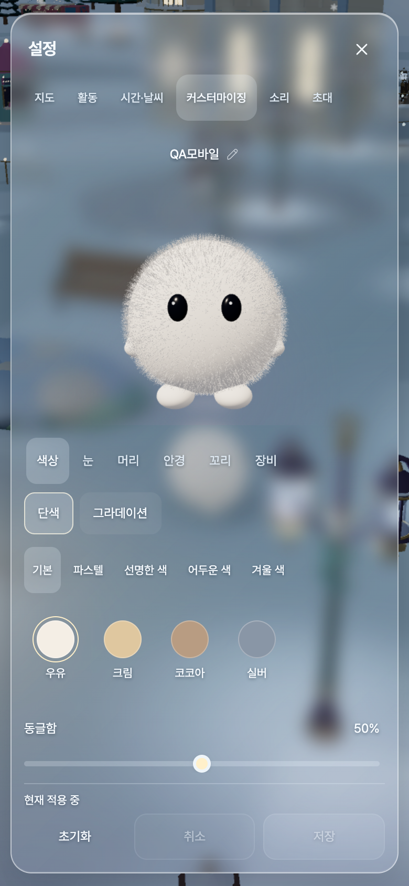
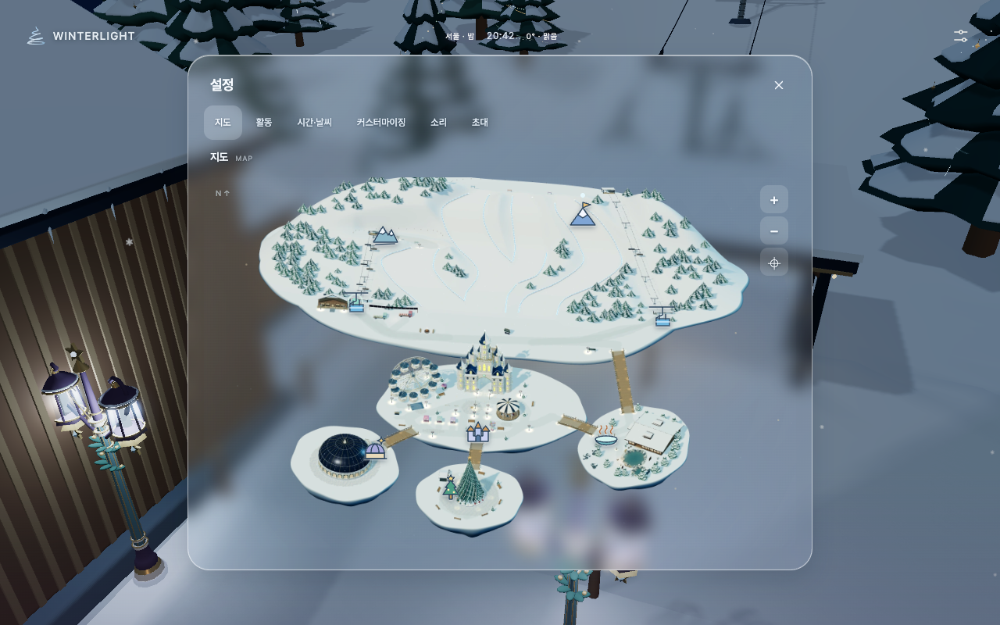
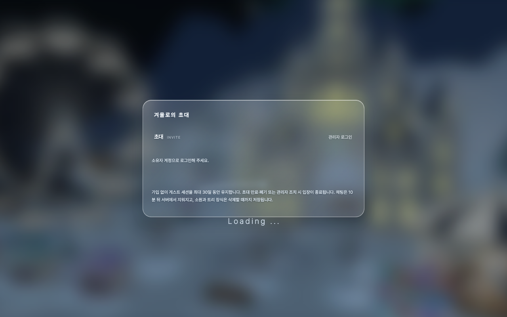

# v46 운영 반영 및 검증 — 2026-11-19

공식 진입: https://moru-winter-park.vercel.app/ · 관리자: https://moru-winter-park.vercel.app/admin

## 배포

실행 소스 `0fe286b8e25ddab2315c5b3a2df0d55b6f78d663`를 GitHub main, Sites 61, Vercel production 및 Cloudflare 실시간 Worker에 동일하게 반영했다. GitHub의 뒤처진 main은 fast-forward로 갱신했고 기존 작업을 덮어쓰지 않았다. 이 문서와 QA 결과는 **운영 후 작성한 증거 브랜치 `codex/v46-production-verification`** 에 보관한다. 문서 저장 때문에 검증한 운영 코드를 다시 배포하지 않는다.

- Sites `appgdep_6afee00c226c8191ba491f243c4ab7d8`: succeeded, 환경 변수 revision 4.
- Vercel `dpl_554AhJ5AVVCu8HLQoJyYzLnDJ7YW`: READY / production, 기존 공식 alias 확인.
- Cloudflare `winterlight-realtime`, 배포 `3b0667f3-95c7-4f0d-b5c3-29d90ab0a366`: 실제 health의 revision 일치. 무료 SQLite Durable Objects 사용. 유료 플랜 변경 및 Render 생성 없음.
- Sites는 저장 데이터·API·소유자 인증용으로 유지한다. 내부 서버 주소는 추가 방문 주소가 아니며 기존 인증 경로를 제거하지 않았다.
- 0017의 관리 기록·인증 테이블을 추가했다. 이전 테이블을 삭제하거나 전체 데이터를 복원하지 않았다. 전후 소원 6행, 장식 102행, quiz_journal 5행, 소유자 1행의 내용이 정확히 일치했다. 공개 소원 API는 공개/노출 가능한 4개를 반환했으며 DB 전체 6행 보존과 구분한다.

## 실제 검사

| 검사 | 결과 |
|---|---|
| GitHub Actions [44515499225](https://github.com/yeyiwon/moru-winter-park/actions/runs/44515499225) | 성공, 8분 13초 |
| source 검사 / 자동 테스트 | 268개 모듈 / 489개 PASS, 실패 0 |
| Worker·Vercel·realtime build / 자산 예산 | PASS |
| 격리 10·25·50·100 연결, 각 15초 | 메시지 성공 비율 1, 재접속/좌석 경쟁 검사 PASS |
| 원격 브라우저 기능 검사 | 17/17, 브라우저·콘솔·HTTP 오류 0 |
| 로컬 실제 GPU, 기본 auto 화질 | 17/17, 오류 0 |
| 운영 PC·모바일 터치 화면, 실제 WSS 두 연결 | 20/20 PASS |
| 운영 핵심 파일 원문 SHA 비교 | 14/14 일치 |
| Sites/Vercel 전체 빌드 자산 | 233/233 바이트 일치 |
| 공식 /admin 소유자 인증 왕복 | 사용자가 로그인 후 관리 화면 정상 열림을 확인 |

운영 브라우저는 실제 공개 입장, 두 게스트 입장과 위치 전달 확인, 외형 저장, 채팅 전달, 기존 소원 읽기, 게스트 관리 API 차단, 위조 소유자 grant 차단, 관람차/리프트 탑승·하차, 모바일 고정 조이스틱·원 밖 최대 입력·해제 정지, 커마 패널과 지도, 관리자 진입을 확인했다. 테스트 게스트만 퇴장 처리했다. 운영 소원·장식·불꽃 공연을 테스트 목적으로 생성하지 않았다.

원격 headless Chrome은 별도 context도 모두 visible로 처리하여 여러 소프트웨어 3D 렌더링이 겹쳤다. 원격 검사에서는 기존 low 설정과 실제 지도 메뉴의 일시 정지를 사용하되 모든 연결과 조작 검사는 유지했다. 로컬 auto 검사는 별도다. 원격 첫 화면 32.732/17.905/25.156초를 실제 PC나 휴대폰 성능으로 해석하지 않는다.

## 오류 기록과 한계

운영 브라우저에서 예외·shader·5xx 오류 0. 배포 후 Vercel error/fatal 로그 조회(11:41:00–11:42:16 UTC)는 0건이었다. Sites 기록에는 의도한 권한 거절 403, 테스트 세션 퇴장 직후 401, 캡처 종료로 취소된 요청과 robots/sitemap 404가 있었다. 관찰된 5xx나 uncaught exception은 없었으며, 모든 상태 코드가 200이었다고 주장하지 않는다.

실물 Windows·iPhone·Android, 실제 GPU 메모리, 운영 장시간 100명 동시접속, 외부 24시간 장애 알림은 **UNKNOWN/미구성**이다. 무료 서비스는 무제한이 아니며 100명 격리 검사는 운영 수용량 보장이 아니다. 렌더링 비교 수치는 [기존 v46 측정](official-ui-v46.md#동일-조건-렌더링-비교)을 유지하며 추가 FPS 개선을 주장하지 않는다.

## 증거

[배포·데이터 보존](../qa/operations-v46/production/deployment.json) · [운영 브라우저](../qa/operations-v46/production/production.json) · [원격 브라우저](../qa/operations-v46/production/ci-browser-final.json) · [핵심 파일](../qa/operations-v46/production/production-assets.json)

기존 Sites 54 및 Vercel `dpl_141ESF8WAfkspfe1XKsQMGRRD67D`를 이전 버전 기준으로 보존했다. 장애 복구 시 추가된 DB 테이블을 삭제하지 않고 서버/화면을 호환되는 버전으로 함께 되돌려야 한다. 이번 배포에서는 rollback을 수행하지 않았다.
