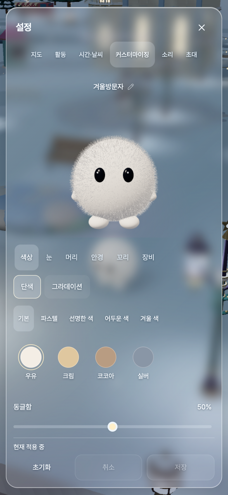

# v47 후속 운영 반영 — 연속 트리 꾸미기와 설정 정렬

2026-11-19. 공식 접속 주소: https://moru-winter-park.vercel.app/.

## 최종 동작

- 닉네임은 서버 저장이 성공하면 수정창을 닫고 변경된 이름만 표시한다. `저장됨` 문구는 없으며 저장 중·실패 안내와 재시도는 유지한다.
- 모바일 지도 탭에만 남아 있던 외곽 여백과 탭 높이 예외를 제거했다. PC·모바일의 6개 설정 탭은 같은 헤더 정렬을 사용한다. 기존 유리 색상과 승인된 저장·전송 버튼 디자인은 유지한다.
- 장식 도착이 꾸미기 세션이나 카메라를 종료하지 않는다. 직접 닫기 전까지 도크와 시야를 유지하며 연속 등록할 수 있다. 등록 시 남아 있는 초기 구도 전환을 멈추고, 충돌 보정 후 실제 화면 거리를 기준으로 고정한다. 목표 거리만 고정하면 충돌 복구 때문에 다시 멀어지는 문제가 있었다.
- 일반 탐험 시야 복귀는 사용자가 직접 닫았을 때 수행한다. 캐릭터 이동·지도 이동·접속 종료 등 사용자가 바꾼 상태의 기존 정리는 유지한다. 저장 개수 정책과 서버의 중복 요청 방지 정책은 이번에 변경하지 않았다.

## 소스와 배포

- 실행 변경: `d895b567de93a951805dde709f5c4129a8c54af9`.
- 최종 운영 소스: **`657581e7085d8fc2c3c0401e69d9d5ddec987791`**. 기존 닉네임 통합 검사의 `저장됨` 기대값 2개를 최신 요구에 맞춰 수정했다. 저장 확인·오류·재시도·초점·재접속 검사는 유지한다.
- GitHub main 반영 완료.
- Vercel `dpl_Ad3i46kBys9KUoxytxRJiVyR4YWp`: READY, 기존 공식 주소 연결.
- Sites 63 `appgdep_6afef26ad3508191944e24d24976d959`: succeeded, 환경 변수 revision 4 유지.
- `/release.json` 및 `/api/health`의 revision 일치. 서버 `ok:true`, `multiplayer:true`, `websocket-configured`.
- Cloudflare 재배포·DB migration·권한 변경·유료 서비스 추가 없음.

## 실제 검증

- 소스 269개 검사, 전체 자동 테스트 **494/494 PASS**.
- Vercel production build 및 자산 예산 검사 PASS.
- 격리 로컬 실제 Chrome: 닉네임 성공/실패와 설정 6개 탭 비교 **7/7**, PC·모바일 화면에서 연속 장식 등록 **15/15**, 구도 전환 도중 빠른 등록 **7/7** PASS. 테스트 장식은 정리했다.
- 실제 운영 Chrome: **41/41 PASS**. PC 1280×800, 모바일 터치 화면 390×844/DPR 2. 운영 자산 14개와 로컬 production build의 SHA-256 일치, 월드 진입, 실제 WSS 수신, 채팅 표시, 저장·전송 버튼, 지도 정렬, 닉네임 저장 후 문구 제거, 트리 이름과 3D 썸네일, 닫기 후 시야 복귀, 게스트 관리 API 차단 및 `/admin` 진입 확인.
- 브라우저 예외·콘솔 오류·HTTP 5xx: **0건**. 운영 검사는 임시 게스트의 닉네임만 저장하고 퇴장했다. 실제 사용자의 프로필·소원·장식은 수정하지 않았다.
- 실물 Windows·iPhone·Android, GPU 메모리와 장시간 운영 성능은 **UNKNOWN**. 모바일 화면 검사는 실물 휴대폰 검증이 아니다.
- 초기 후속 CI는 이전 성공 문구를 기대한 검사 2개로 실패했다. 테스트 수정 후 전체 로컬 검사 통과. [최종 원격 CI](https://github.com/yeyiwon/moru-winter-park/actions/runs/44528661412)는 **8분 30초, 전체 성공**: 소스·전체 자동 테스트·3종 빌드·자산 예산·격리 부하·멀티플레이 및 반응형 브라우저 검사를 통과했다.

## 증거

[배포 상태](../qa/comfort-v47/production-followup/deployment.json) · [운영 검사](../qa/comfort-v47/production-followup/report.json) · [연속 등록](../qa/comfort-v47/continuous-tree/report.json) · [빠른 등록](../qa/comfort-v47/early-tree/report.json) · [설정 정렬](../qa/comfort-v47/final-alignment/after/report.json)

이 문서는 배포 후 증거이며 문서 갱신만으로 실행 소스를 다시 배포하지 않는다.
