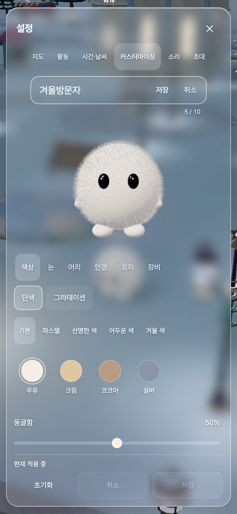
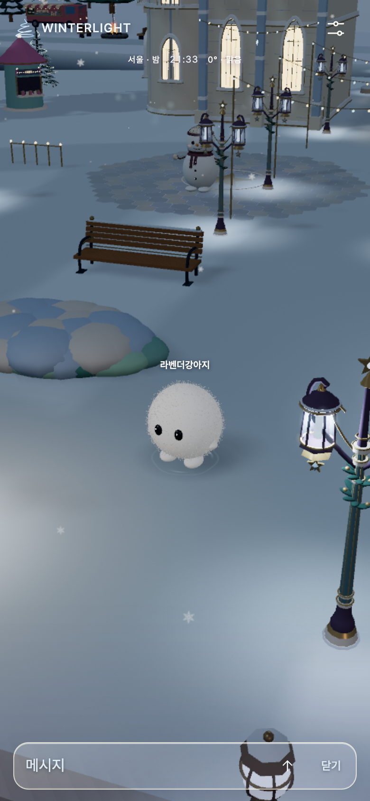

# v47 운영 반영 — UI·채팅·트리 카메라

2026-11-19. 공식 접속 주소는 https://moru-winter-park.vercel.app/ 이다. 관리자 진입은 같은 주소의 `/admin`을 유지한다.

## 반영한 소스

- `22c55c592b1e70cc85d658d52f7cd3a80b59767a`: 관리·초대 간격, 닉네임, 채팅 표시 규칙, 트리 장식 시점 복귀, 3D 장식 미리보기와 VFX, 회전목마 시야, `트리` 명칭.
- **v47 1차 운영 `dfc0b772a4a80be8456a582d8b00841f93ed1e53`**: 추가 피드백에 따라 저장·전송의 개별 배경과 테두리를 제거. 정상/hover 모두 투명하며 44px 조작 영역을 유지한다.
- 기존 GitHub main에 fast-forward 반영. 월드 좌표·서버 API·권한·DB schema·Cloudflare 실시간 Worker 변경 없음.

## 배포 확인

| 대상 | 결과 |
|---|---|
| Sites 62 | `appgdep_6afeec4c925c8191ae94f076682bb97b`, succeeded, 환경 변수 revision 4 유지 |
| Vercel production | `dpl_38prfVeLQX9GppmicobKGHeW9bWx`, READY, 기존 공식 alias 연결 |
| `/release.json` | 최종 운영 SHA 일치 |
| `/api/health` | `ok:true`, `multiplayer:true`, 같은 SHA, `websocket-configured` |
| 주요 운영 파일 | 13개 로컬 production build와 SHA-256 일치 |

Sites 주소는 기존 서버·인증 연결로 유지하며 새로운 방문 주소를 추가하지 않았다. Cloudflare 재배포·유료 서비스 추가·DB migration 없음.

## 검증

- JavaScript 모듈 269개 검사, 자동 테스트 494개 PASS.
- 로컬 실제 Mac Chrome: UI·카메라 50/50, 모바일 회귀 15/15, 최신 저장·전송 버튼 8/8 PASS.
- 실제 운영 브라우저 **36/36 PASS**: PC 1280×800, 모바일 터치 화면 390×844에서 공유 월드 진입, 실제 WSS 수신, 채팅창과 기록 표시, 테두리 없는 버튼, `트리` 명칭, 3D 썸네일, 닫기 후 원래 거리 복귀, 게스트 관리 API 차단, `/admin` 진입을 확인했다.
- 운영 브라우저 예외·콘솔 오류·5xx 모두 0건. 예상된 게스트 권한 403은 오류로 숨기지 않고 검사했다.
- 운영 검사는 임시 게스트를 입장·퇴장했으며, 소원·장식·프로필·공연을 생성하거나 변경하지 않았다. 장식 등록/도착 후 자동 시점 복귀, 채팅 송수신과 좌석 예약은 격리 로컬 데이터로 검증했다.
- 실물 Windows·iPhone·Android, GPU 메모리, 장시간 운영 부하는 **UNKNOWN**. 모바일 화면 검사는 실물 휴대폰 검증을 대신하지 않는다.

GitHub [44524670807](https://github.com/yeyiwon/moru-winter-park/actions/runs/44524670807) 전체 성공(6분 40초): 소스·자동 테스트·3종 build·자산 예산·격리 부하·공유 접속 브라우저 검사를 통과했다. 이후 요청한 저장 완료 문구 제거·지도 정렬·연속 트리 편집은 후속 커밋으로 구분한다.

## 증거

[변경 원인과 구현](ui-camera-comfort-v47.md) · [배포 기록](../qa/comfort-v47/production/deployment.json) · [운영 검사](../qa/comfort-v47/production/report.json)

이 문서와 운영 캡처는 배포 후 작성한 증거로 보관한다. 검증한 실행 소스를 문서 갱신만으로 다시 배포하지 않는다.
