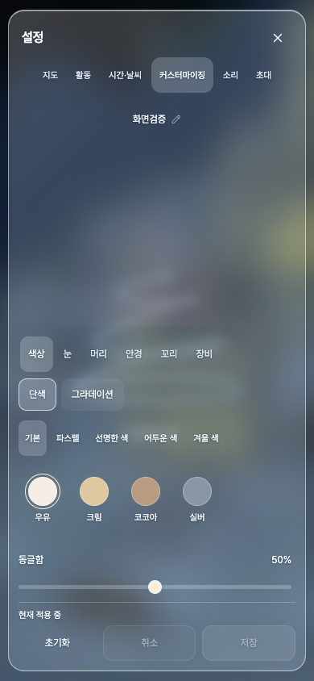
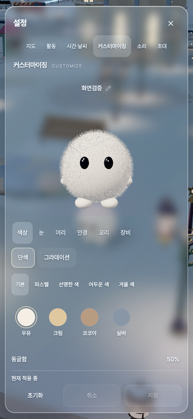
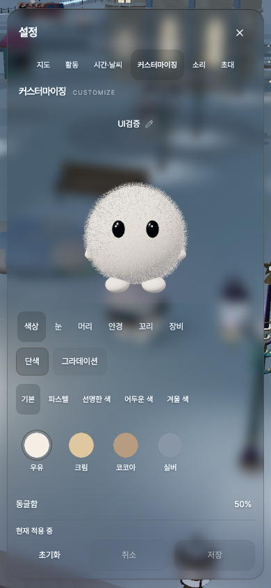
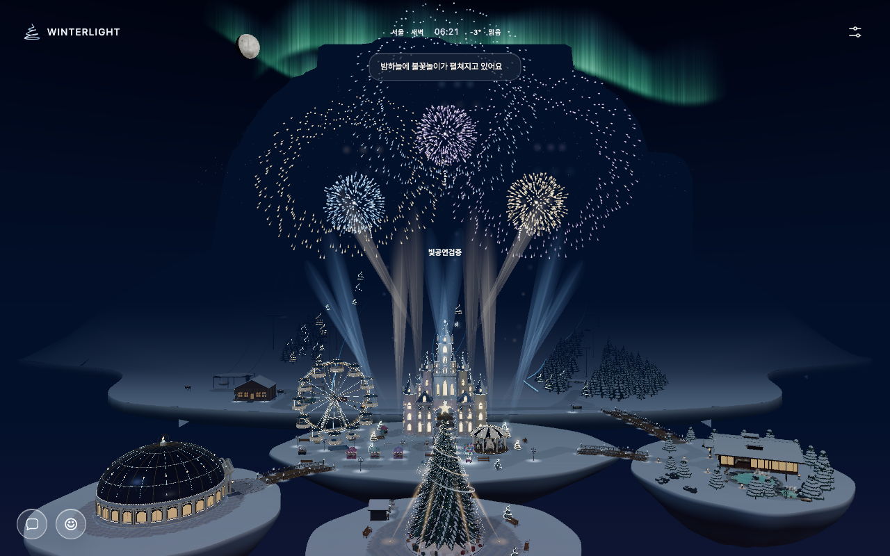
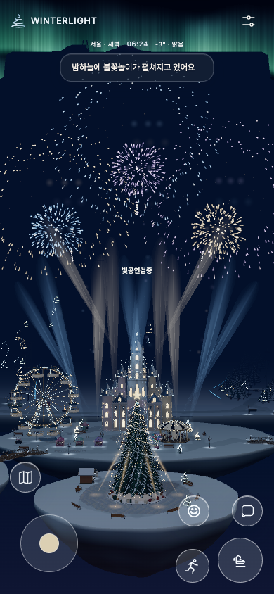
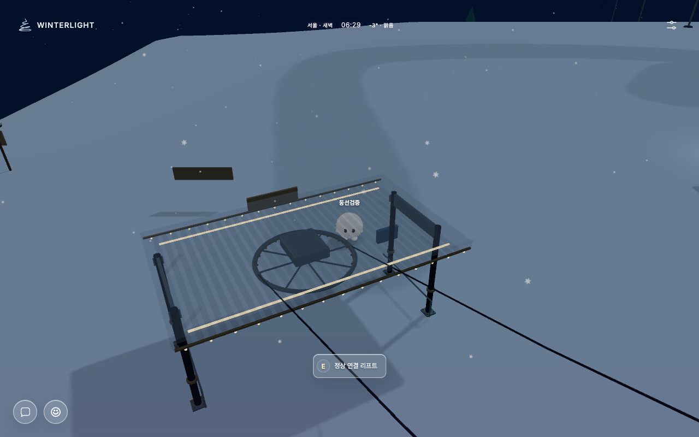

# v52 — 완곡 공연·기기별 UI·설산 마무리

2026-11-20. 사용자가 최종 운영 반영을 요청한 v48–52 통합 수정본. 기존 브랜드, 시설, 익명 게스트, 관리자 인증, 소원·장식 저장을 유지한다. 이전 v48–51 문서의 “보류”는 당시 상태이며 최신 배포 결과는 [DEPLOYMENT](DEPLOYMENT.md)를 따른다.

## 반영 범위와 원인

### 음악과 공연

- 사용자 제공 **Happy And Magical Dynamic / Joyful Piano Orchestra** 원본을 무편집으로 사용한다. 각각 **110.680816 / 125.048163초**. [출처·약관·Content ID·해시·음향 분석](show-music-v52.md).
- `server/fireworks.js`가 암호학적 1바이트 난수를 128/128로 나눠 한 곡만 선택한다. 일반 신청·관리자 시작 모두 같은 경로다. ID, seed, startsAt, endsAt, musicId, duration, timelineVersion=52를 공유한다. 신청 제한은 **실제 종료 + 15분**. 과거 저장된 74초 공연 레코드만 기존 연주를 호환한다.
- `show-tracks.js`의 각 곡별 측정 attack·악구 변화 후보로 큐를 구성한다. A는 128 BPM, B는 127 BPM 추정 격자를 사용하며 서로 다른 구간·강세 시각이다. 고정 공연을 단순 시간 확대하지 않는다. 측정은 기계적 분석이며 사람이 확정한 악보라는 의미가 아니다.
- `firework-music.js`는 스트리밍 Audio 요소 하나만 사용한다. 선택된 곡만 10초 예고 중 준비하며 전곡을 초기 필수 로딩·서비스워커 precache에 넣지 않는다. playbackRate=1, loop=false. 늦은 입장·음소거 해제·탭 복귀는 서버 시점으로 맞추며 오차 220ms 초과 시 보정한다. 공연 재생 중 일반 BGM은 음량 0으로 내려 다른 곡과 섞이지 않게 하고 종료 후 원래 설정으로 복귀한다. 종료 시 연결·파일을 해제한다. 자동 재생 차단 시 짧은 터치 안내를 표시한다.
- 감상 버튼과 자동 공연 카메라 코드를 제거했다. 공연 중 이동·자유 시점과 간단한 상단 알림을 유지한다.

### 불꽃·성 조명

- 상승과 폭발의 반경·크기·잔광을 분리한다. 둥근 head, 짧은 꼬리, 국화·구형·모란 내부층·깊이 있는 별·윌로우·지연된 작은 폭발을 사용한다. 겹치는 폭발은 같은 시드로 재현한다.
- 고품질 shell당 280→360 입자, trail 표본 10→6. 최대 정점 **50,400→38,880**으로 줄이면서 중심 입자를 풍성하게 만들었다. 매 입자 배열 생성 없이 고정 TypedArray를 갱신한다. 중/저 품질은 216/96 입자. 새로운 실시간 광원은 추가하지 않았다.
- 성 아래 임의 상승 구슬 버퍼·생성·갱신 코드를 삭제했다. 빛 입자는 불꽃과 실제 건축 표면 효과에만 사용한다.
- 24개 조명 위치를 광장·성벽 뒤·정문·창문·탑에 분산하고 넓은 빔은 네 겹의 교차 면과 부드러운 감쇠로 표현한다. 한 배치이며 음악 구간별로 일부만 켜진다. 레이저는 강박 구간만 나타난다.
- 성의 10개 구역 속성을 통해 창문·벽·지붕·아치·탑·장식을 분리한다. 실제 메시 표면의 얼음·별·아치 흐름·나선·오로라 패턴을 사용한다. 실버·아이스블루·라벤더·샴페인의 밝기 대비를 유지하고 건물을 관통하는 별도 투사 평면은 사용하지 않는다.

### Windows·Galaxy UI 및 조작

- 흰색 설정/채팅은 투명도 감소·blur 미지원 fallback에 밝은 배경이 지정돼 있었다. 같은 어두운 유리 계열과 흰 글씨로 통일하고 `color-scheme: only dark`를 명시했다.
- Samsung 강제 다크 모드의 swatch 반전은 CSS 색과 작은 PNG 모두에서 재현했다. 최종 `color-swatches.js`는 원래 hex 색을 64px Canvas에 그린다. 값이 달라질 때만 그리며 WebGL 컨텍스트나 매 프레임 갱신은 없다. 캐릭터·조명·장식 팔레트에 함께 적용했다.
- 모바일에서 숨겨졌던 설정의 한국어/영어 제목을 복원했다. PC 채팅 전송 버튼의 중복 margin을 제거해 좌우 여백과 수직 중심을 맞췄다. 닫기 텍스트와 저장 완료 라벨은 다시 추가하지 않는다.
- 관리자/설정 닫기는 44×44 터치 영역, 20px SVG, 동일한 헤더 정렬을 사용한다. 기존 로그인·권한 검사 유지.
- 기존 연속 트리 편집, 종료 시 이전 카메라 복귀, 3D 장식 썸네일, 지도 공통 설정 정렬, 어두운 지도 tooltip, 고지대 달·오로라 수정을 통합한다.

### 설산 마지막 수정

- 주 코스 2.34km·낙차 900m, 실제 정상→베이스 **57.997초**. 중간 리프트·직선 곤돌라·고정 객실 9대·6인 공유 좌석·일곱 선택 점프대를 유지한다.
- 정상 앞 cable support가 터미널보다 약 18m 높아 객실이 솟았다 내려왔다. 지지 높이를 단조 증가로 제한하고 같은 경로를 부드러운 Hermite 보간으로 세분화했다. 노선·객실·케이블·탑 높이의 기준은 하나다.
- 하단은 두 번 꺾이던 평탄화 대신 z=-460~-244의 연속 경사로 연결한다. 중간 역은 좁게 파는 방식 대신 넓은 apron과 긴 전이 구간으로 만든다. 슬로프 횡단면은 마지막에 보존한다.
- 역 주변의 멀리 보이는 지형도 더 촘촘하게 생성한다. 물리 높이만 맞고 거친 원경 삼각형이 역·머리를 관통하던 문제를 실제 scene 검사에서 찾아 고쳤다.
- 렌더·충돌·탑승·지도는 동일한 layout을 사용한다. 지도 이미지도 마지막 지형으로 다시 생성했다. 관련 [v51 기록](alpine-show-v51.md), [접근 검사](../qa/platform-v52/access/access.json).

## 검증과 성능

Mac Chrome, PC 1280×800 high 및 390×844 touch/medium에서 측정했다. 실제 Windows/Edge, Galaxy, iPhone Safari는 **UNKNOWN**이다. 에뮬레이션 결과를 실물 성능으로 표시하지 않는다.

| 항목 | 이전 기록 | v52 실측 |
| --- | --- | --- |
| 정상 실제 활강 | v50 91.71초 / v51 58.21초 | 57.997초 |
| 활강 평균 / p95 | v51 59.99 FPS / 16.7ms | 60.02 FPS / 16.7ms |
| 활강 draw calls | v51 88–1,238 | 77–1,187 |
| 활강 triangles | v51 358,504–5,130,171 | 385,465–4,961,808 |
| 공연 PC 시작~피날레 | v51 약 47–55 FPS | 60.16–60.24 FPS / p95 16.7ms |
| 공연 모바일 화면 에뮬레이션 | v51 약 56–60 FPS | 60.10–60.19 FPS / p95 16.7–16.8ms |
| 반복 공연 6회 | 재사용 검사 | PC geometry 930 / textures 37 유지, 모바일 830 / 34 유지 |

호스트 부하·타임라인·가시 영역이 다르므로 위 수치로 보편적인 FPS 향상률을 주장하지 않는다. 실제 GPU 메모리 byte·실물 모바일 장시간 발열·장시간 Windows 플레이는 UNKNOWN. 반복 검사는 6회 시작/종료 재진입이며 수 시간 내구 시험이 아니다.

- 원본 두 곡 모두 실제 시간 완곡 재생, 재생 속도 1, 중간 입장·음소거·종료 해제 통과. 샘플링 playhead 오차 최대 약 217ms. [오디오 결과](../qa/castle-show-v52/audio.json).
- 두 클라이언트 및 중도 입장 세 번째 클라이언트의 공연 ID·musicId·seed·시계·종료 일치, 게스트 관리자 403, 카메라 자동 이동 없음. [동기화 결과](../qa/castle-show-v52/sync.json).
- [PC 공연](../qa/castle-show-v52/desktop.json), [모바일 화면 공연](../qa/castle-show-v52/mobile.json), [실제 활강](../qa/platform-v52/alpine/desktop-descent-final.json).
- PC와 모바일 화면의 두 게스트가 같은 곤돌라의 다른 좌석에 탑승하고 실제 정상 도착·하차·채팅 공유를 통과했다. [동승 결과](../qa/platform-v52/transport/integration.json).
- [투명도 fallback·제목·전송 정렬](../qa/platform-v52/after.json), [강제 다크 모드·관리자 정렬](../qa/platform-v52/platform-extra.json).
- 최종 전체 검사·부하·배포 결과는 [TESTING](TESTING.md), [DEPLOYMENT](DEPLOYMENT.md)에 기록한다.

## 화면 비교

## 데이터와 배포

기존 D1을 유지하고 `0018_gondola_seats`는 기존 좌석을 복사하여 곤돌라 0–5 좌석만 허용 범위를 확장한다. 소원·장식·관리자 테이블을 초기화하지 않는다. 기존 Cloudflare 실시간 Worker와 Sites API, Vercel frontend를 같은 검증 커밋으로 맞춘다. 방문자 주소는 **https://moru-winter-park.vercel.app/** 하나다.

배포 전 소원 7개·장식 135개·퀴즈 기록 5개·소유자 1개를 읽기 전용으로 비교용 보관했다. 전체 DB backup을 만들었다는 의미는 아니다. 이전 Sites 63 / Vercel 운영 배포 및 기존 schema와 호환되는 rollback 경로를 보존한다. 실제 배포 식별자와 데이터 비교 결과는 배포 확인 후 기록한다.
