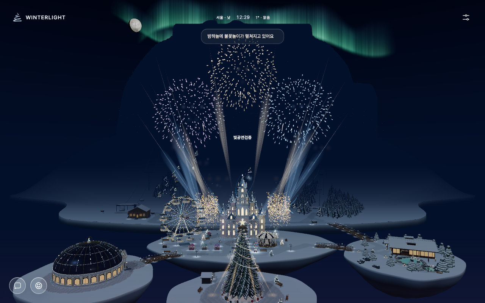
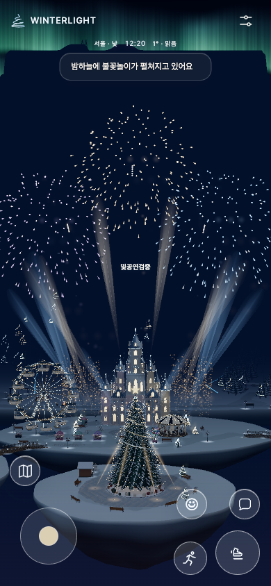
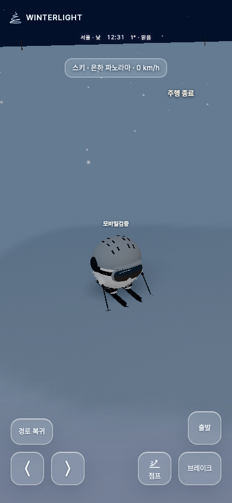
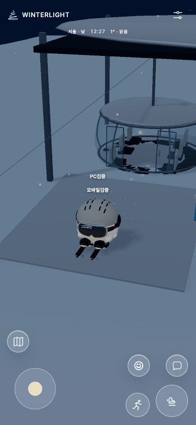

# v53 — Love·Wedding Entrance 공연과 조작 안정화

2026-11-20. 공식 주소와 기존 관리자·게스트·소원·장식 데이터를 유지한다. 최신 사용자 결정에 따라 **Love + Wedding Entrance**만 공연 후보로 사용하고, **Magic Wedding은 별도 허가 미확보로 제외**한다. Happy And Magical Dynamic과 이전 Joyful Piano Orchestra 공연 파일은 교체했다. 최초 74초 합성 공연 음악과 알 수 없는 곡의 자동 대체 연주도 완전히 제거했다. 전체 배포 결과는 [DEPLOYMENT](DEPLOYMENT.md)에 기록한다.

## 음악·공연

- `show-tracks.js`: Love **134.817959초**, Wedding Entrance **123.245714초**, 서버의 기존 균등 랜덤 선택·결정적 seed·시작/종료 시각 공유 유지. 전체 원본을 자르거나 속도를 바꾸지 않는다.
- 두 곡의 PCM 강세·RMS·악구 경계 후보를 각각 분석해 별도 타임라인을 구성했다. Love는 약 134BPM 후보, Wedding Entrance는 약 150BPM 후보이며 클라이맥스와 잔광 구간이 다르다. 기계 분석이므로 음악가가 확정한 악보·청취 평가라는 뜻은 아니다. [원본 해시·출처·이용 조건·분석](show-music-v53.md).
- `firework-music.js`: 선택된 파일 하나만 스트리밍하고 Love 출력 gain 0.755 / Wedding Entrance 1로 음량 차이를 완화한다. BGM 복귀·중도 입장 seek·재생 속도 1·종료 해제 정책 유지. 두 파일 합계 8,258,036 bytes. 초기 필수 리소스로 추가하지 않았다.
- `music-catalog.js`: Waltz of Snowflakes를 **5번**에 삽입했다. 기존 1–4번과 저장된 곡 ID는 유지하고 이후 곡만 뒤로 이동한다. 파일 3,736,555 bytes / 116.767347초.
- `firework-score.js`, `winter-fireworks.js`: 구형·국화·별·윌로우·링·글리터에 낮은 황금 분수, 양쪽 부채꼴 코멧, 시간차 이중 폭발을 조합한다. 상승 궤적은 완만한 곡선이며 코멧 잔광은 짧게 끝난다. 기존 연기와 둥근 spark를 재사용한다. 24개 고정 shell 슬롯, 최대 51,840 정점으로 제한하고 실행 중 geometry를 추가하지 않는다.
- `castle-show.js`, `castle-show-score.js`: 광장 바닥 조명 기구를 한 InstancedMesh로 배치하고 넓은 빔을 분산한다. 음악 구간에 따라 빔과 레이저의 세기·방향·폭을 구분한다. 성의 10개 구역과 표면 투영은 유지한다. 현재 모드에 필요한 표면 패턴만 계산하며, 공연이 꺼져 있으면 해당 shader 계산을 빠져나온다.

## 채팅·라벨·발소리

- `chat-policy.js`, `social.js`, `panels.js`, `park.js`: 게임 버튼에 포커스가 남아 있어도 Enter는 채팅을 연다. 일반 폼·모달·IME 조합·키 반복·중복 전송은 분리한다. 최근 채팅은 수신 후 monotonic clock으로 5초 유지하고 240ms fade, 전체 기록은 세션당 최근 100개를 남긴다. 짧은 간격의 새 메시지가 이전 3개를 바로 잘라내지 않는다. 넘치는 내용은 스크롤할 수 있고 전체 기록을 읽는 중 같은 snapshot이 오면 DOM이나 스크롤을 재설정하지 않는다.
- 모바일 키보드 복귀는 VisualViewport와 기존 viewport 높이를 확인한다. 키보드가 아직 화면을 가릴 때 이동 입력과 카메라 resize를 복귀시키지 않는다. 고정 지연으로 복귀했다고 가정하지 않는다.
- `world-labels.js`, `visitors.js`: 이름표에 플레이어 간 실제 3D 거리(34m 진입/42m 이탈), 카메라 거리, 투영 크기, 지형·건물 가림을 적용한다. 가림 검사는 프레임당 최대 2명, 180ms 간격으로 분산하며 투명도를 보간한다. 캐릭터 렌더와 채팅 수신은 별도다. 말풍선 시간은 기기 시계 차이에 영향을 받지 않도록 서버 age와 로컬 수신 시각을 구분한다.
- `audio-engine.js`: 발걸음은 짧고 낮은 음량의 필터 노이즈와 약한 둥근 음색으로 바꿨다. 동시 2개로 제한하고 정지·일시정지 시 해제한다. 실제 걷기에만 발생하며 스키·보드에는 걷기 소리를 내지 않는다.

## 스키·곤돌라·지형

- `winter-experience.js`, `resort-ui-v43.css`, `index.html`: 실제 활강 중 일반 조이스틱·소셜 UI를 숨기고 왼쪽 턴, 오른쪽 브레이크·점프, 속도·코스·종료·복귀를 표시한다. 탑승 중에는 일반 UI를 유지한다. 각 pointer를 분리하고 취소·화면 전환 시 초기화한다. 짧은 출발·점프 탭은 다음 프레임까지 보존한다. 실제 터치 검사에서 발견한 상위 HUD의 `pointer-events:none` 상속도 수정했다.
- `ride-seats.js`, `winter-rides.js`, `resort-blueprint.js`, `server/ride-api.js`: 접근→대기→문 열림→5초 보행→좌석→출발→도착→문 열림→5초 하차 흐름. 객실 시계(cabin)와 개인 전이 시각(startedAt)을 분리해 기존 schema로 6인 동승을 유지한다. 서버가 열린 역과 남은 정차 시간을 확인해야 하차할 수 있다. 무관한 게스트·공중 하차는 거부하며 재요청은 같은 전이를 반환한다.
- 정차 14초/편도 65초, 9개 객실의 정수 loop 유지. 바닥 정렬과 마지막 회차 속도를 보정하고 정상 하차 지점을 실제 문 가까운 apron으로 맞췄다. 산 규모나 기존 약 1분 주행 코스를 새로 늘리거나 줄이지 않았다.
- `mountain-layout.js`, `mountain-tile.js`, `mountain-terrain.js`: 슬로프 입구의 약 2.78m 높이 단차를 연속 가중치로 보정했다. 혼합 LOD에서 경계 정점이 달라 최대 약 218m 벌어지던 부분은 같은 경계 표본으로 삼각형을 연결한다. 10m 스커트로 숨기던 방식은 제거했다. 원경 슬로프·역 주변 32분할, 나머지 12분할을 적용했다. 실제 triangle raycast로 경계 양쪽 높이 차이 0.1m 미만을 확인한다. 물리 높이 함수는 공유한다.

## 관련 구현 커밋

- `c68a711`: 확정 음악·완곡별 공연·초기 음악 제거·VFX.
- `e0f909a`: 채팅·스키 터치·곤돌라 연속 전이·지형·운영 확인 도구.

## 검증 범위

- Mac Chrome PC와 390×844 touch 화면에서 실제 3D 렌더·입력·오디오를 검사했다. **실물 Windows/Edge·Galaxy/Samsung Browser·iPhone Safari는 UNKNOWN**이다. 에뮬레이션은 해당 기기 성능이나 실제 가상 키보드를 대체하지 않는다.
- 두 원본 음악 전체 길이 실제 시간 재생, playbackRate=1, 중간 입장 seek, 종료 해제 통과: [오디오](../qa/gameplay-v53/show/audio.json).
- PC Enter, 최근 채팅 3초 이후 표시·fade·기록, 두 명 같은 객실 다른 좌석·공중 하차 방지·연속 하차: [곤돌라 검사](../qa/gameplay-v53/gondola-before-hud-fix.json). 이 원본 결과의 마지막 스키 터치 실패는 후속 수정과 [재검사](../qa/gameplay-v53/gameplay.json)에 별도 기록했다.
- 성의 정면·좌우·모바일 화면과 6회 재시작 geometry/texture 수 유지: [PC](../qa/gameplay-v53/show/desktop.json), [모바일 화면](../qa/gameplay-v53/show/mobile.json). 수 시간 내구 시험이나 실제 GPU 메모리 byte 측정은 아니다.
- 요청 문서에 언급한 추가 불꽃 참고 사진 4장은 확보되지 않아 분석 완료로 표시하지 않는다. 제공된 실행 화면과 실제 3D 화면을 기준으로 수정했다.
- 운영 소스 `8b3b449`의 공식 주소 UI 60개와 곤돌라 동승/스키 터치 15개, 3인 공연/중도 입장/전체 종료 검사를 통과했다. [최종 배포 및 실제 결과](DEPLOYMENT.md).
- 자동 검사·최종 빌드·부하·배포 결과는 [TESTING](TESTING.md), [PERFORMANCE](PERFORMANCE.md), [DEPLOYMENT](DEPLOYMENT.md)를 따른다.

## 화면

