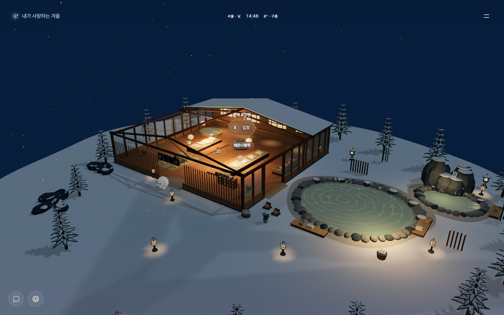
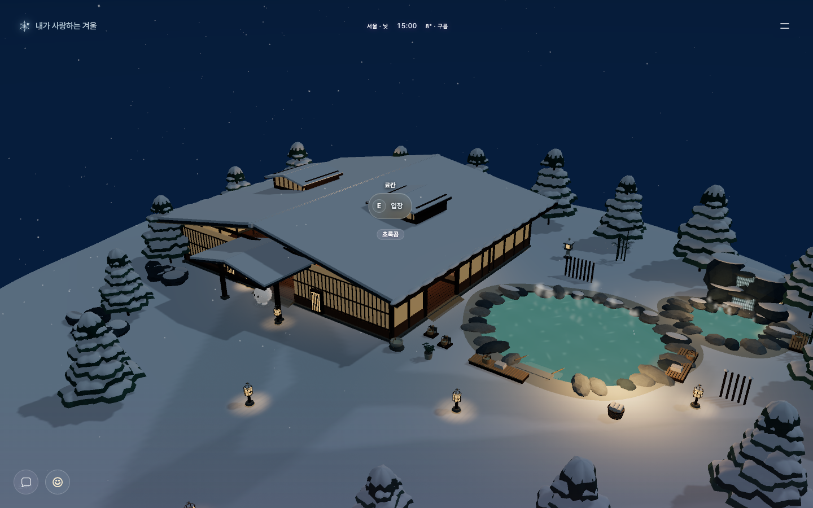
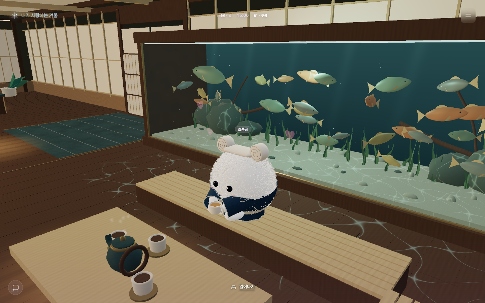

# v33 — 료칸·노천온천·수족관 정비

기준: `2f4b91bc238aebde086691e4763add3211c2b379` / 2026-11-18.

## 원인과 범위

사용자가 제공한 니세코 료칸·노천온천·대형 수족관 요구사항을 기준으로 기존 온천 섬을 수정했다. 다섯 섬의 위치, 서버의 익명 세션·소원 데이터, 놀이시설, 음악은 보존했다. 새 시설이나 추가 섬을 만들지 않았다.

- **확인됨:** 기존 외관은 지붕이 뒤쪽 일부에만 있고 투명 벽이 둘러진 전시관 형태였다. 나무는 얇은 가지가 반복되고, 탕의 돌은 같은 크기로 둘러져 있으며 물에는 반복 동심원 무늬가 보였다.
- **확인됨:** 입장 클릭 메시가 문이 아니라 건물 전체 24×22m를 덮었다. 서버는 문에서 6m 이내만 허용한다. 따라서 건물 다른 면에서 상호작용할 경우 안내 영역과 실제 입장 허용 범위가 달라질 수 있었다.
- **재현되지 않음:** 정상 입구까지 실제로 걸어가 버튼을 누르는 기존 흐름은 수정 전에도 HTTP 200으로 성공했다. 전체 입장 기능이 고장 났다고 단정하지 않는다.
- 창밖의 외부 월드 차단, 실내 독립 좌표, 유카타, 주방장, 실내 체험은 기존 기능을 유지한다.

## 외관과 정원

24×22m 기존 기단과 4.4m 현관 통로를 유지하면서 전체를 덮는 깊은 눈 지붕, 두 개의 낮은 채광 지붕, 돌 기단, 처마 서까래, 현관 캐노피, 목재 격자와 따뜻한 불투명 창호로 구성했다. 목재와 돌 표면은 배치 병합 후에도 유지되는 절차적 재질을 사용한다. 새로운 외부 텍스처나 모델 다운로드는 없다.

주변 16그루를 층별 수관과 눈을 가진 소나무로 교체했다. 나무 위치와 현관 기둥을 `ryokan-exterior-layout.js`에서 공유하며 동일 데이터가 충돌에도 반영된다. 통로 검사에서 서쪽 다리 끝 나무가 침범하는 것을 발견해 로컬 `(-26,119)`에서 `(-28,122.8)`로 옮겼다. 다른 구역의 나무는 변경하지 않았다.

건축 참고: [Zaborin](https://zaborin.com/en/the-ryokan/), [Mokunosho 객실](https://www.mokunosho.com/en/rooms/). 해당 숙소 모델·사진·브랜드를 복제하지 않은 자체 절차적 건축이다.

## 노천탕과 폭포

기존 지형에 뚫린 두 탕의 위치와 수중 이동 영역을 유지했다. 큰 매립형 자연석, 작은 보조 돌, 눈 덮인 후면 바위와 실제 진입 계단을 구성했다. 큰 탕 입구에는 가장자리 돌을 두지 않는다.

`onsen-water.js`는 서로 다른 방향의 잔물결, 표면 법선, Fresnel, 지역 조명 반사와 약한 수면 무늬를 GPU에서 계산한다. 고정된 동심원 장식은 제거했다. 실제 반사 렌더 타깃을 추가하지 않는 근사 반사이며 화면 전체의 SSR이나 유체 시뮬레이션은 아니다. 플레이어가 큰 탕 내부에서 천천히 이동하고 종료하는 기능을 검증했다.

기존 가느다란 세 줄의 물 대신 바위 사이에서 두 단계로 내려오는 물막과 바닥 물보라를 사용했다. 수증기는 기존 파티클 풀과 그래픽 품질 단계에 연결했다. 기존 물·폭포 합성 환경음과 볼륨 설정을 유지한다.

## 실내와 수족관

실내 42×34m와 중앙 8m 동선, 차·다다미·족욕·찜질·오마카세의 가구/체험 좌표를 유지했다. 현관의 평평한 석재 마감, 목재 결, 처마 안쪽 간접광, 다다미 뒤 장식 벽과 연결된 설경 창을 추가했다. 창은 실내에 속하는 얕은 장면이며 실외 월드를 보이게 하지 않는다. 별도 렌더러는 없다.

수족관은 약 14.8m 너비의 파노라마 구조이며 전면 유리, 양쪽 암석·수초, 가운데 열린 수역과 후면 깊이 표현으로 재구성했다. 물고기는 둥근 타원 대신 머리·꼬리가 좁아지는 몸체, 등지느러미·가슴지느러미·꼬리가 같은 방향 좌표계를 따른다. 조향은 이웃 분리, 같은 군집의 정렬/응집, 유리·장애물 회피를 사용한다. 고품질 32 / 중간 24 / 낮음 12마리, 원거리 5Hz / 근거리 최대 30Hz 갱신, InstancedMesh와 두 단계 지오메트리를 사용한다. 바닥·암석·인접 목재의 caustics와 수초 흔들림은 셰이더 애니메이션이다.

## 입장·카메라·동기화

입장 클릭 영역을 실제 문 주변 4.2×1.6m로 제한했다. 클라이언트도 6m 접근 조건을 확인하고 실내 자산 준비 후 서버의 입장 승인을 요청한다. 서버의 최종 권한 검증은 유지한다. 실패하면 실외에 남으며, 퇴장 시 서버가 지정한 문 앞 `(114,-23.4)`로 돌아온다.

기존 실내 카메라 경계와 선택적 가림 처리, 체험 종료 UI 정리를 유지한다. 여섯 실내 체험의 실제 카메라 화면에서 캐릭터가 화면 내에 남는지 검사한다. 다른 게스트가 같은 실내에 입장할 때 표시되는 것도 별도 서버 세션으로 검증한다.

## 검증 자료

- 수정 전/후: `qa/browser-v33/before`, `qa/browser-v33/after`.
- 실행 시나리오: `scripts/verify-ryokan-v33.mjs`.
- PC에서 실제 문까지 걷기→입장→여섯 체험까지 걷기→이용→종료→문 앞 퇴장.
- 큰 탕 이용과 수중 이동, 모바일 터치 입장·조이스틱 이동·퇴장.
- 두 번째 게스트의 실내 표시. UI 및 카메라는 다른 이용자 때문에 변경하지 않는다.
- 물고기 경계/조향, 메시 수·삼각형 예산, 실내 접근성, 다리 폭, 보이지 않는 트리거, 물 모션 감소, 눈 수관 면 방향 회귀 검사.
- 실제 휴대폰, 물리 GPU 메모리와 장시간 발열은 **미검증**. 모바일 결과는 Chrome 터치 에뮬레이션이다.

## 성능 측정

Chrome / Apple M2. PC 1280×800, 모바일 에뮬레이션 390×844 DPR 3. 장면별 준비 후 8초 동안 실제 게임 프레임 콜백을 수집했다. 수정 전 비교는 `PROFILE_SOURCE_REV=2f4b91b`로 변경 대상 모듈을 해당 커밋의 원본으로 응답하여 동일 위치에서 측정했다. 다른 앱의 부하, 짧은 측정 시간과 적응형 품질 때문에 숫자를 모든 기기의 성능 보장이나 일반적인 개선율로 해석하지 않는다.

| 조건 | 장면 | 이전 FPS | 이후 FPS | 이후 p95 (ms) | 이전 게임 CPU (ms) | 이후 게임 CPU (ms) |
|---|---|---:|---:|---:|---:|---:|
| desktop | spa-garden | 60.0 | 60.0 | 16.7 | 4.47 | 3.77 |
| desktop | onsen | 60.0 | 60.0 | 16.7 | 2.87 | 2.54 |
| mobile | spa-garden | 60.0 | 58.3 | 16.8 | 3.92 | 3.88 |
| mobile | onsen | 60.0 | 60.0 | 16.7 | 2.44 | 2.66 |

원시 자료: `qa/browser-v33/performance-{before,after}-{desktop,mobile}.json`. GPU 실행 시간과 실제 휴대폰 성능은 측정하지 않았다. 월드의 제한된 PointLight 풀, 구역 로딩, 파티클 품질 단계, 정적 배치를 재사용했다. 지도용 별도 실시간 렌더러는 추가하지 않았다.

## 변경 파일

- `spa-resort.js`, `ryokan-exterior-layout.js`, `ryokan-garden.js`, `resort-blueprint.js`: 건물·정원·자연석·문·공통 충돌 데이터.
- `onsen-water.js`, `ryokan-finish.js`: 물과 지역 재질.
- `interior-world.js`, `ryokan-window.js`, `ryokan-aquarium.js`: 실내 마감·설경·수족관.
- `park.js`: 문 접근 조건, 입장 전 실내 준비.
- `map-atlas.js`, 지도 WebP, `sw.js`, `index.html`: 실제 배치 렌더·배포 캐시.
- 검증 도구·회귀 검사·README·CHANGELOG·개발 기록.

## 최종 검사와 배포

PC/모바일 브라우저 체험 검사 **11개 통과**, 브라우저 오류 0개. 물고기 중심만이 아니라 꼬리까지 유리 안에 남도록 보수적인 회전 반경도 검사한다. 최종 전체 테스트와 빌드·배포 결과는 아래 기록을 따른다.

- 실제 놀이공원→온천 다리 보행: PC 29.3초 / 모바일 에뮬레이션 29.4초. 모든 기록 지점에서 통행 가능, 발높이·카메라 좌표 정상, 캐릭터 화면 내 표시. `qa/browser-v33/routes/verification.json`.
- Worker/Vercel 빌드 성공, 정적 파일 158개 / 22,122,504 bytes / JS·CSS gzip 910,329 bytes. 기존 파일 크기 예산 이내. 새 production dependency 없음.

- 최종 전체 자동 검사 **309/309 통과**, 실패 0. `qa/browser-v33/unit-tests.json`. 별도 lint/typecheck 명령은 프로젝트에 없다.
- 압축된 `web-dist` 파일을 실제 브라우저에 제공한 입장·퇴장 검사 통과, 런타임/셰이더 오류 0. `qa/browser-v33/production-smoke.json`.

### 운영 반영

- 코드 릴리스: `fb5f0827c5ec00f3775c2cfedb24ee4c12071158`, GitHub `main` 반영 완료.
- Sites 버전 **34**, 배포 `appgdep_6afd422c7b9c8191af5382db5312e3d7`: 성공.
- Vercel 운영 배포 `dpl_CSLX1jkGr3nQjc2Ci9GHSRGrDxu5`: `READY`, [기존 주소](https://moru-winter-park.vercel.app)에 연결 완료.
- 2026-11-18 15:17 KST에 두 운영 주소에서 변경된 8개 파일의 SHA-256이 로컬 배포 산출물과 모두 일치했다. `winter33` 진입 파일과 API health의 `ok` / `multiplayer` 모두 정상. `qa/browser-v33/deployment.json`.
- 운영 서버에 검증용 소원이나 게스트를 생성하지 않았다. 체험·다중 세션 검사는 분리된 로컬 QA 서버에서 수행했다.
- 이 배포 결과 문서는 릴리스 이후 별도 문서 커밋으로 기록한다.
