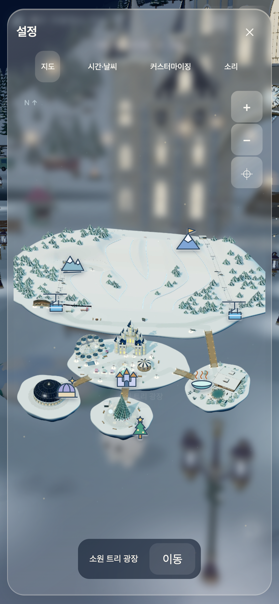
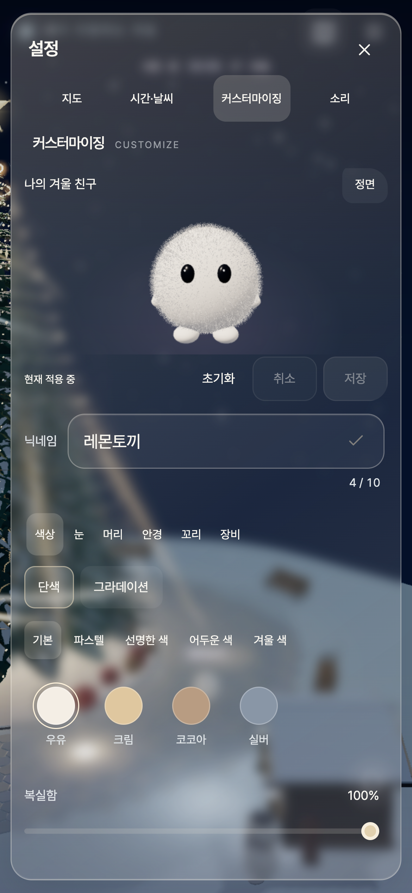
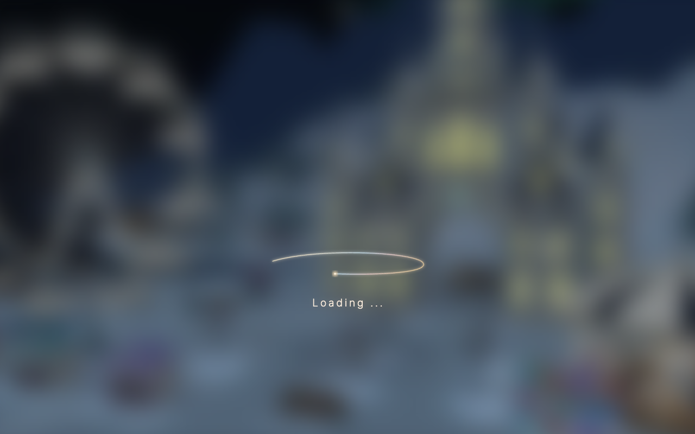

# v41 — 게스트 동기화·모바일·색상 처리 안정화

2026-11-19. 기준 소스 `a35e42d`와 비교한다. 월드 위치·건축 모델·콘텐츠는 유지하며 접속, 렌더 경로와 UI 조작을 수정했다.

## 원인과 수정

| 구분 | 확인한 원인 | 수정 |
|---|---|---|
| 원격 이동 | 이전 보간이 원격 캐릭터에도 로컬 이동/충돌 경로를 적용. 좌표와 실제 보행 주기 불일치 | 서버 `pose_at`·speed, 순서 검사, 최대 8 snapshot, 1.1초 보간 지연, 120ms 제한 예측 후 정지. 원격 이동은 서버 좌표만 사용하고 이동 거리에 발 애니메이션을 연결 |
| 채팅 중 위치 | heartbeat `seen`과 pose 갱신 제한이 섞임 | `pose_at`을 분리해 채팅 직후에도 새 이동 상태를 수용 |
| 순간 멈춤 | 기본 framebuffer만 사전 컴파일하여 HDR 경로/화질 전환에서 다른 program을 즉시 준비 | 실제 HDR·합성·직접 출력 경로를 로딩 중 준비. 같은 화질에서 render target 재할당 방지 |
| VFX 색상 | 여러 custom ShaderMaterial의 최종 색공간 변환 누락 | 표준 tone mapping/output color chunk 적용. RGBA16F 실제 지원 sample 수 확인, HDR 미지원 장치는 직접 출력 |
| 음악 | 이전 트랙 전환의 play Promise 대기 중 ended/timeupdate가 다음 전환을 중복 시작할 수 있음 | pending 상태·요청 번호로 전환 직렬화. Safari interrupted와 BFCache 복귀 시 기존 AudioContext/재생 객체 재사용 |
| 게스트 UI | 서버 권한은 막혔지만 일반 게스트에게 초대/로그인 UI 노출 | 초기부터 메뉴 숨김, 서버 확인된 owner만 초대 메뉴. 유효 초대는 저장 외형 또는 기본 외형으로 자동 진입 |

Windows VFX 문제의 **가능한 원인**은 출력 경로 차이이며, 실제 Windows GPU에서 재현한 원인이라고 단정하지 않는다. UI의 기존 유리 토큰은 유지하고 native controls의 color-scheme·공통 폰트를 명시했다. backdrop-filter 미지원 fallback도 한 곳에서 정의한다. OS 디스플레이 색관리/HDR/True Tone 차이까지 동일하게 보장할 수는 없다.

## UI·조작

- HUD 지도 버튼 44px, 모바일 헤더의 두 버튼 공간을 92px로 확보.
- 모바일 지도 첫 터치 선택 → 명시적인 `이동` 버튼. PC 클릭 이동 유지.
- 모바일 커마 미리보기 높이를 최대 220px로 제한. 기존 색상 계열/그라데이션·저장/취소 구조 유지.
- 나선형 Loading ... 및 실제 월드 blur 유지. 트리는 PC 최대 560→360px, 모바일 최대 270px로 축소.
- 기존 카메라 기준 360도 아날로그 이동·Pointer ID 분리·자유 시점/시설 종료 복귀를 실제 브라우저로 확인. 카메라를 새 방식으로 강제 교체하지 않았다.
- owner는 기존 `/signin-with-chatgpt?return_to=/` 보호 경로로 인증. 게스트 UI에 로그인 유도 없음.

## 관리자 장식 관리

개별 장식 삭제는 소원 텍스트를 보존한다. 전체 삭제는 서버 owner 검증, 최신 목록 revision·수량과 정확한 `장식 N개 삭제` 확인을 요구한다. 먼저 `decoration_backups`에 대상 행/actor/시각을 보관하고 그 ID만 삭제한다. 동시에 새로 등록된 장식과 소원 텍스트는 보존한다. 기존 공유 목록 갱신으로 다른 클라이언트도 반영한다. 백업 복구는 운영자 DB 작업이며 복구 UI는 추가하지 않았다. 운영 데이터 삭제는 시험하지 않았다.

## 불꽃놀이

기존 5종 GPU 입자·시드·공연 시각·거리별 지연 음향은 유지한다. 색상 대비와 출력 색공간을 수정하고, 기존 fill light 하나에 색상별 짧은 펄스를 합성한다. 추가 광원 없이 intensity 증분 최대 0.38, 색 혼합 최대 0.48로 제한한다. 움직임/섬광 감소 또는 실내에서는 펄스를 생략한다. 월드 조명이 매 프레임 기본 상태를 먼저 복구한다.

## AI 퀴즈

`server/quiz-generation.js`는 기존 서버의 OPENAI_API_KEY/OPENAI_MODEL로 하루 한 번 공유 후보를 만든다. 클라이언트 키 전달은 없다. 기존 참조 문제에서 7개 근거를 선택하고 Responses JSON schema로 최대 3개 후보·2,200 output token을 요청한다. 중복 선택지·질문·범위·참조 ID를 검사하고 **검토 대기**로 저장한다. 관리자가 출처/정답/복수 정답 가능성을 검토하고 숨김을 해제해야 공개된다. 모델 출력의 사실성을 자동 검증했다고 주장하지 않는다.

날짜별 실행 행의 고유키로 동시 실행·자동 재시도 비용 증가를 막고, 실패해도 기존 문제는 유지한다. input/output token 사용량을 보관한다. 일일 호출/출력 token 상한은 구현했으며 정확한 원화/달러 비용과 모델 내부 추론량은 UNKNOWN. 후보 수정·숨김·제외는 owner 전용 관리 UI를 사용한다.

Vercel cron은 `0 21 * * *`(한국 오전 6시, 요금제의 실행 시간 오차 가능). `/api/quiz-refresh`는 양 서버에 같은 CRON_SECRET가 설정돼야 하며 Bearer 검증을 통과한 예약 호출만 허용한다. 일반 API에서는 인증 헤더를 전달하지 않는다. 운영 인증 호출에서 후보 2개를 검토 대기로 저장했다(HTTP 200). 미래의 예약 시각 실행은 아직 미검증이며 수동 호출 성공과 구분한다.

천문대 기존 중앙 홀·돔·천체 전시·영역별 퀴즈·전용 카메라를 보존했다. 기존 실내 VFX에도 출력 색공간을 적용했으며 새 실내 건축 리디자인을 완료했다고 보고하지 않는다.

## 데이터·성능

마이그레이션 0012~0014는 pose 필드, 장식 백업, 퀴즈 후보/실행 이력을 추가한다. 기존 소원·외형·장식·초대 세션을 삭제하지 않는다. HTTP presence는 이동 700ms/정지 1,600ms/백그라운드 8초, 쓰기 제한 500ms, 기존 원거리 AOI/12명 정원 유지. 원격 외형 반복 구체 Geometry를 캐릭터 안에서 재사용한다.

[성능 측정](PERFORMANCE.md), [검증](TESTING.md), [배포](DEPLOYMENT.md)에서 실제 결과와 UNKNOWN을 구분한다. 실물 Windows, iPhone Safari, Android Chrome, 30분 발열 검사는 UNKNOWN.

## 화면

동일 PC 시점의 [이전](../qa/browser-v41/pc-before-guest-world.png) / [이후](../qa/browser-v41/pc-after-guest-world.png).

