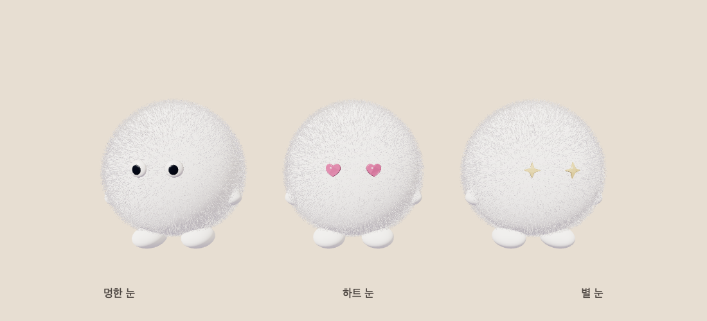
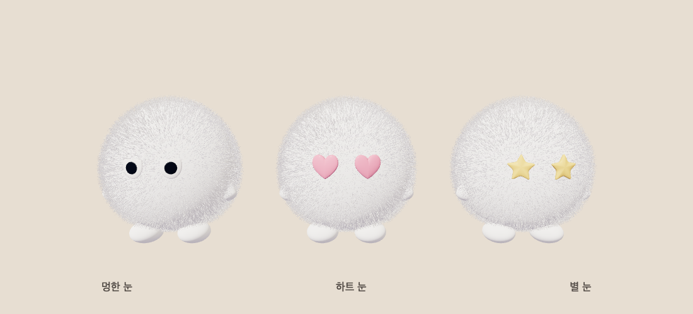
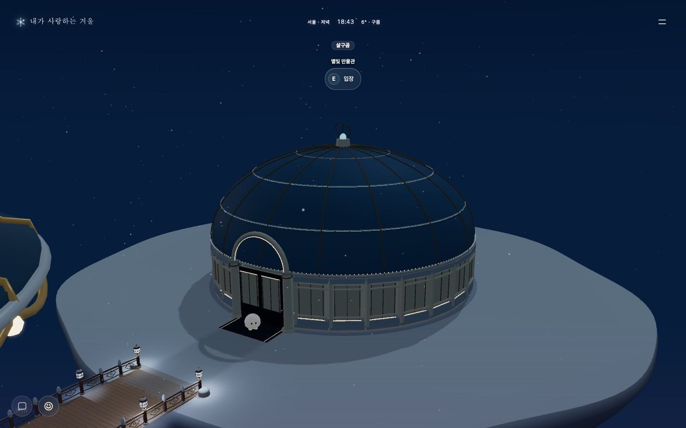
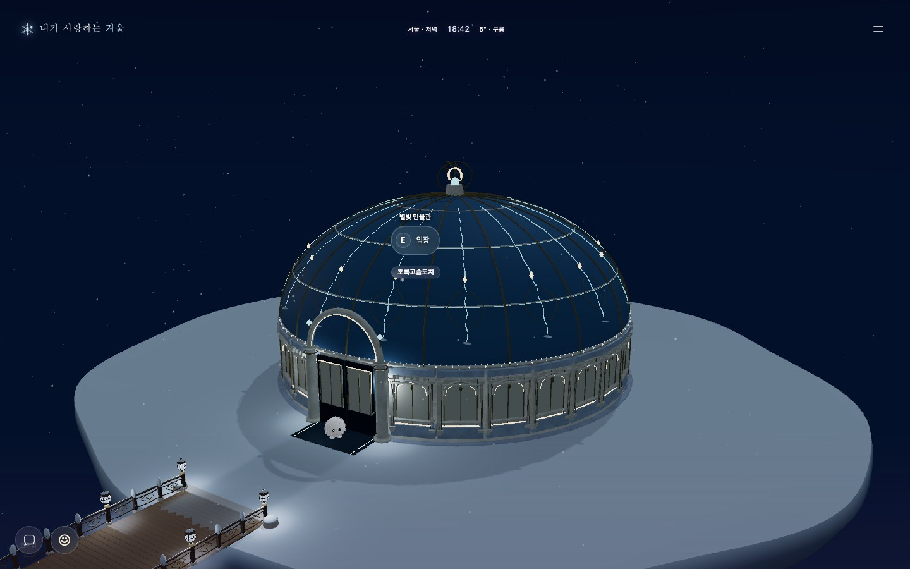
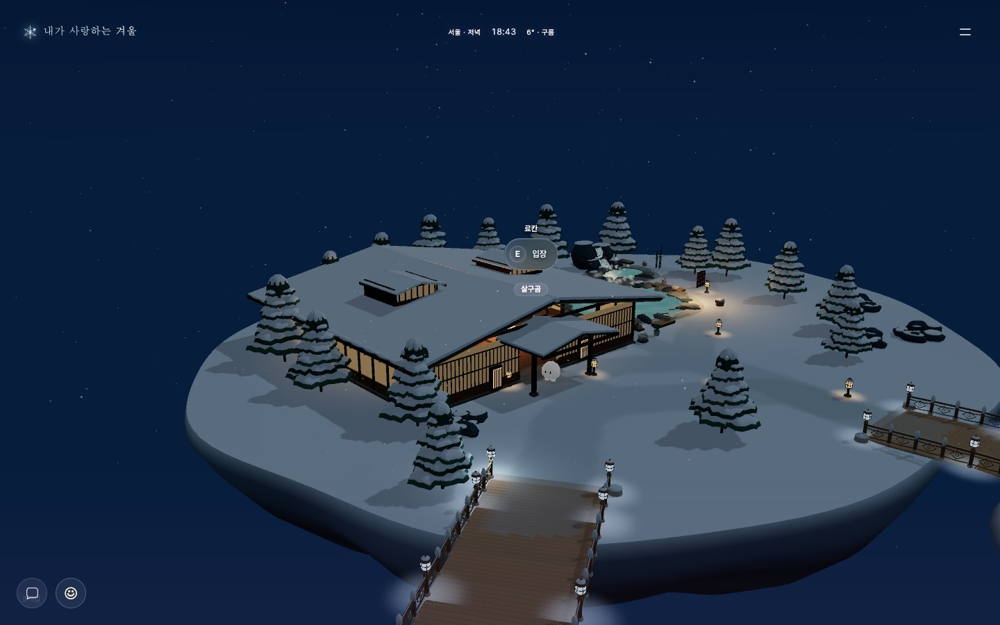
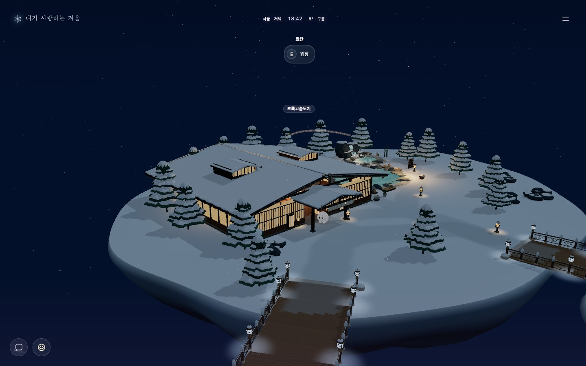
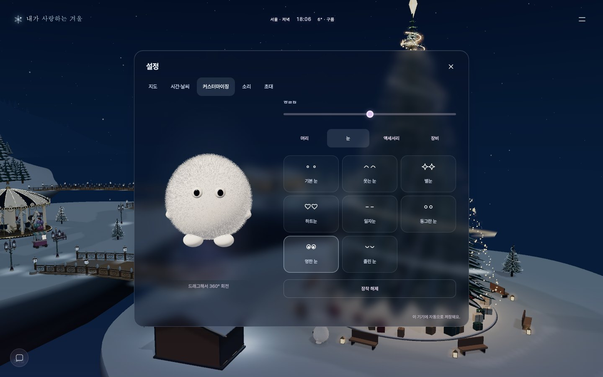
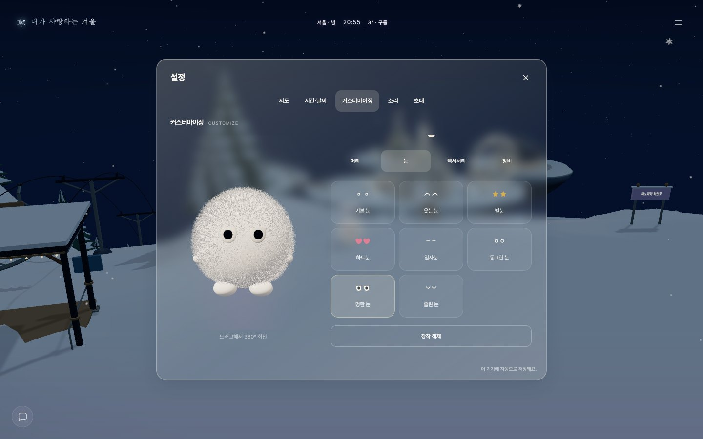

# v37 — 유리 UI, 모루 표정, 겨울 리조트 디테일

## 범위와 원인

기존 다섯 섬, 트리·소원 데이터, 게스트 세션, 음악과 놀이시설을 유지한다. 이번 변경은 반투명 UI, 캐릭터 표정/액세서리, 료칸·별빛 만물관 외관과 실내 디테일, 좌석, 스키 코스, 야간 연출에 집중했다.

- 불투명한 필드·포커스·드롭다운 재정의가 공통 유리 표면과 섞였다. `ui-system.css`의 공통 표면/선택/입력 토큰으로 통일했다. 설정 제목은 탭과 다른 행을 유지하고 패널 크기가 탭별로 달라지지 않는다. 스크롤바는 4px의 약한 표시, 채팅 포커스는 핑크 테두리 없이 처리한다.
- 닉네임은 서버와 입력창이 서로 다른 길이 규칙을 사용했다. `nickname.js`를 공유해 한글 조합·이모지를 포함한 **보이는 글자 10자**를 기준으로 한다. 신규 입장과 이름 변경은 서버에서 초과 요청을 거절한다. 기존 세션 이름은 임의로 변경하지 않으며 만료된 세션의 오래된 입력 캐시는 제한에 맞춘다. 저장 중 중복 요청을 막고 결과와 글자 수를 표시한다.
- 멍한 눈은 넓게 벌어진 작은 동공과 돌출된 흰자가 강한 인상을 만들었다. 간격을 좁히고 동공을 키우며 윗눈꺼풀과 둥근 아래 윤곽으로 변경했다. 하트·별은 날카로운 Extrude 대신 부드러운 닫힌 클레이 메시다. 불투명 고글/선글라스는 눈 메시를 가리고 벗으면 선택한 눈을 복원한다.
- 고양이 귀는 얇고 둥근 삼각형으로 다듬고 털은 인스턴스 수를 늘리지 않고 길이·굵기를 조정했다. 검은 귀 색상과 몸 색상의 분리는 유지한다.

## 건축과 연출

`winter-architecture-details.js`는 기존 건물 안에 들어가는 세부 구조를 만든다. 건물 규모와 출입구 좌표는 유지했다.

- **별빛 만물관 외부:** 기둥의 세로 홈, 겹 아치, 몰딩·눈 처마, 돔 표면을 따르는 금속 장식/빛과 천체 왕관. 기존 재질에 석재 결을 적용한다. 도착 카메라는 실제 문 방향을 기준으로 하여 건물 뒤에서 캐릭터 쪽으로 파고드는 구도를 고쳤다.
- **료칸 외부:** 서까래 끝, 겹 처마, 용마루·박공 장식, 출입구 위 노렌과 격자, 세밀한 등롱. 통로에 커튼이나 기둥을 추가하지 않는다. 기존 자연석 탕·폭포·정원과 동선을 유지한다.
- **실내:** 천문대의 높은 천체 캐노피·크리스털·지역별 별자리, 료칸의 격자 천장·방석·차 도구와 부유 입자. 서로 무관한 별을 연결해 천장 전체를 가로지르던 선은 작은 별자리 묶음으로 바꿨다.
- **야간:** 더 짙은 하늘과 구분되는 조명, 부스 전구와 기존 제한된 광원 풀, 완만한 오로라 흐름과 아래 메시 가장자리의 투명도 페이드. 가로등을 개별 실시간 광원으로 무제한 추가하지 않는다.
- **불꽃놀이:** 관리자가 시작한 74초·26발 시퀀스를 서버의 ID/시각/시드/상태로 공유한다. 한 GPU Points에서 5개 패턴과 중력·잔광을 계산하며 고정 버퍼를 재사용한다. 저사양과 효과 감소는 밀도를 줄인다. [구조와 검증](luminous-fireworks-v37.md).
- **로딩:** 제공된 이미지의 가느다란 나선 트리를 SVG 한 경로로 그린다. 발광점은 실제 경로 끝점을 따르고 텍스트는 `Loading ...`만 표시한다. 최초 입장과 료칸·천문대 전환은 실제 준비 완료에 연동한다. 가짜 진행률과 최소 대기 시간은 없다.
- 다리 목재는 눈과 구분되는 차분한 색으로 조정했다. 놀이공원 시장·탑승장 앞의 평평한 돌 장식은 하나의 InstancedMesh 안에서 늘렸다.

## 2인 좌석과 이동

`bench-layout.js`는 모델·접근 위치·앉는 위치·서버 예약이 공유하는 데이터다. 놀이공원/트리/천문대 벤치와 료칸 차·찜질·다다미를 합쳐 22개 위치가 각각 두 자리를 제공한다. 넓은 기존 실내 벤치의 양쪽도 이용할 수 있다. 다다미는 방석 위 앉는 자세이며 료칸의 기존 유카타와 표정은 유지한다.

기존 `ride_seats`의 고유 좌석 제약을 재사용한다. 같은 공간에서 가까운 벤치만 예약할 수 있고 세 번째 이용자는 거절한다. 앉아 있는 동안 예약을 갱신하며, 움직이기/일어나기/공간 변경/접속 만료 시 자리를 정리한다. 한 사람이 일어나도 다른 자리는 유지한다. 채팅은 앉은 상태를 취소하지 않는다.

검사 중 발견한 실제 수정:

- 벤치 접근 위치가 충돌 반경 안에 있던 곳은 여유 있는 앞쪽으로 옮겼다.
- 차와 다다미는 탁자 대신 비어 있는 옆 통로를 접근점으로 사용한다.
- 트리 벤치는 원형으로 같은 반경에 강제 배치하지 않고, 우체국과 산책로의 **2.2m 보행 폭**을 확보하는 개별 휴식 위치로 조정했다.
- 트리 벤치 충돌을 공통 이동 데이터에 연결했다. 기존 산책로 재생성과 전체 연결 검사를 함께 수행한다.

## 스키와 지도

후속 요청에 따라 스키장 내부를 네 코스·좌우 두 리프트로 다시 설계했다. 외부 섬 좌표·연결 다리는 유지한다. 초급은 중간 하차장에서, 중급·상급·파노라마는 정상에서 출발한다. 기존 오뎅 트럭·마시멜로 트럭·모닥불은 하단 휴식 구역에 보존했다. 자세한 좌표, 지형/리프트 변경과 최신 검증은 [스키·천문대·광장 기록](resort-festival-v37.md)에 있다.

참고는 [비발디 공식 슬로프 소개](https://www.sonohotelsresorts.com/skiboard/aboutus)의 난이도/폭과 [용평 공식 슬로프 지도 PDF](https://www.yongpyong.co.kr/upload/kor/winter_trail_map.pdf)의 분기·합류 구조다. PDF는 22/23 시즌 표기 자료이며 현재 운영 현황을 주장하지 않는다. 실제 시설의 지도나 명칭을 그대로 복제하지 않았다.

지도는 실제 월드의 정적 렌더를 다시 생성한다. 실시간 두 번째 렌더러를 실행하지 않는다.

```sh
PROFILE_URL=http://127.0.0.1:4185 MAP_OUTPUT=qa/browser-v37/map-render node scripts/render-world-map.mjs
npm run build
npm run build:vercel
npm run test:budget
```

## 변경 전후

| 영역 | 이전 | 수정 |
|---|---|---|
| 눈 |  |  |
| 천문대 |  |  |
| 료칸 |  |  |
| 설정 |  |  |

[실내 착석](../qa/browser-v37/ryokan-seated.jpg), [2인 벤치](../qa/browser-v37/two-seat-bench.jpg), [입장 로딩](../qa/browser-v37/ryokan-loading.jpg), [갱신 지도](../qa/browser-v37/map-render/world-map.png).

## 검증

격리된 로컬 SQLite와 브라우저 게스트를 사용했다. 사용자 방문자/소원 데이터에는 테스트 글을 남기지 않았다.

- [PC 기능 검사](../qa/browser-v37/world-after.json), [모바일 에뮬레이션 기능 검사](../qa/browser-v37/world-after-mobile.json): 두 실내 입퇴장/실제 로딩, 다다미·벤치 착석과 이동 취소, 10자 입력/저장/API 거절, 서로 다른 2인 좌석·세 번째 거절, 원격 닉네임·앉은 채 채팅·개별 하차.
- [실제 조작 검사](../qa/browser-v37/controls.json): 이전 코스의 실제 키 입력 검사 기록이다. 최신 네 코스 검증은 후속 기록으로 대체한다. 장비·카메라 상태·전용 UI 종료. 모바일 native touch 이동+점프, 터치 해제, 카메라 드래그.
- [반응형 UI](../qa/browser-v37/verification-after.json): 1440×900, 320×640, 390×844, 844×390에서 탭 전환/선택/드롭다운/입력·고글의 눈 가림 확인.
- 물리적인 iOS/Android 기기는 미검증이다. 모바일 화면/입력/성능 결과는 데스크톱 Chrome의 에뮬레이션이며 기기별 FPS 보장이 아니다.

### 초기 v37 성능 비교 (후속 스키·광장·불꽃 변경 전)

동일 Chrome, medium 품질, 각 구역 5초의 실제 게임 프레임을 비교했다. 다른 브라우저 검사와 전체 테스트는 측정 중 실행하지 않았다. [원본 비교 데이터](../qa/browser-v37/performance-comparison.json).

| 구역 | PC 이전 → 이후 FPS | 모바일 에뮬레이션 이전 → 이후 FPS | 이후 p95 프레임 시간 |
|---|---:|---:|---:|
| 광장 | 58.82 → 60.00 | 60.00 → 59.80 | 16.7ms |
| 온천 외부 | 60.00 → 60.00 | 60.00 → 59.60 | 16.7–16.8ms |
| 료칸 내부 | 60.00 → 60.00 | 60.00 → 60.00 | 16.7–16.8ms |
| 천문대 도착 | 60.00 → 60.00 | 60.00 → 60.00 | 16.7ms |

짧은 단일 측정으로 모든 기기에서 60fps를 보장하지 않는다. 천문대는 도착 카메라도 교정했으므로 이전/이후 보이는 메시 수가 다르다. draw/triangle 수 차이를 최적화 효과라고 단정하지 않는다. 실물 iOS/Android와 장시간 저사양 발열 테스트는 미검증이다.

초기 v37 에셋 예산 검사: 176개 파일, 전체 22,217,505 bytes, JS/CSS gzip 합계 942,861 bytes로 기존 상한 이내다. 새 production dependency를 추가하지 않았다.

최종 자동 검사와 운영 배포 결과는 아래 후속 기록에 남긴다.

트리 주변 벤치에 중복으로 있던 트리 꾸미기 행동을 제거했다. 가까운 벤치에서는 앉기가 유일한 기본 행동(E/터치)이 되고 F 안내가 사라진다. 벤치에서 떨어진 트리 주변에서는 기존 꾸미기가 유지된다.

## 최종 검증 범위

- 전체 자동 검사 347개가 통과했다. 이후 풍선 무작위 수령·벤치 우선순위·지도·하차장·이정표 피드백을 적용하며 관련 검사들을 재실행했다(하차장/상호작용 최종 20개, 지형·리프트·지도·조명 15개 통과). 검사 수를 합쳐 서로 다른 전체 테스트 수처럼 표시하지 않는다.
- PC와 모바일 에뮬레이션의 실제 2인 리프트·4코스 활강, 실내 입퇴장·앉기, 소원/캐릭터 UI, 랜덤 풍선·비눗방울, 관리자 불꽃놀이 동기화가 통과했다. 하차장 지형 수정 뒤에는 초급 리프트 실제 재탑승·하차·보행도 별도로 재확인했다.
- 이정표 앞 안내 팝업과 바로 옆 가로등만 제거했으며, PC·모바일에서 다리부터 이정표까지 실제 걸어가 확인했다. 천문대 돌바닥은 유지하고 추가한 상향 조명은 제거했다.
- 불꽃놀이 종료 후 전용 geometry/position buffer의 동일성을 확인했다. 전용 drawRange는 0, root는 숨김 상태로 돌아온다. 전역 scene 메모리는 다른 콘텐츠의 로딩으로 변할 수 있어 이를 전용 파티클 누수로 판정하지 않는다.
- 실제 휴대폰, 장시간 발열 및 다수 실제 원격 사용자의 동시 접속은 미검증이다.

### 후속 수정까지 반영한 최종 성능

동일 medium 품질, 각 5초, 실제 게임 프레임 기준이다. 이 측정에서는 다른 브라우저 QA를 동시에 실행하지 않았다. 모바일은 390×844 데스크톱 에뮬레이션이다.

| 구역 | PC FPS | 모바일 에뮬레이션 FPS | p95 PC / 모바일 |
|---|---:|---:|---:|
| tree | 45.30 | 54.16 | 33.4 / 33.3ms |
| quiz | 60.00 | 60.00 | 16.7 / 16.8ms |
| fireworks | 60.00 | 60.00 | 16.7 / 16.7ms |
| fireworks-off | 60.00 | 60.00 | 16.8 / 16.7ms |

트리 광장은 다른 구역보다 렌더링 부하가 크고 두 환경에서 60fps에 도달하지 못했다. 전체 월드가 모든 기기에서 60fps라고 보고하지 않는다. 불꽃놀이 전후의 고정 버퍼는 재사용되고, 종료하면 그리기가 멈춘다. 이번 측정은 장시간 메모리/발열 보장이 아니다.

[PC 원본](../qa/browser-v37/perf-final-desktop.json), [모바일 에뮬레이션 원본](../qa/browser-v37/perf-final-mobile.json).
